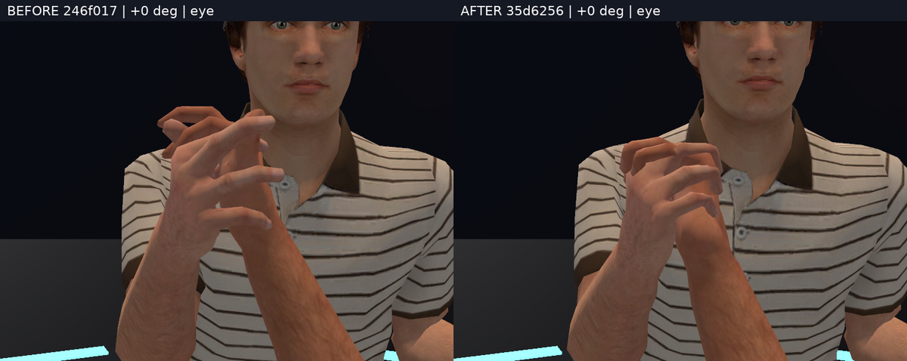
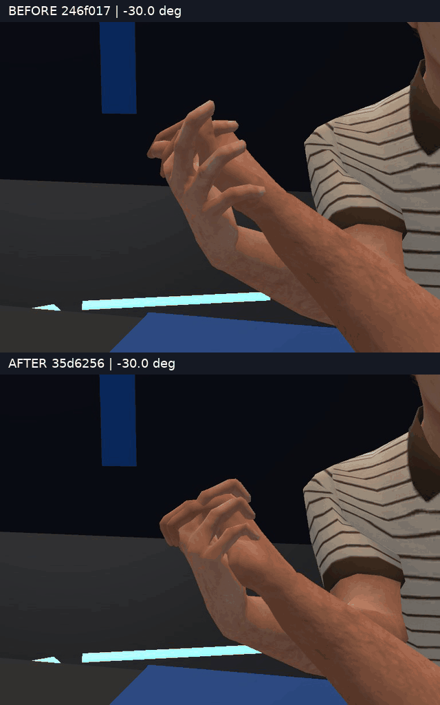
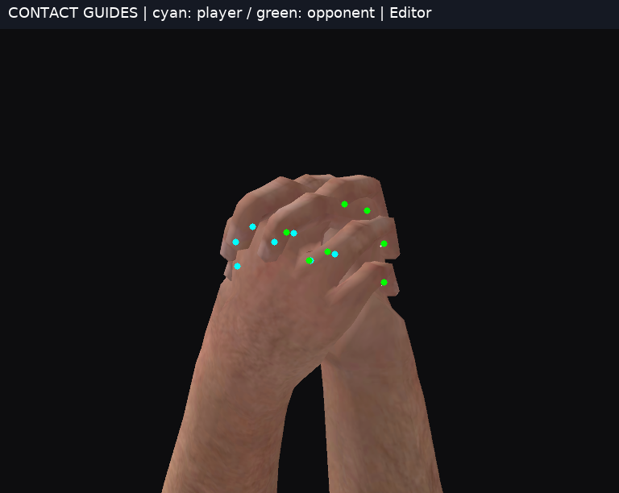

# P2-D 修订：成对表面目标与可视化定姿

针对 [PR #11 审阅](https://github.com/Ihtbfas/armwrestling-vr/pull/11#issuecomment-7009866475)，本轮保留跨 Humanoid 适配，直接修改了 `ArmWrestlingMain` 使用的握姿生成路径。**四指明显张开的情况已有可观察改善；仍有指节交错、拇指贴合不足和掌根交叠，不能宣布自然扣握全部通过。** PR 继续 Draft。

[最新真实画廊](validation/p2d-contact-targets/README.md)保留零位第一人称、斜正侧/反侧近景、±30°、完整坐姿及连续 GIF。旧 [P2-D 首轮画廊](validation/p2d-visual/README.md)和 [P2-C](validation/p2c-visual/README.md)不覆盖。

## 选择与实际实现

参考 [UltimateXR Hand Pose Editor](https://www.ultimatexr.io/guides/hand-pose-editor) 的真实模型预览、双端点和 Avatar override，及 [Meta Hand Grab Pose](https://developers.meta.com/vr/documentation/unity/unity-isdk-creating-handgrab-poses/) 的相对抓握参考与可编辑抓握面。没有安装这些框架或导入其素材。

新增 `GripContactTargets`，每只手有**掌部接触基准、虎口、拇指搭扣与四指指腹区域**。坐标按掌宽、掌长归一化，X 朝拇指侧、Y 从腕向掌指关节、Z 是表面外法线偏移；四指以自身 MCP 在对方手掌坐标内的投影为基准，保留可编辑偏移及有限掌部范围。拇指目标在对方虎口的掌面侧，四指在掌背侧。拇指末节朝向单独定义在共同 Grip Anchor 坐标中，避免沿用四指“向下包掌”的方向。

`PairedSurfaceGrip` 在启动时读取实际蒙皮三角形，以射线找到这些区域的掌面/掌背，配对掌部参考点；**新路径不再调用凸包分离来决定双腕位置**。从同一冻结表面快照为双方求端点，复用已有 `ArmChain.SolveJoints`，只旋转指骨，不拉伸、不修改机械轨迹。超出实际长度的目标保留残差，不伪造到达。

Humanoid 映射继续提供骨骼坐标与初始手形；新的目标端点在各自目标骨架上生成。`ContactGrip` 在已定好的包握姿态附近，以 3.5% 的释放区间限制继续闭合。现有 Animator、Clip、Blend Tree、IK 及执行顺序保留。它不会修复初始姿态的全部碰撞，也不会把未能到达的指尖强行吸到目标。

没有在控制器中分 Rocketbox/Ch03。`GripAvatarProfile.contactOffsets` 是可选的七个小量标记覆盖；相同共享目标分别用于两套不同骨架以及混合人物。模型更换仍只选择 profile。旧 `LegacyHumanoidGrip.asset` 是首轮公开定义的保留副本，可复现原模式。

## Unity 中查看、编辑与切换

1. 使用现有 Unity `2022.3.62f3c1`。菜单 **扳手腕 → P2-D → Open Surface Contact Preview**，显示两只真实蒙皮手臂；预览根节点不会保存进主场景。
2. 选预览根节点，在 Inspector 选择 `Edit hand / Contact marker`，Scene 中可以看到双方七组目标及残差线；拖动选中的位置手柄，再点 **Rebuild both hands from markers**。`Closure` 可检查已定姿附近的 open/closed 形变。指腹黄色线是骨骼代理残差，绝非完整皮肤接触证明。
3. **Save shared contact targets** 保存共享姿态。可在同一预览里分别选择玩家/对手 profile，检查换模型；小量模型差异在 profile 的 `Contact Offsets` 中校准，无须改 C#。不要缩放预览根节点；人物尺寸在 profile 设置。
4. 主场景默认启用 **Use Humanoid Grip + Use Grip Surface Targets**，直接使用这份共享资源。关闭后一个开关使用保留的首轮 P2-D；关闭前一个开关使用旧 P2-C；胶囊/P1-E 按原 README 关闭 Humanoid/Paired Grip 开关。比赛流程保留。

预览菜单已在 Editor 实际实例化并渲染，不只是未使用的接口。公开 `contact-guides` 是同一预览加屏幕投影标记的诊断图，青色玩家、绿色对手；为了能看见掌内标记，覆盖点不做遮挡剔除。正常主场景 Before/After 和 GIF 没有这个覆盖层。

## 实际测试与代价

Windows Direct3D11，**真实主场景 Editor Play**。Rocketbox 和 Ch03 各完成 181 帧、6 秒、30 Hz 的 `−30 → 0 → +30 → 0 → −30°`；旧 Rocketbox 模式用本轮相同相机/动画进度重录。不是旧截图加新数字。11 项完整比赛模式/回退均通过（Rocketbox、Ch03、混合、首轮 P2-D、无效 profile、无效标记、P2-C、P2-B、P2-A、P1-E、胶囊），RuntimeErrors=0；最终 Ch03 校准后又通过本机/混合比赛。覆盖倒计时、Fighting、暂停继续、结算和 Contest Clip。

| 指标 | Rocketbox 首轮重录 | Rocketbox 表面目标 | Ch03 表面目标 |
|---|---:|---:|---:|
| 零位掌心骨代理距 mm | 55.78 | 49.61 | 33.19 |
| 对手腕目标最大误差 mm | 0.0182 | 0.0181 | 0.0012 |
| 对手 / 玩家最大腕折角 ° | 22.11 / 21.51 | 33.98 / 34.39 | 35.66 / 31.39 |
| 零位根部凸包最大深度 mm | 1.00 | 7.04 | 14.71 |
| 手部诊断代理峰值 mm | 3.64 | 16.37 | 31.09 |
| 胸臂代理峰值 mm | 13.03 | 12.12 | 0 |

**不是各项都改善。** 四指更包握、Rocketbox 掌心骨代理距减少约 6.18 mm，但仍比 P2-C 原记录约 35.8 mm 大；没有把“距离减少”当成自然握姿成功。更紧的预定姿带来更高的掌根/指节代理相交，手腕折角也增大。画面仍有局部交错和悬指。Ch03 能复用同一目标并明显收指，但手型更厚、蒙皮更粗，掌根交叠更明显。

新增两类分开的指腹测量：

- 零位 **骨骼指腹参考点**到目标：Rocketbox 约 2.3–7.8 mm；它由骨长与近似半径构造，不是实际皮肤。
- 零位**最终蒙皮掌侧远指节顶点**到目标：Rocketbox 约 3.0–4.9 mm，Ch03 有效采样约 3.9–5.4 mm；Ch03 小指没有满足筛选的顶点，记 `NaN`。这只是稀疏顶点距离上界，不是三角面精确距离、穿模深度或压力，不能据此宣称网格无穿插。

闭合结果每组仅构建一次，之后缓存应用；最终样本约 0.02–0.16 ms/次，初次闭合约 77–85 ms（较早负载下的试验曾达 233 ms），启动还另有表面解析。未观察到持续逐帧搜索，不是头显性能结论。

## 蒙皮测量修正及肘垫限制

本轮验证了 CPU LBS 和 `BakeMesh(mesh,true)` 世界顶点（Rocketbox 校准副本最大差约 0.001 mm）；旧测量直接变换 `BakeMesh(mesh)` 输出，在这套带缩放的导入结构上会重复作用缩放，整身最大偏差约 103 mm。[Unity BakeMesh 的缩放参数](https://docs.unity3d.com/2022.3/Documentation/ScriptReference/SkinnedMeshRenderer.BakeMesh.html)解释了两种调用的区别。因此修正的是 **Editor 测量**，旧画廊和旧模式控制未改，历史肘垫数字不能直接拿来证明接触良好。

同一修正工具重录的 Rocketbox：肘下缘局部采样距垫面从旧模式 `+0.54～+15.73 mm`，变为新模式 `−0.47～+15.21 mm`，零位 `+7.51 → +6.57 mm`。小幅改善，仍有悬空，不能说一直贴垫。

Ch03 的演示配置也暴露出原来未被正确测量的穿垫。测试过提高肘支撑平面，过高会在端角触发可达性退化；最终将本机 profile 的肘骨支撑高度从 0.109 调为 0.121 m，实际局部下缘穿垫范围从约 −26.23～−22.39 mm 减到 −16.25～−12.30 mm；仍穿垫，未完成表面接触。0.134 m 的尝试曾在端角退化到约 −60 mm，已放弃。没有强锁肘、改骨长或改 Grip Anchor 来掩盖该问题。

## 本机证据与验证边界

- Rocketbox 新模式：`.p0-local/p2d-cross-avatar/20261119-214414/cross/`。
- 首轮模式同工具重录：`.p0-local/p2d-cross-avatar/20261119-214529/cross/`。
- Ch03 最终扫描：`.p0-local/p2d-cross-avatar/20261119-215715/cross-local/`；各次完整扫描、最终配置及混合人物测试、`targets-*-play.log.txt` 均在 `.p0-local/p2d-cross-avatar/`；素材和画面不公开。
- 完整本机根目录：`E:\桌面\研究生\实验室\人机交互课程\实物大作业\code\armwrestling-vr\.p0-local\p2d-cross-avatar\`。原人物、裁切模型、既有录像保留。
- 实际新增故障回归：无效 profile、目标射线落空均安全退到旧模式；临时 Avatar 模型初始化后没有残留。胶囊、P1-E、P2-A/B/C、首轮 P2-D 的回退仍保留。
- 未验证 PICO、PCVR、真实机械、PC UDP 或 STM32；这些系统和机械参数没有修改。Editor 按钮回调测试不等于头显输入测试。

后续在本阶段中优先继续处理可视目标暴露出的拇指可达残差、相邻指节交错和掌根体积，再处理坐姿/支撑几何；不回到随机 muscle 搜索或用凸包不断推开双手。公开画面保留这些缺陷，供 PR 实际视觉审阅。

握持外观还参考了[真实闭合握姿示例](https://ameblo.jp/kisokarawakaru-arm-kouza/entry-11958884813.html)，只作调研，没有复制或公开其照片。
