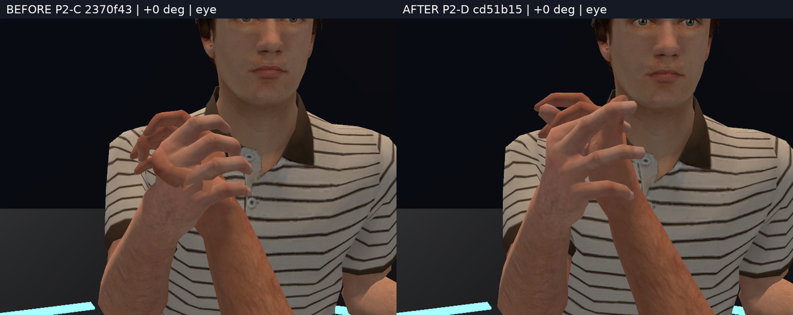
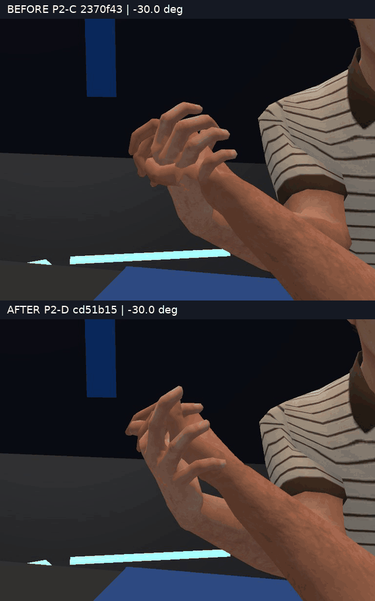

# P2-D 跨人物握姿：已接入主场景，自然扣握尚未验收

最新接触目标修订已直接接入主场景，见[可视化定姿、真实测试及剩余问题](P2D-contact-targets-revision.md)与[最新公开画廊](validation/p2d-contact-targets/README.md)。以下保留首轮记录；其中旧蒙皮测量的缩放问题已在修订中说明，勿与新结果直接混用。

2026-11-19，Unity 中国版 **2022.3.62f3c1 / Windows Direct3D11 / 实际 Editor Play**。本轮完成同一握姿定义在 Rocketbox 和本机 Ch03 两套不同 Humanoid 上的重定向、主场景接入和配置切换。**没有完成“看起来像正常扳手腕”的最终视觉验收**：拇指横穿掌背的旧形态有所缓解，但四指仍松散、部分像抓腕，局部指节交叠仍在；不能把新增接口或低代理深度当作完成自然握姿。

实际画面见 [P2-D 公开画廊](validation/p2d-visual/README.md)。只发布 Microsoft Rocketbox MIT 人物和原创场景，Ch03 及其衍生网格/画面均只留本机。旧 [P2-C 画廊](validation/p2c-visual/README.md)未覆盖。

## 实际采用的方法

- Unity [HumanPoseHandler](https://docs.unity3d.com/2022.3/Documentation/ScriptReference/HumanPoseHandler.html) 在启动时对临时 Avatar 副本应用标准化手指 muscle，再读出**目标人物自己的** 15 个指骨局部旋转。运行中不对完整人物调用 `SetHumanPose`，避免覆盖已有 Clip、Blend Tree、IK。
- 参考 [UltimateXR Hand Pose Editor](https://www.ultimatexr.io/guides/hand-pose-editor) 的通用端点与 Avatar override，以及其[独立骨轴描述](https://github.com/VRMADA/ultimatexr-unity/blob/main/Runtime/Scripts/Manipulation/HandPoses/UxrFingerNodeDescriptor.cs)。采用 Unity Avatar 映射，没有导入整个 UltimateXR 或复制其模型/握姿资产。
- 参考 [Meta Hand Grab](https://developers.meta.com/horizon/documentation/unity/unity-isdk-hand-grab-interaction/) 的相对抓握参考点：两腕始终由共同 Grip Anchor 推导，不让碰撞改变机械轨迹。按手掌骨长、掌宽、蒙皮表面和前臂长度求初始适配，启动时以双方掌部凸包和拇指根代理做有限对称接近；这不是物理手或全身动力学。
- ContactGrip 对双手同一级指节同步提议、碰撞回退。近端遇阻后中/远端仍可闭合，最多三轮 MCP→PIP→DIP 重新尝试；重用已有相对腕位姿缓存，避免每帧搜索。最终结果在 Animator IK 之后写指骨，沿用旧执行顺序。旧 P2-C 的逐指求解仍在原模式中。

`HumanoidGripDefinition` 保存 5 指 open/closed 的标准化伸展/张开量、两掌朝向、共同掌部参考点、拇指错层/对掌扭转及起始闭合量，不包含某个 FBX 的四元数。`GripAvatarProfile` 保存 Prefab、统一缩放、坐姿/脚高、玩家肩位、肘骨支撑高度、按掌长计的校准偏移、掌滚转、muscle/拇指覆盖和代理半径倍率。核心控制器没有 Rocketbox/Ch03 分支；旧资源路径只用于原模式回退。

一次性蒙皮测量使用 bindpose + bone matrix 的 CPU LBS，避免隐藏副本的 BakeMesh 更新时机；并非每帧重建网格。当前掌厚来自低面数蒙皮的稀疏局部极值，可能偏保守，不能视为精确扫描。根部拟合日志分别输出掌—掌和双方拇指根—掌，避免把任一接触的最大值误说成双掌贴合。最终 Rocketbox 掌—掌约 1 mm、两项拇指根—掌为 0；这是凸包结果，不是皮肤无穿模证明。

## 两套真正不同的骨架

| 检查 | Rocketbox Male_Adult_01 | 本机 Ch03 |
|---|---|---|
| 来源/公开边界 | 仓库现有 Microsoft Rocketbox，MIT，保留原许可 | 原交付，授权未明确，文件和画面不公开 |
| Transform 节点 | 84 | 67 |
| Humanoid / Avatar | 有效 | 有效 |
| 右/左手指骨映射 | 15 / 15 | 15 / 15 |
| 代表骨名 | `Bip01 R Finger0`, `Bip01 R Finger1` | `mixamorig:RightHandThumb1`, `mixamorig:RightHandIndex1` |
| profile 缩放 | 0.94 | 1.12（演示配置） |
| 测得掌长 / 掌宽 | 89.9 / 61.4 mm | 81.9 / 56.0 mm |
| 测得前臂骨长 | 254.7 mm | 241.9 mm |

两套均以同一 `P2D/ArmWrestlingGrip` 跑完 181 帧往返；各有零位及 ±30° 正侧视、第一人称截图。另用 Rocketbox 玩家 + Ch03 对手跑了零位和完整比赛。测试间只选择 profile，不编辑核心 C#，不是同模型换缩放的证明。Ch03 的原白色材质没有借本轮重制成另一个正常肤色人物；它用于独立骨架兼容验证。

## 不改 C# 如何换人物

1. 新人物需有有效 Humanoid Avatar、全部 15 个右手指骨，以及当前身体碰撞诊断所需 Spine、Chest、Neck、左右 Shoulder 映射；模型蒙皮需可读。当前支持形式是根节点 Animator、统一正缩放和带手部的主要 SkinnedMeshRenderer。缺失必需骨会在初始化预检中拒绝并回退，不能把所有有效 Humanoid 都理解为自动兼容。
2. `Create → Arm Wrestling → Grip Avatar Profile` 创建配置，填 Prefab 和缩放。先按目标手型校准掌部偏移/滚转、必要的 muscle/拇指覆盖，再按实际肘表面设置坐姿和支撑高度。Inspector 的 Web Correction 是按掌长计的局部掌部校准，不是米。
3. 主场景 Runtime Bootstrap 勾选 **Use Humanoid Grip**，选择共同 **Humanoid Grip** 和独立的 **Player Avatar / Opponent Avatar**。运行即可。新人物不需要改控制器、IK 或机械数据。
4. 本机运行 **扳手腕 → P2-D → Prepare Profiles And Main Scene** 可创建缺少的公开/本地配置；存在的配置不重置。Ch03 配置只生成在 `.gitignore` 排除的 `Resources/P2DLocal/`，切换本机人物后不要把含私有 GUID 引用的场景另行提交。
5. 看旧 P2-C：关闭 **Use Humanoid Grip**，保留 **Use Paired Grip + ContactGrip**。P2-A/P2-B 同时关闭新开关后选择 Off / Diagnose / Correct。胶囊：关闭两个 Grip 开关及 Use Original Art。P1-E 同样先关闭两个开关，再按原 README 开启本机人物开关。

## 最终扫角与实际限制

两组输入均为 6 秒、30 Hz、181 帧 `−30 → 0 → +30 → 0 → −30°`，同一 Clip 进度；相机和机械轨迹与 Before 一致。下表是本机 Editor 样本，单位 mm，角度列为度。

| 测量 | Rocketbox | Ch03（私有） |
|---|---:|---:|
| 对手腕目标最大误差 | 0.0182 | 0.0008 |
| 玩家腕目标代理最大误差 | 0.0007 | 0.0006 |
| 掌心骨代理间距，零位 | 55.78 | 45.97 |
| 肘下缘局部采样距垫面，范围 | −9.77～+3.69 | −0.03～+6.74 |
| 肘骨水平 x / z 范围 | 74.91 / 90.11 | 51.74 / 70.42 |
| 对手 / 玩家最大腕折角 | 22.11 / 21.51° | 27.20 / 17.01° |
| 手部诊断代理最大深度 | 3.64 | 13.25 |
| 胸臂代理最大深度 | 13.03（负角端） | 0 |
| 根部起始 / 最终凸包最大深度 | 约 1.00 / 1.00 | 约 1.00 / 1.00 |
| 起始手指接触最大深度 | 0 | 0 |
| 蒙皮点对另一只手凸包采样峰值，对手 / 玩家 | 19.33 / 16.20 | 9.24 / 9.72 |

**指标互不等价。** 手部诊断仍采用简化代理，新模式按骨长适配尺寸，与旧 P2-C 固定尺寸不能直接换算改善百分比；蒙皮点对凸包会把凹部空隙算作内部，也不能当作精确皮肤穿深。低根部/代理值未解决真实四指包握，公开近景可直接看到松握和交错。肘部采样也不是完整肘表面碰撞：Rocketbox 有约 10 mm 穿垫，Ch03 部分角度约 7 mm 悬空，均不能称肘垫接触完成。Rocketbox 的水平 x/z 外接范围对角约 117 mm（旧 P2-C 约 128 mm），仍有显著滑移，不能说已经固定肘部。

反转双手查询顺序的额外零位测试也实际运行，停止关节数和蒙皮采样峰值一致；代理深度差约 0.0002 mm，未见顺序造成的单手优先。独立 Editor 运行有浮点/渲染差异，不声称 PNG 逐像素相同。

缓存闭合各组仅构建 1 次，闭合构建约 47.30 / 45.41 ms；缓存应用最大约 0.14 / 0.25 ms，完整诊断单次最大约 0.58 / 0.68 ms。启动时另有 Avatar/表面解析，这些数不是总启动耗时，也不是头显帧率测试。

## 实际回归与本机证据

最终批次 9 项全部通过：Rocketbox、Ch03、混合人物、无效配置→P2-C 回退、旧 P2-C、P2-B Correct、P2-A、本机 P1-E、胶囊。日志在 `.p0-local/p2d-cross-avatar/final-*-play.log.txt`；流程沿用 DeviceCheck → Calibration → Lobby → Ready → Countdown → Fighting → Paused → Fighting → Finished，检查 IK 回调、动画与对应玩家模型，运行错误为 0。

扫角原始证据：

- Rocketbox：`.p0-local/p2d-cross-avatar/20261119-203943/cross/`，公开画廊从这里选取。
- Ch03：`.p0-local/p2d-cross-avatar/20261119-204017/cross-local/`，严格本机留存。
- 两组的 `measurements.csv`、`collision-pairs.csv` 在各自上级目录，汇总为 `.p0-local/p2d-cross-avatar/final-metrics.json`。混合人物文件夹名含 `cross-mixed-local`，发布工具拒绝这些私有路线。
- 全部本机根目录：`E:\桌面\研究生\实验室\人机交互课程\实物大作业\code\armwrestling-vr\.p0-local\p2d-cross-avatar\`。旧人物、玩家裁切模型和原始录像保留，没有上传。

没有验证 PICO、PCVR、真实机械标定、PC UDP/STM32；本轮未修改这些系统。没有新做 Windows/Android 构建。Unity Editor 自动按钮回调回归不等于头显射线输入验证。

## 有限试验的结论与下一步

试过虎口对齐、掌心对齐、骨/蒙皮法线、不同自然闭合端点、整指与分关节限位、有限多轮复试，以及将旧 P2-C 人工端点通过 HumanPose 读回再重定向。全指冻结和初始相交已减轻；但旧非标准拇指扭转读回会在 Humanoid 限值处饱和，没有采用这个导入结果。竖直双掌能改善部分外观，却把对手腕折角推至约 41°，因此保留原来较顺的腕方向。

本轮到此保留可运行、可换骨架的版本，**自然扣握任务保持未完成**，不继续无终点调 muscle。优先下一步是做可视化的双方成对姿态编辑：以目标掌背/虎口表面为参考，为两只手分别摆一次可读的握持端点，并在共同坐标表达后重定向；再检查新的末端求解是否真的把指腹带到对方掌背。不要继续只缩代理或放宽碰撞阈值。随后才处理 Rocketbox 负角端胸臂接触、演示肘支撑的小量 profile 校准和真实尺寸标定。
