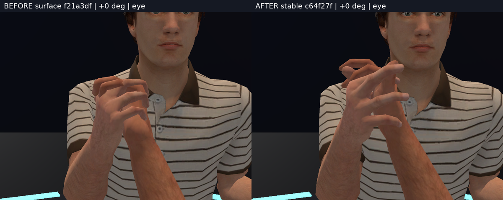
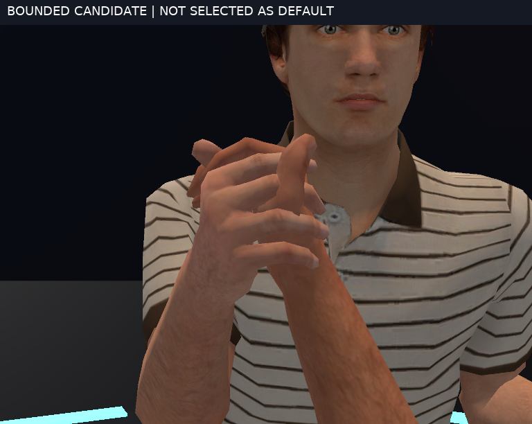

# P2-D 有界约束实验与默认回退（2026-11-20）

**本轮结论：没有得到同时满足自然扣握、腕姿和防穿模的候选。按任务的停止条件，主场景恢复较保守的通用 Humanoid 握姿作为默认，不继续搜索参数。自然握姿验收仍不通过。** 跨人物 Profile、表面目标预览、上一轮表面目标模式及这次有界候选均保留；PR #11 继续 Draft，不合并。

真实结果见[本轮画廊](validation/p2d-joint-constraints/README.md)。Before 是上一轮表面目标模式的本轮重录；After 是实际选定的稳妥默认，**不是声称手指更紧的“改进完成图”**。另公开候选零位近景，解释为何没有选它。

## 调研和一次受控修改

参考 [Unity 2022 Avatar Muscle & Settings](https://docs.unity3d.com/2022.3/Documentation/Manual/MuscleDefinitions.html) 的 Avatar 活动范围及预览，[UltimateXR Hand Pose Editor](https://www.ultimatexr.io/guides/hand-pose-editor) 的成对端点/模型坐标适配，以及 [Twist Correction](https://docs.unity3d.com/Packages/com.unity.animation.rigging@1.2/manual/constraints/TwistCorrection.html) 的扭转分配实践。后者不能直接代替手指关节限位，因此没有安装新框架。

本轮固定一套候选，端点、权重、轮次均未进行反复搜索：

- **掌部位姿**：从首轮 Humanoid 的较顺腕轴出发，保持旋转；以掌部基准、虎口和中央掌面三处实际表面点做带正则的对称平移配准，均值握点不变。修正幅度按掌长限制，根部凸包深度超过 1.5 mm 时拒绝该平移；未满足的整体接触关系保留为配准残差。法线继承腕姿参考，不能把这次平移配准说成完整六自由度整掌求解。
- **指骨**：用各目标 Avatar 已解析的 Humanoid open/closed 局部四元数构成屈伸弧；每指三个标量各固定五档、三轮坐标搜索。代价同时包含目标距离、局部朝向、关节耦合与偏离舒适种子的代价；相对对手掌凸包使用 2.5 mm 硬门。不再把末节绝对旋成世界 `LookRotation`，不加自由轴向扭转、不平移或拉伸骨骼。
- **拒绝不可行解**：全部代价非有限时显式拒绝候选，进入既有回退。不可达目标保留残差。末节查询与最终诊断复用同一局部直轴端点，近/中节保留相同裁剪。
- **统一性**：同一候选定义用于 Rocketbox、Ch03 及混合角色；双方读同一冻结蒙皮，没有一只手优先使用另一只手更新后的表面。模型只由 Profile 选择，未增加角色分支。

这里的“关节弧”是**所选姿态资产允许的一维子空间**，不是完整的人体解剖学模型，也不是医学舒适限位。两个基准端点本身仍需要美术与实际模型确认。2.5 mm 门只覆盖求解时手指对冻结掌凸包的局部查询，**不覆盖指间碰撞或完整皮肤接触**；之后仍由原 ContactGrip 做小范围闭合并诊断。

## 实际 Editor Play 结果

Unity 中国版 `2022.3.62f3c1`、Windows Direct3D11、真实 `ArmWrestlingMain`。候选和选定默认均对 Rocketbox、Ch03、混合人物各采集 181 帧，0°/±30° 和六秒往返；旧表面目标在两套人物上以相同工具重录。没有 PICO/PCVR/硬件测试。

| 角色 / 模式 | 对手 / 玩家最大腕折角 ° | 手部代理峰值 mm | 根部凸包峰值 mm |
|---|---:|---:|---:|
| Rocketbox 上轮表面目标 | 33.98 / 34.39 | 16.37 | 7.04 |
| Rocketbox 本轮有界候选 | 22.10 / 21.59 | 10.13 | 1.27 |
| **Rocketbox 选定默认** | **22.11 / 21.51** | **3.64** | **1.00** |
| Ch03 上轮表面目标 | 35.66 / 31.39 | 31.09 | 14.71 |
| Ch03 本轮有界候选 | 28.61 / 17.15 | 16.17 | 1.37 |
| **Ch03 选定默认** | **28.63 / 17.01** | **13.25** | **1.00** |
| 混合人物候选 | 28.70 / 21.30 | 11.31 | 1.32 |
| 混合人物选定默认 | 28.73 / 21.24 | 6.15 | 1.00 |

代理和凸包不是皮肤穿深，不能把较低值当作自然握持通过。候选末节与求解硬门采用固定的同一局部代理；旧模式保留原绑定时采样，因此也不把此表换算成精确网格改善百分比。

候选最终活骨骼的关节弧超出量各组均记录为 **0.0000°**；它证明没有越过所选弧，不证明姿态自然。Rocketbox、Ch03、混合三处掌部配准 RMS 仍约 **15.75 / 21.22 / 19.22 mm**。Rocketbox 拇指指腹代理目标残差约 **49–55 mm**，四指仍有明显松握或钩形；画面不满足验收。全局指间代理相交仍高于选定默认。

因此选择 `LegacyHumanoidGrip`：腕姿较顺、没有候选新增的自由末节扭转、诊断相交较少，但**手指偏松，仍不是自然扣握**。不是将目标失败解释为整个人体/机械几何无解：本次只证明这套现有端点、腕轴和有限关节弧不能同时实现给定接触关系。

肘垫/身体也未解决：选定默认的 Rocketbox 下缘局部采样距垫面约 **+0.54～+15.73 mm**；Ch03 约 **−15.72～−12.17 mm**，仍穿垫。胸臂代理峰值 Rocketbox 约 **13.03 mm**、Ch03 为 0。沿用修正后的蒙皮缩放测量，不混用旧报告。没有改支撑、骨长、模型尺寸或 Grip Anchor 来抵消这些冲突。

`contact_build_ms` 是既有 ContactGrip 缓存构建的局部计时，不包含本轮所有 Avatar 解析、表面配准和搜索成本；不能据此宣称总启动变快。尚无头显性能验证。

## 当前运行和对照方法

- 直接打开主场景 Play：`Use Humanoid Grip=true`、`Use Grip Surface Targets=false`，选定通用稳妥默认，玩家/对手 Profile 可分别更换，比赛流程保留。
- 启用 `Use Grip Surface Targets`：选择 `ConstrainedHumanoidGrip` / `ConstrainedContacts` 观察本轮候选，**实验模式，不建议替代默认**。
- 将 Humanoid Grip 指向原 `ArmWrestlingGrip` 并启用表面目标：回看上轮 f21a3df 的直接表面目标模式。
- 关闭 `Use Humanoid Grip`：保留 P2-C；胶囊/P1-E 仍按 README 原开关。手部接触预览可选择不同定义和 Profile，资源未删除。

默认 Rocketbox、默认 Ch03、默认混合、候选 Rocketbox、P2-C、胶囊均实际进入主场景比赛回归，状态覆盖校准、选角、准备、倒计时、Fighting、暂停继续、结算，运行错误 0。运行稳定与自然握姿验收是两回事。

## 证据、授权和停止条件

- 公开原始帧：上一轮表面模式 `.p0-local/p2d-cross-avatar/20261120-101803/cross/`；候选 `20261120-101429/cross/`；选定默认 `20261120-101619/cross/`。
- 私有 Ch03：候选 `20261120-101457/cross-local/`、默认 `20261120-101651/cross-local/`。混合角色目录均含 `cross-mixed-local`，不上传。
- 日志、命令结果和 `final-comparison.json`：本机 `.p0-local/p2d-joint-constraints/`。全部本机根目录为 `E:\桌面\研究生\实验室\人机交互课程\实物大作业\code\armwrestling-vr\`。
- PNG/GIF 仅含 MIT Rocketbox 和原创场景，保留 Microsoft MIT 和 DejaVu 许可；旧画廊、人物原件、私有派生模型与录像保留。
- 本轮停止继续调参。重新推进应先获得满足关节约束的成对美术握姿资产，再在现有通用定义/Profile 工作流内验证；不能仅靠放宽碰撞阈值或加大腕折角。

没有修改 PC 控制仓库、UDP、STM32 或机械参数，没有合并 PR #11 / 上游分支。自然握姿任务仍未通过，这次按有界实验与稳妥回退完成收口。
