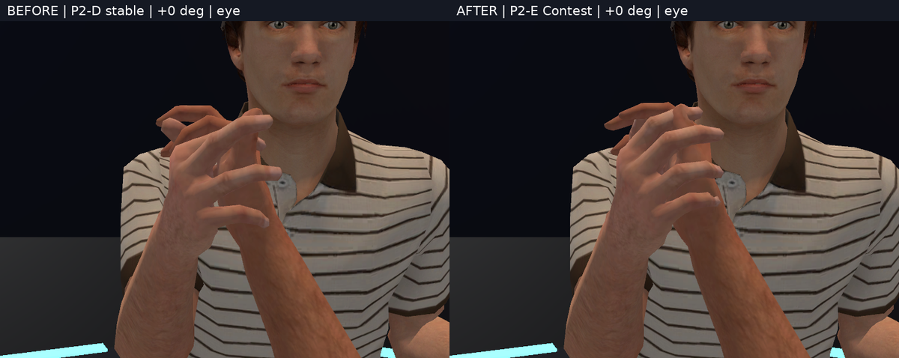
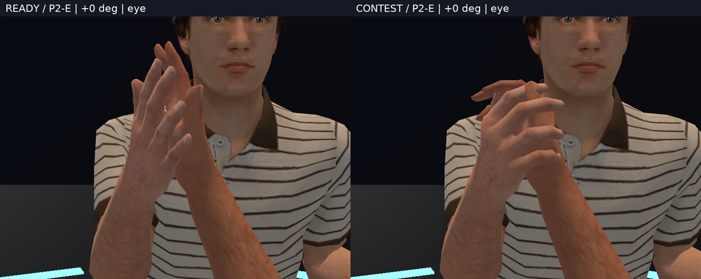
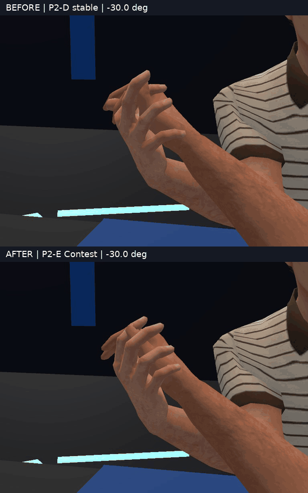

# P2-E 双人美术握姿结果

已保存一对 Ready 和一对 Contest 真正的骨骼定姿，两套 Humanoid 可在 `ArmWrestlingMain` 使用。**Rocketbox 四指有包拢趋势，仍有露缝和指间重叠，未通过自然握持验收。** 主场景默认使用 P2-D 稳定握姿，美术姿态作为可选模式。

[完整画廊，包括手部正侧反侧、三角度与身体连续侧视](validation/p2e-authored-grip/README.md)

## 姿态制作和编辑

以 UltimateXR 在同一预览里编辑骨骼及保存 Open/Closed 两端的流程为参考，采用类似 Blender Pose Library 的固定姿态快照。对掌、两只拇指朝虎口及拇指关节仍能看清，是本轮定位的参照。选用现有 Unity 编辑器和 Rocketbox 蒙皮，用 Editor 脚本执行逐骨的明确定姿。 [UltimateXR Hand Pose Editor](https://www.ultimatexr.io/guides/hand-pose-editor) · [Blender Pose Library](https://docs.blender.org/manual/en/4.5/animation/armatures/posing/editing/pose_library.html) · [WAF 握姿规则 §5.3.1](https://waf-armwrestling.com/wp-content/uploads/2014/10/85-2015-WAF-Rules.pdf)

- 以稳定腕位和双掌相对的布局起步，分别给玩家和对手掌面约 −5°、−7° 的滚转。Ready 保持放松，Contest 逐指摆出不同近、中、远节弯曲。
- 查看双手正侧反侧、第一人称实际蒙皮之后做一次修订，收回竖起的双拇指并放松穿插较明显的中节。保存实际骨骼 Transform 快照，没有调用表面目标搜索、二骨指尖 IK 或网格搜索。源脚本 `AuthoredGripAuthoring.cs` 保留两次定姿中的明确骨骼修改。
- [AuthoredPairedGrip.asset](../Assets/ArmWrestling/Resources/P2D/AuthoredPairedGrip.asset) 保存两侧各 15 骨 × 2 端点、相对 Grip Anchor 的腕位校准，以及从同一手指快照读取的 20 个 Humanoid 通道。姿态资产内的原始四元数仅匹配同一源 Avatar。Ch03 以自己的映射和本机 Profile 重定向，可使用原有 Finger Muscle Offsets 和 Thumb Opposition 独立校准。
- 腕位由原 Grip Anchor 驱动，同一腕姿用于两组指骨端点。实际比赛在准备与倒计时使用 Ready，开赛后约 0.2 秒过渡到 Contest。后者的接触限制只在靠近闭合端的最后 10% 做小幅回退。Rocketbox 扫角实际最大修正 4.94°，Ch03 4.95°。手掌、胸臂和垫面仍可诊断。

在 Unity Edit 模式选择 **扳手腕 → P2-E → Open Authored Grip Preview**。选择 Player 或 Opponent，点 **Show Ready** 或 **Show Contest**，再在 Scene 中选择骨节旋转。选择 Wrist 可以移动和旋转整只手。完成后点相应的 **Save selected hand as…**，用 **Reload saved wrists and endpoints** 核对。编辑 Pose 使用源 Rocketbox，替换 Profile 可查看 Ch03 的重定向效果。保存腕位会同时影响两组端点。主场景在 **Runtime Bootstrap** 勾选 **Use Authored Grip** 即可试用，取消勾选回到稳定默认。

## 同镜头实测

同一 Unity 2022.3.62f3c1 / Windows Direct3D11 正式主场景，181 帧六秒往返。候选与稳定默认按相同角度、Grip Anchor 及 Animator 相位采集。0°、−30°、+30° 检查手部及全身画面。

| 人物和模式 | 对手 / 玩家最大腕折角 | 手部代理峰值 | 掌根凸包峰值 | 对手肘下缘的垫面间隙 |
|---|---:|---:|---:|---:|
| Rocketbox 稳定 | 22.11° / 21.51° | 3.64 mm | 1.00 mm | +0.54～+15.73 mm |
| Rocketbox 美术 | 22.11° / 21.51° | 9.61 mm | 1.36 mm | +0.54～+15.73 mm |
| Ch03 稳定 | 28.63° / 17.01° | 13.25 mm | 1.00 mm | −15.72～−12.17 mm |
| Ch03 美术 | 28.19° / 17.71° | 10.26 mm | 0.61 mm | −15.72～−12.17 mm |
| 混合美术（玩家 Rocketbox） | 28.29° / 21.24° | 9.97 mm | 0.37 mm | −15.72～−12.16 mm |

Rocketbox 反侧能看到指尖更贴近掌背，拇指向虎口收拢。第一人称仍有明显缝隙，局部指间重叠增加，手部代理峰值 3.64→9.61 mm。Ch03 侧面四指更清楚地围绕手背，但部分指尖仍悬空，拇指附近仍交叠。Ch03 肘垫残余穿入约 12～16 mm。Rocketbox 胸臂代理峰值仍约 13.03 mm。连续动作保持原有上身和肘部轨迹，Rocketbox 对手腕到目标最大误差约 0.018 mm。代理和局部蒙皮样本用于定位，实际穿模以画面为准。

本轮接触缓存构建仅测到约 5.5 ms（Rocketbox）、8.8 ms（Ch03）、6.0 ms（混合）；此计时包含既有 ContactGrip 局部构建。PICO、PCVR、真实机械、UDP 和 STM32 联调均未验证。

## 运行验证与来源

六项实际 Editor Play 比赛回归全部通过，运行错误 0。分别验证 Rocketbox、Ch03、混合角色的美术模式，以及主场景稳定默认、胶囊、缺失美术资产时回退到稳定握姿。测试覆盖设备检查、校准、角色选择、准备、倒计时、对抗、暂停继续和结算，三个美术模式均观察到 Ready 与 Contest 端点实际应用。

从同一主场景运行 `P0Validation.Run -p0authored`，附加 `-p0crosslocal` 或 `-p0crossmixed` 可切本机目标。默认和缺资产回退分别用 `-p0crossdefault` 和 `-p0authoredfallback`，无附加参数为胶囊。扫角用 `AnimationComparison.Run -p2d -p2e`，附加 `-p2dlocal` 或 `-p2dmixed` 测其他模型，`-p2eready` 采准备端点。

回归日志在本机 `.p0-local/p2e-authored/`。私有 Ch03 美术扫角在 `.p0-local/p2d-cross-avatar/20261120-110401/cross-local/`，稳定对照在 `20261120-110617/cross-local/`，混合在 `20261120-110445/cross-mixed-local/`。这些帧、既有录像、人物和 Profile 均留在本机。公开画廊仅使用 Rocketbox，附 MIT 与标注字体的许可证。

P2-E 已完成源资产、跨人物复用和主场景接入。自然扣握仍待美术验收。后续继续从零位正反面修虎口与指腹落点，检查 Ch03 的肘垫几何，再决定是否切换默认。
