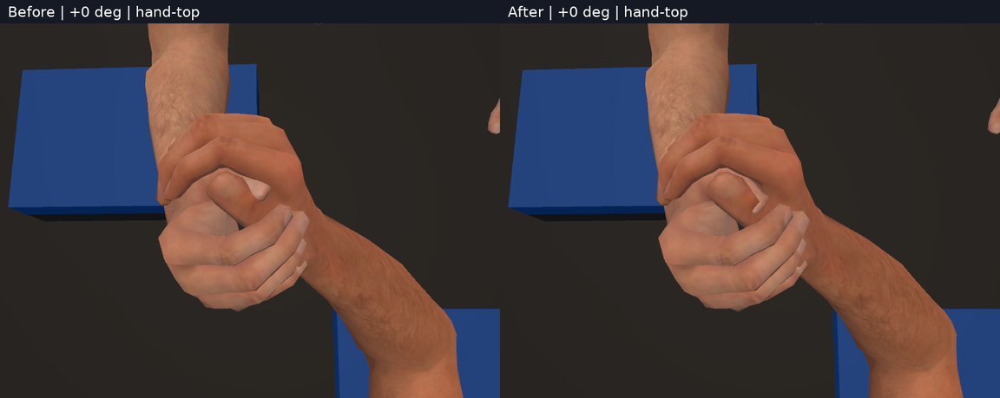
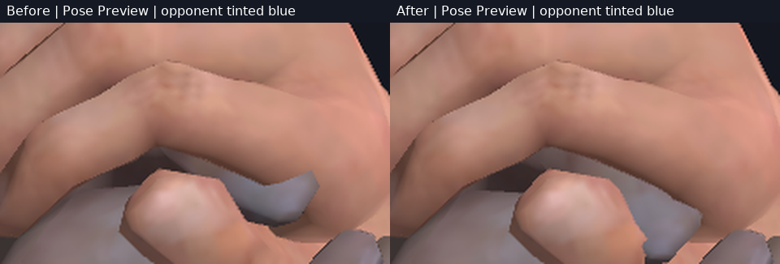
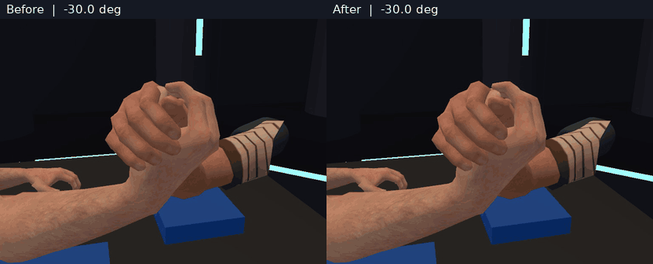

# P2-E 手部接触收尾

`ArmWrestlingMain` 的 **Use Authored Grip** 使用修订后的 `ImagePairedGrip`。默认继续使用 P2-D。对照基线为 `9a4e4cf`；公开图和 GIF 左侧为基线，右侧为本轮。

[第一人称、正侧反侧、Ready/Contest 和三角度画廊](validation/p2e-contact-finish/README.md)

## Rocketbox 的拇指搭扣

在真实双手 Pose Preview 中分别载入 Ready 和 Contest，旋转对手拇指的中节、末节，将指腹沿玩家食指根的内缘移回虎口。保存、重载后从第一人称、俯视和反侧核对。四指仍绕在对方掌背，腕位与食指近节保持原稿。主场景里变化最容易从俯视看到；第一人称整体握形变化很小。

六秒往返中，这一对碰撞代理的峰值在 Contest 从 **6.14 降至 0.24 mm**，在 Ready 从 **7.02 降至 0.77 mm**。Contest 的全手代理峰值从 6.14 降至 3.18 mm，最深处转为对手拇指中节与玩家掌面。主场景蒙皮采样中，对手侧峰值从 9.15 降到 6.73 mm，玩家侧从 6.69 增至 7.47 mm。顶视拇指边缘仍有遮挡和局部相交。对手与玩家腕折峰值分别为 21.59° 和 23.34°，与上轮相同。

## Ch03 对手的中指

先在本机 Ch03 骨架上摆对手中指的近节、中节、末节，再将相对重定向端点的三个局部旋转保存到 Avatar Profile。一次完整的摆位使双 Ch03 的中指指腹局部样本离开掌背至少 6.61 mm。实际蒙皮显示两个玩家掌型需要的改动幅度不同。最终双 Ch03 使用该局部修正的 14%，Rocketbox 玩家对 Ch03 对手使用 71%。两端点共同使用对应校准，握点、骨长、原 Animator 与 IK 继续沿用。运行时按握姿和对面的 Profile 查找校准，其他配对继续使用原有 Humanoid 映射。

| 零位 Contest 的实际蒙皮抽样 | 上轮 | 本轮 |
|---|---:|---:|
| Rocketbox 对手拇指末节 → 玩家食指近节 | −7.43 mm | −3.63 mm |
| Ch03 对手中指末节 → Ch03 玩家掌面 | −0.55 mm | +0.67 mm |
| Ch03 对手中指末节 → Rocketbox 玩家掌面 | −6.13 mm | −0.18 mm |

表中取 Edit 模式双手预览的蒙皮顶点，对侧找最近三角面，仅保留两面相对且三角面属于目标部位的样本，报告最小带符号距离。负值表示顶点位于局部表面内侧。Rocketbox 前后分别只有 2 和 4 个符合筛选的拇指样本；Ch03 的最末指节在两种搭配中有 17–20 个。此量与运行时碰撞代理采用不同几何，均不足以证明整张手网格无穿模。

已有本机 Ch03 Profile 可在 Edit 模式执行 **扳手腕 → P2-E → Apply Ch03 Middle Finger Calibration**，操作可 Undo。它会写入本次校准数据，只修改本机 Ch03 Profile 上这套对手手型配置。在 Runtime Bootstrap 中选择玩家和对手 Profile，开启 **Use Authored Grip** 即可复现。通过 **P2-D → Prepare Profiles And Main Scene** 新建本机 Profile 时也会带入这些数值。

本机日志、源帧路径和局部蒙皮核对在 `.p0-local/p2e-finish/`。其中 `ch03-private.png`、`mixed-private.png` 对比同镜头零位的反侧、顶视、第一人称和坐姿。Ch03 的肘部下缘在往返中仍局部低于垫面约 12–16 mm，留待单独的座椅和肘垫几何校准。

## 主场景回归

Unity 2022.3.62f3c1，Windows Direct3D11。Contest 的 −30° → 0° → +30° → −30° 各有 181 帧。双 Ch03 的中指末端与掌面代理峰值从 11.66 降至 10.37 mm，混合人物从 15.14 降至 14.60 mm。代理深度明显大于零位局部蒙皮样本的穿入量。反侧还可看到 Ch03 一侧拇指与邻指轮廓相交，玩家侧旧有的无名指、小指贴合不匀。对手 / 玩家腕折峰值在双 Ch03 为 27.72° / 13.23°，混合为 27.81° / 22.89°，均与基线相同。

Rocketbox、双 Ch03 和混合角色的 Ready 姿态也分别跑完相同的 181 帧往返。双 Ch03 与混合角色在 Ready 时的中指末端与掌面代理峰值分别为 8.92 和 13.04 mm。

新稿 Rocketbox、双 Ch03、混合、稳定 P2-D、胶囊及缺美术资产回退分别运行离线比赛。从准备、倒计时、对抗、暂停继续直到结算，六项均通过，运行错误 0。人物模式实际观察到 Ready 与 Contest。此次验收仅覆盖 Editor；头显、实际机械和 UDP 联调仍待验证。
