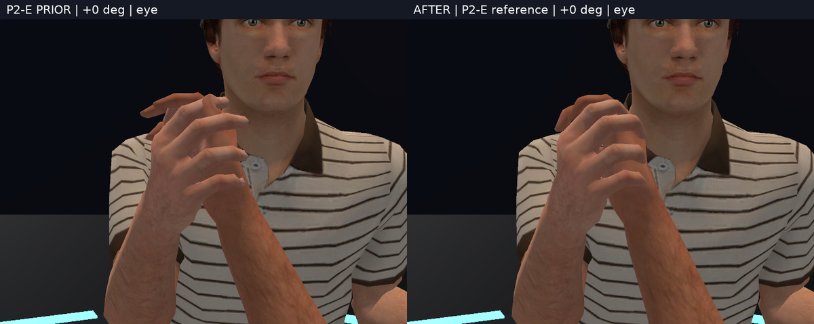
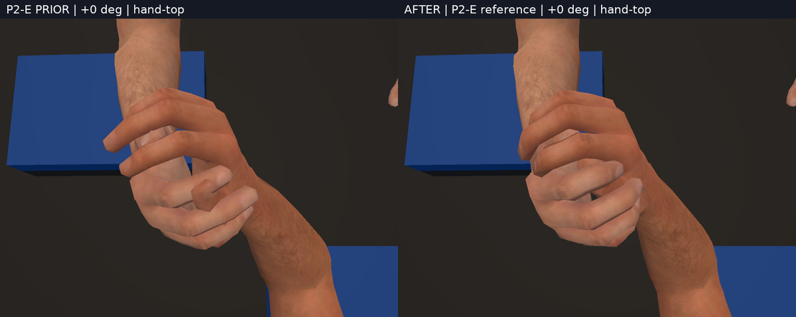
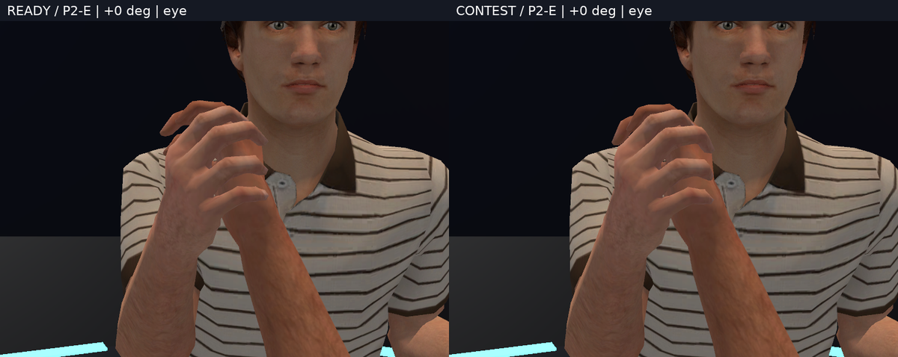
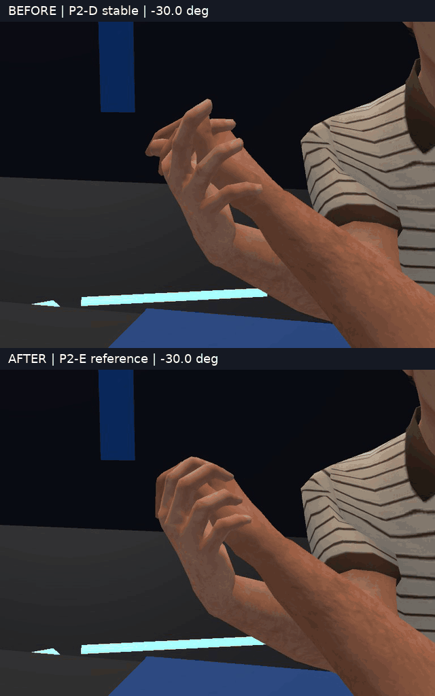

# P2-E 真人参考握姿续作

`ReferencePairedGrip.asset` 保存了双方用同一腕位的 Ready 轻握和 Contest 扣握。主场景 **Use Authored Grip** 已指向新资产，关闭该选项继续使用稳定 P2-D。上一轮 `AuthoredPairedGrip.asset` 保留。

[正面、侧面、反面、上方及三角度画廊](validation/p2e-real-grip/README.md)

## 真人参考与实际定姿

采用无绑带右手对握。CAWF 与 AWE 的起始定握规则强调掌面相对、腕部顺直和拇指关节可辨认。世锦赛照片能看见四指横落到对方掌背，指尖远离对方腕线。裁判教学的网页可访问标题与预览帧，完整播放未能核实，遮挡处依据规则和比赛照片判断。外部参考未进入公开仓库。[CAWF 规则](https://cawf.ca/rulesfull) · [AWE 规则](https://www.awearmwrestling.com/ruleset) · [CAWF 裁判指南与实拍](https://cawf.ca/how-to-referee) · [世锦赛照片](https://www.skg-sprendlingen.de/verein/bildergalerie/armwrestling-wm-2025-in-bulgarien) · [裁判定握视频](https://www.youtube.com/watch?v=wkr34Z7dHJE) · [规则教学视频](https://www.youtube.com/watch?v=lyBQBNtgFQ8)

延用现有 Unity Pose Preview 和源骨骼保存。此次以原 P2-E 为底稿，在打开的两只 Rocketbox 手上做直接 Transform 编辑。临时编辑命令等同移动腕部和旋转单个指骨。每步根据同一预览的正侧反侧、上方蒙皮和骨点位置决定，未使用 `PoseDigits()` 重新生成端点，也未运行角度或碰撞参数搜索。公开运行时画面来自主场景的真实角色。 [UltimateXR 手部姿态编辑参考](https://www.ultimatexr.io/guides/hand-pose-editor)

1. 先摆双腕和掌面。在握点局部坐标内让两手沿前后方向靠拢，少量拉开掌面法向位置以保留皮肤厚度。围绕掌心略调倾斜以容纳虎口。相对旧版，玩家腕位移动约 5 mm，对手约 6 mm。通过相同 Grip Anchor 带动，骨长与机械轨迹保持原值。
2. 再摆虎口与拇指。玩家拇指沿对手食指根侧的虎口收拢，对手拇指沿玩家食指根侧反向收拢。分别旋转两个拇指的根、中、末节，让两节的方向错开，避免两个拇指尖朝上碰头。上方视角仍有部分关节被遮住，需进一步美术核对实际搭扣层次。
3. 逐指摆到对手掌背。食指、中指落向掌背较高处，无名指、小指顺着掌背外缘。两侧远节各自朝不同接触位置转动。结果可见指弯包拢，部分指腹仍未平贴，拇指和局部指间需要继续确认。
4. 保存双方 Contest 后，从闭合姿态稍许放松得到 Ready，重新加载验证两端。两侧各 15 骨的原始快照只对 Rocketbox 使用。目标 Avatar 不同则用现有 Humanoid 通道和独立 Profile 重定向。

编辑模式菜单 **扳手腕 → P2-E → Open Authored Grip Preview** 加载新稿，**Open Previous Authored Grip Preview** 打开旧稿。选择 Player/Opponent 和具体关节后在 Scene View 旋转，分别保存 Ready 或 Contest。Wrist 两端共用，保存后用 **Reload saved wrists and endpoints** 核对。主场景的 **Use Authored Grip** 用于试玩。

## 主场景实际表现

Rocketbox 的第一人称空隙减少，指尖不像上一稿一样从两侧伸出。侧面和反侧能看到多根指腹沿对手掌背绕过去。上方仍可看到虎口遮挡，部分指腹只在末端接近掌背，尚未形成真人照片中较平的接触。Ready 与 Contest 都呈轻到紧的包握，准备状态不用等开赛才合手。头显与实体握把同步未测。

Ch03 的四指轮廓也随两侧掌背弯曲，但部分指节偏高，拇指仍从两手中间露出，并与几根手指交叠。重定向沿用原本机 Profile；该手型需要单独的虎口、拇指及内侧两指落点。原有肘垫局部穿入仍约 12–16 mm。Rocketbox 肘垫间隙及胸臂代理与旧稿相近。

| 模型 / 握姿 | 对手 / 玩家最大腕折角 | 手部重叠代理峰值 | 掌根凸包峰值 | 对手肘下缘距垫 |
|---|---:|---:|---:|---:|
| Rocketbox 稳定 P2-D | 22.11° / 21.51° | 3.64 mm | 1.00 mm | +0.54～+15.73 mm |
| Rocketbox 上一轮 P2-E | 22.11° / 21.51° | 9.61 mm | 1.36 mm | +0.54～+15.73 mm |
| Rocketbox 真人参考 | 22.80° / 20.60° | 5.90 mm | 0.00 mm | +0.46～+15.41 mm |
| Ch03 上一轮 P2-E（上轮同口径记录） | 28.19° / 17.71° | 10.26 mm | 0.61 mm | −15.72～−12.17 mm |
| Ch03 真人参考 | 28.73° / 21.10° | 15.37 mm | 0.00 mm | −15.70～−12.14 mm |
| 混合真人参考（玩家 Rocketbox、对手 Ch03） | 28.82° / 20.61° | 15.66 mm | 0.00 mm | −15.69～−12.14 mm |

Rocketbox 对手腕到目标的最大误差约 0.018 mm，玩家对应误差约 0.001 mm。ContactGrip 在 Rocketbox 及 Ch03 Contest 的最大改动均约 0.5°，主要形状来自保存快照。代理为诊断读数，凸包读到零仍需看蒙皮。Rocketbox 比上轮更接近目标，Ch03 局部接触退步，**稳定默认继续使用 P2-D**。

要继续改善，最有用的输入是一组同一真人握姿的双侧及上方近景，手腕和拇指都入镜，分别标出哪只拇指在上、四指指腹的落点。其次是在 Ch03 蒙皮上独立校准这些落点，并核对肘垫高度。不要仅据重叠代理继续收指。

## 实际 Editor Play 与复现

Unity `2022.3.62f3c1`、Windows Direct3D11。Rocketbox、Ch03 和混合角色均通过同一主场景 181 帧、六秒往返，包含 −30°、0° 和 +30°。三种 Rocketbox 姿态对照拍摄的每帧角度、Grip Anchor 位置和动画相位逐项相同。新美术模式下，比赛回归单独检查实际出现 Ready 与 Contest，并观察角色动画、设备检查、准备、倒计时、对抗、暂停继续与结算。PICO、PCVR、硬件和 UDP/STM32 联调未测。

六项实际比赛回归均通过，运行错误 0。包括新稿 Rocketbox、Ch03、混合、主场景稳定默认、胶囊和缺新姿态资产回退。公开证据共 14 张 PNG（各小于 1 MiB）和两段连续 GIF（手部 48 帧、6.01 秒，侧视 60 帧、6 秒，各小于 8 MiB）。

- 使用 `AnimationComparison.Run -p2d -p2e` 录新稿。追加 `-p2eprior` 录上一轮，`-p2eready` 录新稿 Ready。基线使用 `-p2d -p2ddefault`。追加 `-p2dlocal` 或 `-p2dmixed` 可录本机角色。
- 比赛验证使用 `P0Validation.Run -p0authored`，追加 `-p0crosslocal` 或 `-p0crossmixed`。稳定默认用 `-p0crossdefault`，缺新资产回退用 `-p0authoredfallback`，胶囊不加模式参数。
- 本机日志在 `.p0-local/p2e-real/`，定姿中间帧和重载核对在 `.p0-local/p2e-real-session/`。Ch03 扫角及附加视角在 `.p0-local/p2d-cross-avatar/20261120-143014/cross-local/`，混合角色在 `20261120-143053/cross-mixed-local/`。公开画廊使用授权明确的 Rocketbox 和原创场景，附 MIT 许可。
