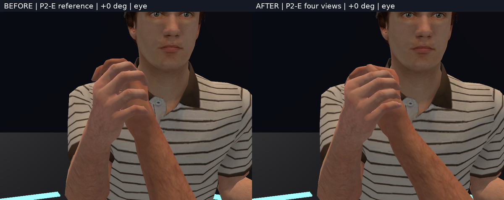
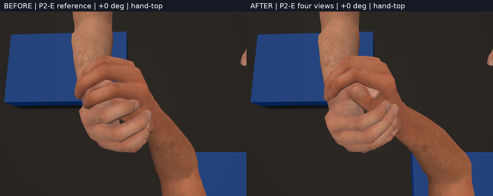
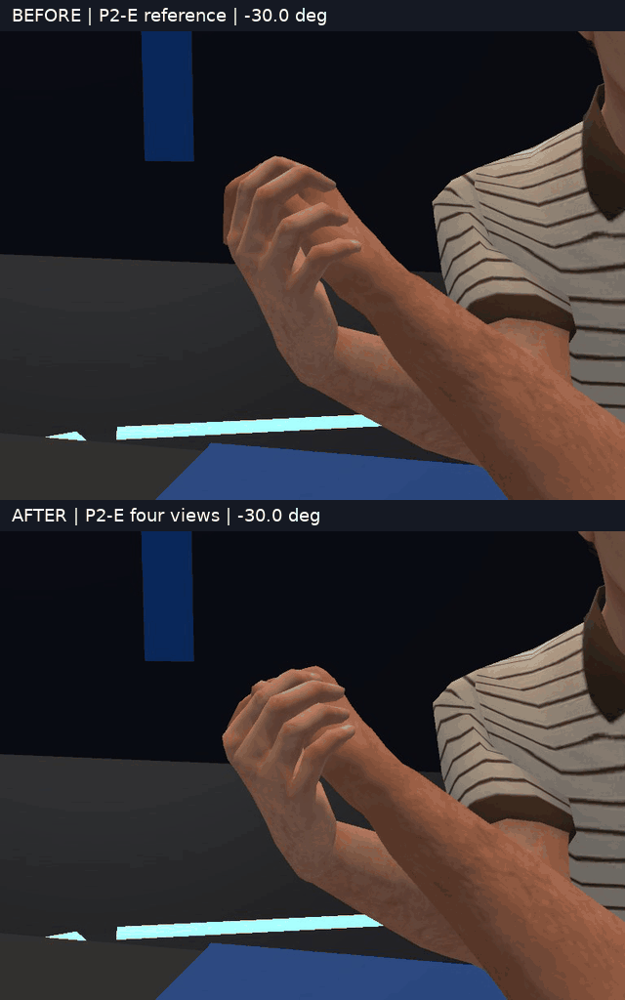

# P2-E 四视角参考握姿

`ArmWrestlingMain` 的 **Use Authored Grip** 加载 `ImagePairedGrip.asset`。同角度对比的左侧为上一稿 `ReferencePairedGrip`，右侧为本轮 Contest。稳定 P2-D 继续作为默认。

[完整画廊含正面、侧面、反侧、全身、三角度和 Ready/Contest](validation/p2e-user-reference/README.md)

## 参考图如何落到骨骼上

打开了两张四宫格附件。手部图中，侧面和选手视角能看见四根手指依次落在对方掌背，指尖离腕横纹仍有距离；俯视能看见拇指斜跨虎口，四指从另一侧绕入。全身图中，握点在两肘之间，两人以前臂托住握点。各象限的人物与朝向有差别，遮挡下的接触深度无法从图中量出。取一种无绑带右手对右手摆法，玩家拇指在上，对手拇指从另一侧略低搭入。原图来自对话附件，已放入本机 Git 忽略目录。预期的本机 `README_参考说明.md` 未找到；本轮采用分支任务书和 PR #11 所附的使用说明。

在既有 Unity 双手 Pose Preview 上打开 Rocketbox 源骨架，从上一稿复制独立资产。用编辑命令移动真实腕 Transform、绕掌中部倾转双腕，给虎口留出前后错位，再分别摆两枚拇指的根、中、末节。按两手各自的蒙皮轮廓逐根编辑四指：降低食、中指原先过高的指弓，无名指和小指沿掌背外缘收拢。反侧看到小指尖埋入掌背后，单独抬出两枚小指远节。全过程使用固定骨长，未调整碰撞阈值。双方 Contest 保存后，轻放松得到 Ready，再重载两端核对。

## 主场景里能看到什么

**Rocketbox。** 第一人称能看到四指顺着掌背排列，握姿顶部比上一稿低而紧。俯视可分辨斜搭的拇指，侧面小指仍有局部埋入，+30° 时虎口内侧留有空隙。零位最深的一对简化碰撞体是玩家食指近节与对手拇指末端，约 6.14 mm。玩家腕折峰值比上一稿增加 2.74°，对手降低 1.21°。对手腕相对 IK 目标的最大误差约 0.02 mm。对手胸臂代理峰值从 12.78 增至 13.18 mm。

**Ch03。** 同一新稿首次仅通过 Humanoid muscle 重定向时，两枚拇指仍明显竖起。源姿态中双方拇指近节通道分别约为 −2.67 和 −1.71，目标骨架原有映射均会截到 −1。为此，保存端点时额外记录拇指头两个骨段在掌面坐标中的方向。目标骨架先应用原 Humanoid 姿态，再按自身掌面方向转动这两个关节；骨长、末节的屈伸及 Profile 校准仍由目标骨架决定。旧资产的空方向会跳过这一步。该处理发生在加载姿态时。

在同一 Ch03 握姿上单独对比这项改动，双拇指远节骨点距离由 71.86 降为 39.28 mm，侧面原先伸出四指轮廓的拇指落回握面。反侧仍能看到指节交叠，零位对手中指尖进入玩家掌面。混合人物的拇指方向也改善，较大的 Ch03 手指在 Rocketbox 掌面上仍显得过深。双 Ch03 和混合角色的对手肘下缘仍比垫面低约 12–16 mm。

| Contest 六秒往返 | 双拇指远节骨点间距峰值 | 手部重叠代理峰值 | 对手 / 玩家腕折峰值 | 对手肘部采样下缘距垫 |
|---|---:|---:|---:|---:|
| Rocketbox 上一稿 | 45.47 mm | 5.90 mm | 22.80° / 20.60° | +0.46～+15.41 mm |
| Rocketbox 本轮 | 24.57 mm | 6.14 mm | 21.59° / 23.34° | +0.66～+15.38 mm |
| Ch03 上一稿 | 80.65 mm | 15.37 mm | 28.73° / 21.10° | −15.70～−12.14 mm |
| Ch03 本轮 | 39.28 mm | 11.66 mm | 27.72° / 13.23° | −15.62～−12.06 mm |
| 玩家 Rocketbox、对手 Ch03 上一稿 | 59.72 mm | 15.66 mm | 28.82° / 20.61° | −15.69～−12.14 mm |
| 同一混合搭配本轮 | 27.84 mm | 15.14 mm | 27.81° / 22.89° | −15.62～−12.05 mm |

Rocketbox 上一稿在本次重录；Ch03、混合的上一稿取自上一轮相同场景和输入。远节间距量到两根骨的原点，指腹贴合程度仍须看蒙皮。Rocketbox 双方蒙皮采样穿入峰值也有小幅上升，对手为 8.54 → 9.15 mm，玩家为 6.47 → 6.69 mm。新稿更接近参考图的包握轮廓，局部接触和腕部仍有取舍，因此保留稳定默认。后续应优先在对手拇指末端与玩家食指根之间给出能从两侧同时看到的接触面，再校准不同手宽下中指指腹的落点。

## 验证记录

Windows Direct3D11，Unity 2022.3.62f3c1。三种人物配对分别录满 181 帧，经过 −30°、0°、+30° 后返回 −30°，每帧都有 Animator IK 回调。三组中相邻帧的掌心骨代理间距变化均低于 0.02 mm。同镜头对比以每帧的机械角度、握点 XYZ 和 Animator 相位逐项匹配。Ready 在准备时已经轻握，Contest 比 Ready 略紧，侧面仍能看见局部指尖陷入蒙皮。

实际比赛回归覆盖 Rocketbox、双 Ch03、混合、P2-D 稳定模式、胶囊以及缺美术资产回退。六项均通过设备检查、校准、大厅、准备、倒计时、对抗、暂停继续和结算，运行错误为 0。三组新稿都观察到了 Ready 与 Contest。此次验证使用 Editor，头显与真实机械尚待联调。

本机 `.p0-local/p2e-user/` 下的 `match-*.txt` 记录各项比赛结果，`*.path` 指向原始扫角帧和 CSV。`ch03-private.png`、`mixed-private.png` 各有三列，分别为上一稿、本次单用 muscle 和保存拇指方向后的结果。公开画廊有 12 张 PNG、6.01 秒双手 GIF 与 6 秒全身侧视 GIF。用户原图及涉及 Ch03 的画面仅留本机。

## 在工程中打开

- 双手编辑使用 **扳手腕 → P2-E → Open Authored Grip Preview**。要编辑历史资产，在 Project 选中 `ReferencePairedGrip` 或 `AuthoredPairedGrip`，使用 **Open Selected Paired Grip**。Show Ready / Show Contest 可切换两端。
- 主场景选中 RuntimeBootstrap，打开 **Use Authored Grip** 后进入 Play。Player / Opponent Avatar 使用同一个 Rocketbox Profile，或任选本机 Ch03 Profile 形成双 Ch03 或混合。Ch03 资源仅在本机可用。
- 扫角入口为 `AnimationComparison.Run -p2d -p2e`，上一稿追加 `-p2ereference`，Ready 追加 `-p2eready`，双 Ch03 和混合分别追加 `-p2dlocal`、`-p2dmixed`。比赛回归使用 `P0Validation.Run -p0authored`，本机人物可追加 `-p0crosslocal` 或 `-p0crossmixed`。
