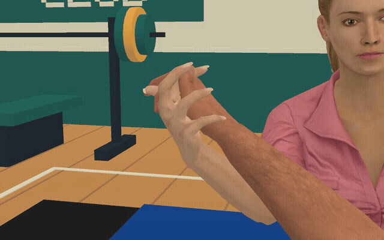

# P2-F 对手外观与对战场景

[大厅面板实拍](validation/p2f-visual/lobby-panel.png) · [三场馆同视角对照](validation/p2f-visual/venues.png) · [四位对手的正面、侧面及握姿](validation/p2f-visual/README.md)

打开 `Assets/Scenes/ArmWrestlingMain.unity`，点 Play，进入「下一步：空间标定 → 跳过标定」。在选择页点击「对手外观」或「对战场景」下面的名称即可轮换，绕一圈回到初始项。再选右侧对抗策略、力量和「准备对战」。结算后点「返回选择」可换人换场，「再来一局」沿用当前组合。

## 对手与握姿

| 界面名称 | 公开模型 | 蒙皮顶点数 | 造型 |
|---|---|---:|---|
| 成年男士（默认） | Male_Adult_01 | 4,811 | 条纹 Polo 衫 |
| 日常装女士 | Female_Adult_01 | 5,561 | 粉色衬衫、牛仔裤 |
| 运动装女士 | Sports_Female_02 | 5,439 | 灰色运动上衣、深色长裤 |
| 灰发绅士 | Male_Adult_03 | 4,483 | 鬓角灰白、西装外套、酒红衬衣 |

四人均来自 Microsoft Rocketbox 同一固定版本。灰发绅士取自原厂已有的成熟面容，厂商未标注年龄。本机未找到可用的 MakeHuman/MPFB 制作环境；本轮没有另做年龄滑块建模或新的老年骨架。选用现成人物可沿用已核实的衣服、头部与手部授权。[原厂成年人目录](https://github.com/microsoft/Microsoft-Rocketbox/tree/0943055db6ec570bcef9f2c8b41c9e5467c808f9/Assets/Avatars/Adults) · [运动装女性来源](https://github.com/microsoft/Microsoft-Rocketbox/tree/0943055db6ec570bcef9f2c8b41c9e5467c808f9/Assets/Avatars/Professions/Sports_Female_02) · [随模型分发的 MIT 许可](../Assets/ArmWrestling/Resources/P2F/ROCKETBOX-LICENSE.txt)

三名新对手各有一个 FBX、三套材质、三张色图及独立的 `GripAvatarProfile`。身体与脸部色图为 1024²，透明贴图最长边 512。新增人物目录含 Unity 元数据约 3.53 MiB。三套新 FBX 从公开文件重导入后都通过有效 Humanoid、右手 15/15 指骨实际带蒙皮权重和材质贴图绑定检查。普通 clone 已含配好的 Profile；编辑器菜单 **扳手腕 → P2-F → Prepare Rocketbox Opponents** 可重建导入配置。

选角只在 Lobby 生效。玩家保留自己的蒙皮手臂，双方按所选 Profile 重新解析同一份握姿；运行时替换对手和碰撞探针，复用原机械握点、肘部提示点、Animator 与 IK。默认沿用 P2-D 的 `LegacyHumanoidGrip`，**Use Authored Grip** 可切到 P2-E 的 `ImagePairedGrip`。原策略编号仍为均衡 1、防守 2、节奏 3，外观和场景切换均不发布策略事件。历史胶囊及本机 Ch03 回退模式继续使用原设置。

## 场馆

- **科技竞技场**沿用原来的暗色灯带、发光圆环和立柱。
- **日光训练馆**使用木地板、采光窗、杠铃架、壁面肋木和吊环。
- **锦标赛场馆**采用双侧看台、队旗、桁架灯与 FINALS 标牌。

新增室内物件由工程生成，按材质合并网格。训练馆使用一盏有硬阴影的方向光，比赛馆另有一盏无阴影聚光灯。换场只替换房间装饰、灯光和环境设置。比赛桌、座椅、肘垫、握点与玩家方位继续使用原对象。

公开版中文界面使用从 Noto Sans SC 截取的常用界面字形，固定字重 400，子集名为 Match UI（约 149 KiB）。原始字体来自 Google Fonts；公开仓库附 SIL OFL 1.1。本机原交付字体仍按既有逻辑选用。[字体上游](https://github.com/google/fonts/tree/06bfe0d62a98375cb09c942fa18e68bd32cff057/ofl/notosanssc) · [子集许可](../Assets/ArmWrestling/Resources/Fonts/MatchUI-OFL.txt)

## 实际验证

运行环境为 Windows、Unity 2022.3.62f3c1、Direct3D 11、ArmWrestlingMain 和离线模拟。游戏源提交为 `93df514`。

| 检查 | 操作与结果 |
|---|---|
| Windows 鼠标输入 | 前台 Editor 的 Game 视图通过 Windows 原生鼠标事件移动、按下和释放。按标定、外观、场景、策略和比赛按钮，四位对手各完成一局。实际收到按钮回调并记录了 Ready、Countdown、Fighting、Paused、恢复及 Finished。控制脚本仅在恢复后开启已有自动对战。 |
| 大厅组合 | 在仅含公开文件的工程中，P2-D 默认和 P2-E 可选各覆盖 4 人 × 3 场馆 × 3 策略。通过现有 HUD 按钮逐次检查模型、环境、原策略编号与力量，选完一圈可回到原男士和科技场馆。每种握姿各完成四场训练馆比赛。 |
| 骨骼与角度 | 四位对手分别在两种握姿下运行 −30° → 0° → +30° → −30°，每人每种 181 帧，每帧确认有 Animator IK 求值。零位两位女士肘骨原点相对垫中心横向约 73 mm，两个男士约 59 mm。四人的骨原点均约高出垫面 40–41 mm。 |
| 历史回退 | 胶囊、本机 P1-E Ch03、P2-C ContactGrip、缺少美术端点四项在主工程重新进入 Editor Play，均完成离线结算，运行错误为 0。 |

前台鼠标实测的四局如下。胜负受本局离线角度输入影响。

| 实际对手 | 实际场景 | 策略 | 结算 |
|---|---|---|---|
| 成年男士 | 科技竞技场 | 均衡 | 玩家胜 |
| 日常装女士 | 日光训练馆 | 防守 | 对手胜 |
| 运动装女士 | 锦标赛场馆 | 节奏 | 玩家胜 |
| 灰发绅士 | 科技竞技场 | 均衡 | 对手胜 |

另在独立的公开副本临时移开运动装女士的 Profile 复测。由日常装女士继续轮选时，大厅提示并实际回到成年男士，下一次点击可到灰发绅士，场馆、策略及力量均保留。该次 Editor Play 使用无图形模式，仅验证回退逻辑。

从同机位可见，两位女士的衣肤、脸与马尾可辨，灰发绅士的头部和西装材质正常。侧面可以看到坐到座板上的位置，以及工作臂与垫边的相对关系。近景仍有张指、相邻指节交叠；侧面也会露出第一人称玩家手臂的裁切端。肘骨原点的高度和腕目标误差都不能证明皮肤与垫面或双手表面完全贴合。此次保留既有握姿和机械轨迹。[各角度实拍与采集方式](validation/p2f-visual/README.md)

最后从源提交 `93df514` 创建无 Library、无私有资源的新 clone，首次导入后再次跑完默认握姿 36 种选择和四场比赛。公开中文字体实际加载为 MatchUI-Regular。静态检查解析 172 个工程 GUID，错误数为 0；旧 HDRI 材质及历史 Preview 场景对未分发素材的可选引用仍单列。

Windows 鼠标记录位于本机 `.p0-local/p2f-mouse/steps.txt`。公开副本的握姿测试日志见 `.p0-local/p2f-verify/`；主工程回退日志见 `.p0-local/p2f-regression/`。本阶段未构建 Android 包，PICO、PCVR、真实机械和 UDP 联调均待独立验证。
