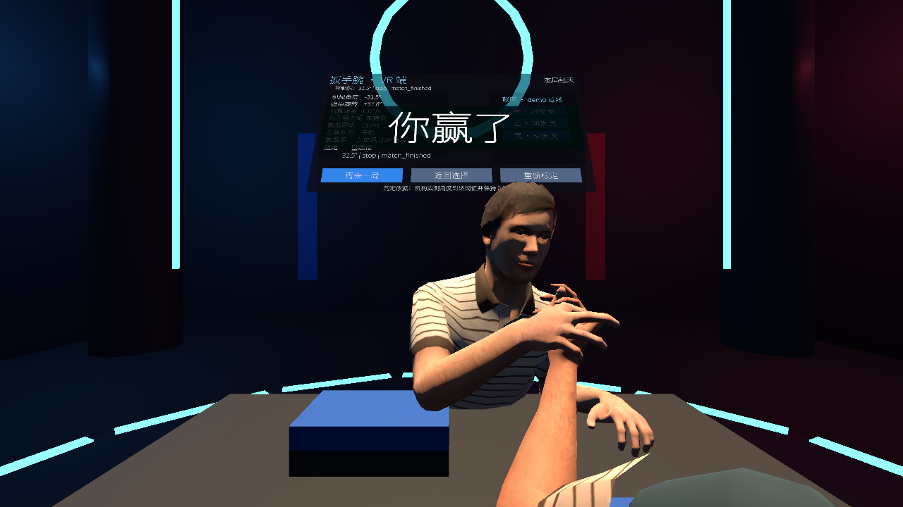
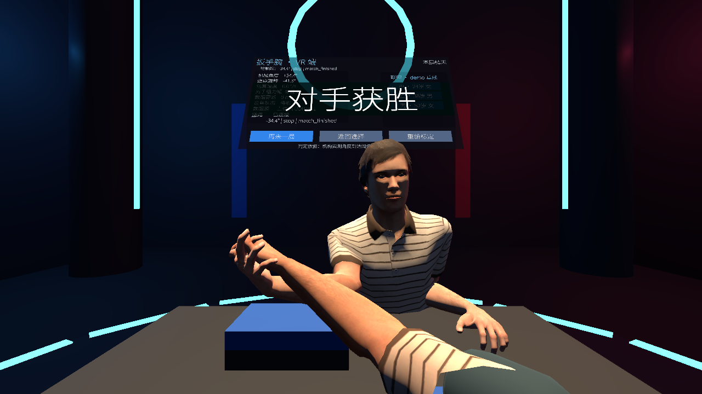
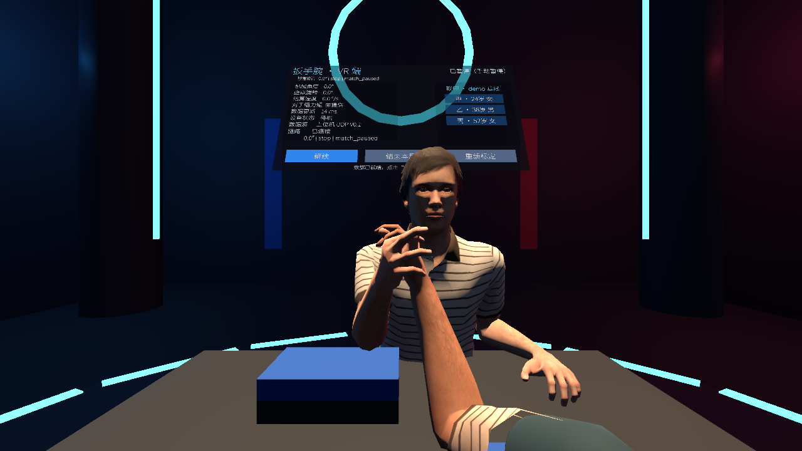

# P3.0 正式主场景与 PC 联合仿真

Windows 同机联调使用 Unity 中国版 2022.3.62f3c1、Direct3D11、正式场景 `Assets/Scenes/ArmWrestlingMain.unity` 的默认 P2-D Rocketbox 人物、PC V0.3 和软件 STM32。PC 配对版本为 [`fce4ab9b11e41c52c966336e74efc234a5ef2c82`](https://github.com/Ihtbfas/armwrestling/commit/fce4ab9b11e41c52c966336e74efc234a5ef2c82)。

## 最短运行流程

在 PC 仓库根目录分别开两个 PowerShell 窗口，首次运行可用 `python -m venv .venv` 创建环境。

窗口一启动 PC 桥接。

```powershell
.\.venv\Scripts\python.exe -m common.bridge --log-file "$env:TEMP\arm-p3-pc.jsonl"
```

窗口二启动手动施力。模拟器窗口有焦点时按 `1` 下压、`2` 回推、`0` 松手、`R` 软件回零。施力保持到下一个操作，松手后仍可能因惯性运动。再来一局前可以按 `R`，准备和倒计时期间保持零位。

```powershell
.\.venv\Scripts\python.exe -m sim.mock_stm32 --manual --torque 0.8 --log-file "$env:TEMP\arm-p3-sim.jsonl"
```

在 VR 仓库打开正式主场景并 Play。点 **改用网络数据 → 下一步：空间标定 → 跳过标定 → 准备对战**，可直接以 demo 开局，或在选择页先选甲、乙、丙。需要指定地址时以 `-network -hostip 127.0.0.1 -hostport 9102` 启动 Editor。使用 `-character demo` 或 `-character person_01` 可指定初始人物。联调时只运行这个 VR 客户端。

PC 的联网人物与离线对抗策略各自选择。甲、乙、丙对应 `person_01..03`，界面显示年龄、性别和训练背景。三人共用 P2-D 公开模型作为联网演示形象。联网由 PC 计算阻力，界面将力矩显示为“未提供”。离线仍可选均衡、防守或节奏策略，也可调力量。

## 状态、方向和异常

设备检查、选角、准备和倒计时都发 `waiting`。只有进入对抗才发 `running`。暂停与结算分别发 `paused`、`finished`。状态切换尽快发全量心跳，稳定期间由主循环每约 200 ms 发送。新回合经 `waiting` 清除 PC 疲劳。

PC 机械角以 rad 表示，负角使我方占优。VR 先取反并换算为度，再用现有 1.2 倍映射。机械约 −25° 对应视觉判定 +30°。胜负按有效测量角度和原 0.35 s 保持时间计算，画面仍使用滤波及短时平滑。合法 0 可驱动姿态，空角度冻结最后姿态。有效 STOP 角度仍可更新画面。

通信超时、无角度和非预期 STOP 会暂停对抗。链路恢复并确认暂停状态后，用户可以继续。客户端使用显式 PC 地址和同一 UDP socket 收发，过滤重复及旧序号。PC 重启后由接收超时触发会话重建。UDP V0.1 现有字段与 PC 1 s 心跳超时仍按原约定。

## 复现验证

在 VR 仓库根目录执行以下命令，使用实际安装的编辑器路径。测试按现有界面按钮回调操作，启动正式主场景，并运行 PC 桥接和软件下位机。输出目录应为全新的本地目录。

```powershell
python tools/run_p3_validation.py --unity 'D:\Unity\Hub\Editor\2022.3.62f3c1\Editor\Unity.exe' --pc '../armwrestling' --output '.p0-local/p3-local-run'
```

自动化用模拟器的 `--input-file` 在零位切换固定幅值的下压和回推动作，并重启自己拉起的两个 Python 子进程验证恢复。固定遥测的控制对照及固定步长施力序列在 PC 仓库记录。不同闭环角度下的阻力读数应结合角度和速度解读。[PC 阻力、疲劳和轨迹对照](https://github.com/Ihtbfas/armwrestling/blob/fce4ab9b11e41c52c966336e74efc234a5ef2c82/docs/test-results/2026-11-25-p3-pc-input.md)

## 2026-11-25 Windows 实测

正式 Editor Play 记录 35 个流程检查点，运行错误为 0。PC 日志确认 demo 和三个人物各自生效，都在 running 期间实际下发过非零阻力。准备和倒计时各轮均为 STOP/0，疲劳归零。离线主场景另跑一局，继续支持选策略、动作、倒计时、暂停、继续和结算，运行错误为 0。

| 联网人物 | 软件施力 | 实际结果 | 结算时机械角 | 视觉角度 | 结算时 PC 目标 |
|---|---|---|---:|---:|---:|
| demo | 下压 | 我方胜 | −0.550 rad | +37.815° | 0 N·m |
| demo | 回推 | 对手胜 | +0.600 rad | −41.253° | 0 N·m |
| person_01 | 下压 | 我方胜 | −0.550 rad | +37.815° | 0 N·m |
| person_02 | 下压 | 我方胜 | −0.550 rad | +37.815° | 0 N·m |
| person_03 | 下压 | 我方胜 | −0.550 rad | +37.815° | 0 N·m |

各下压局的输入幅值均为 0.8 N·m，仿真从软件零位开始。最终“再来一局”回到 Ready，PC 回到 waiting/STOP，清除疲劳。固定遥测与长时疲劳采用独立 PC 试验，比较结果见上文链接。

手动暂停和继续通过。冻结 Unity 主循环后，PC 记录 `vr_timeout` 和 STOP/0，解冻后保持暂停，待链路恢复再点击继续。关闭模拟器时 VR 收到空角度并暂停，未记胜负，恢复后重新接收合法零角度。停止 PC 后 VR 超时暂停，重新启动 PC 后接纳降低的状态序号并允许继续。Editor 退出后，软件下位机仍在传送遥测，PC 再次记录 `vr_timeout` 和 STOP/0。

在 Editor 的另一对回环 socket 上，接收测试接受超过 65535 的序号及合法零角度，重复和旧包不会刷新接收时间。解码检查同时覆盖空角度、缺字段、非法类型、超范围序号及尾随第二个对象。[逐步结果与退出后状态](validation/p3/editor-results.json)

下图由实际正式场景相机在 Editor Play 中渲染。截图采用内置字体和带许可声明的公开 Rocketbox 资源。[模型来源与许可](P2A-avatar-and-paired-grip-result.md)







本轮验证范围为 Windows 同机软件联合仿真。PICO、PCVR、跨设备网络、实体 STM32 和物理零位与限位仍待各自实测。
