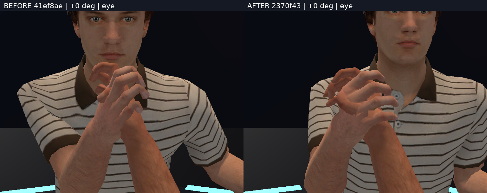
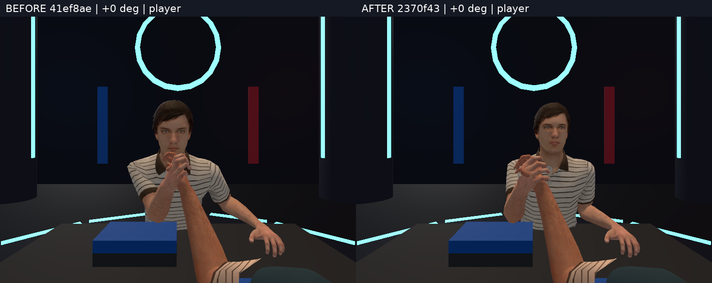
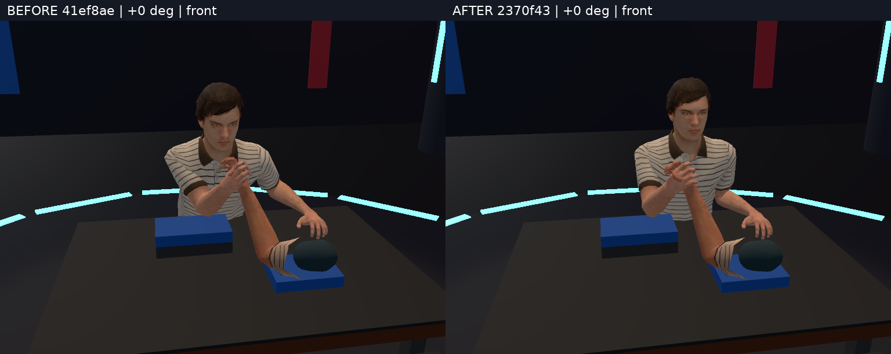
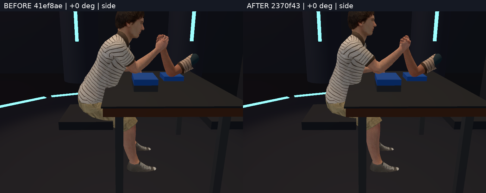
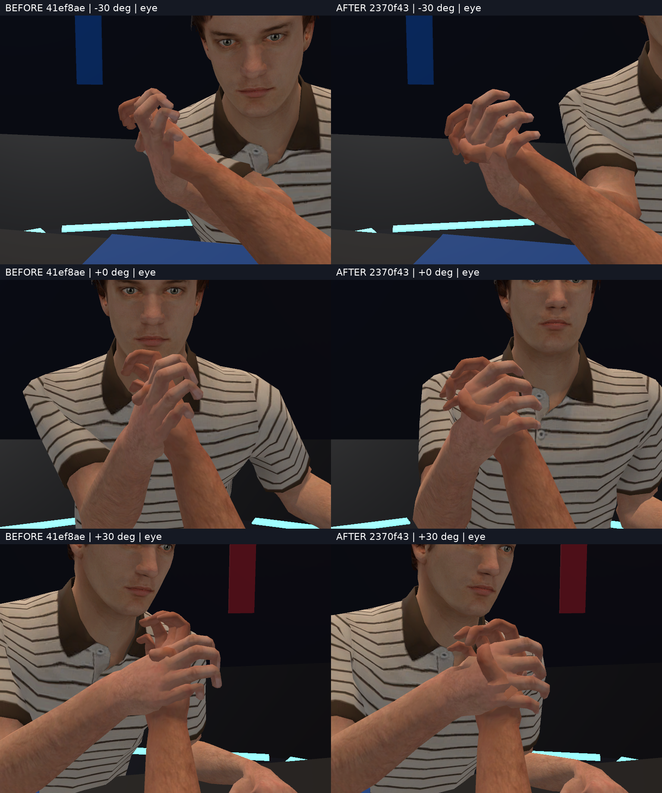
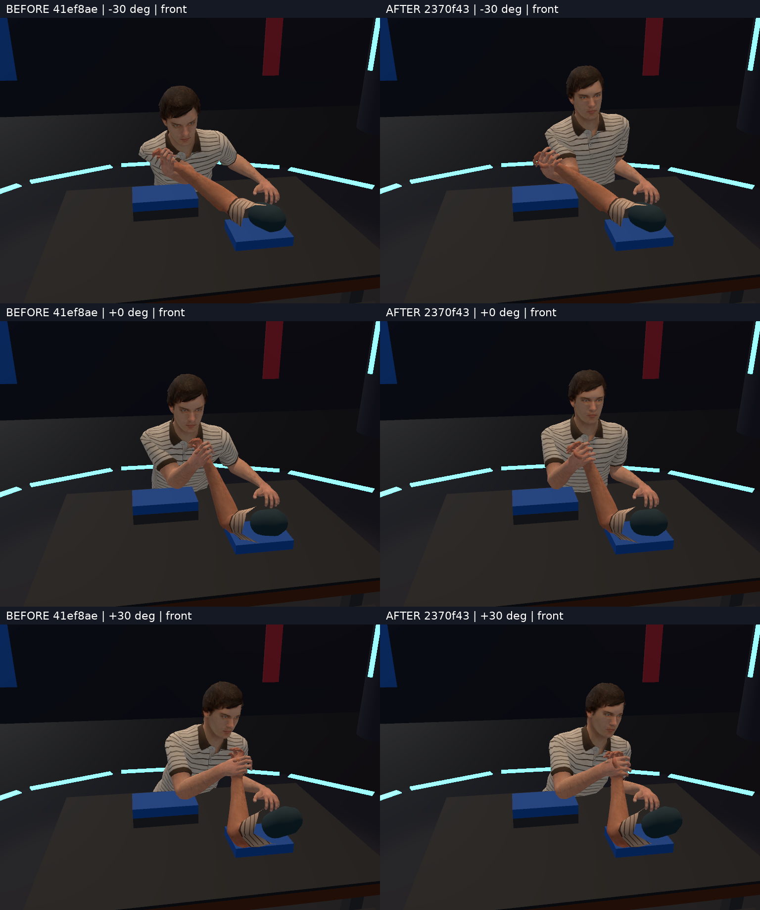
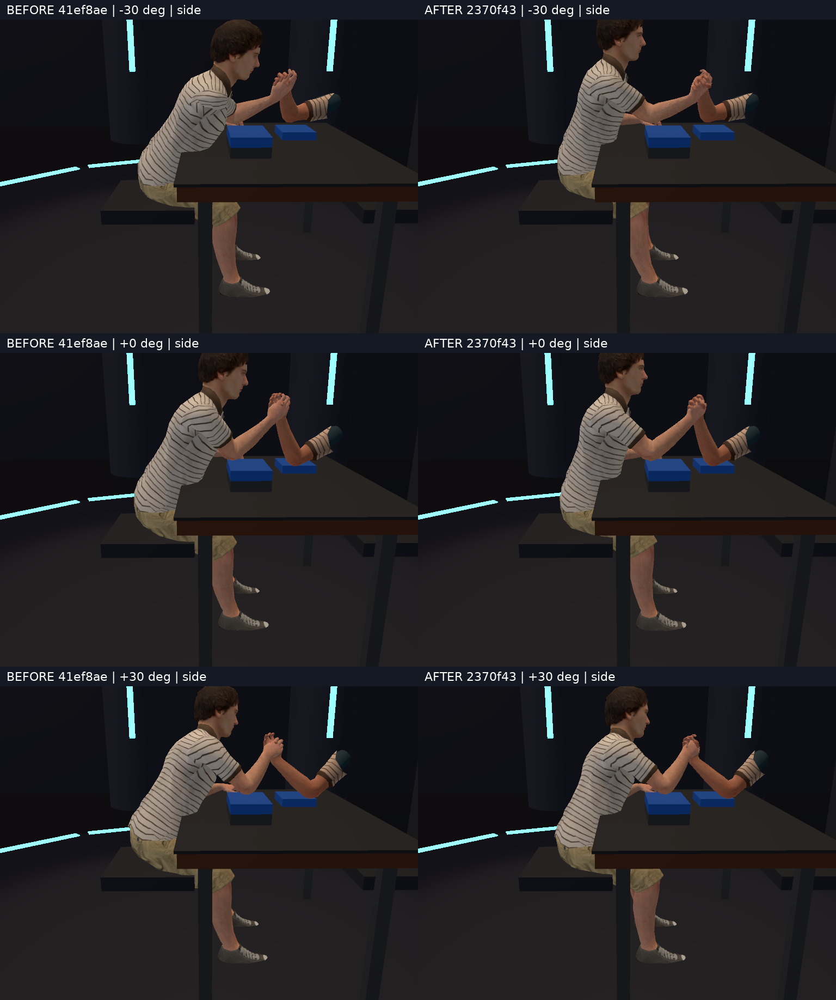
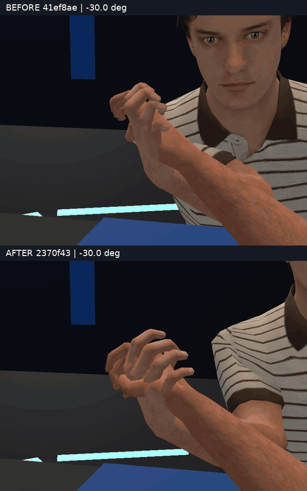
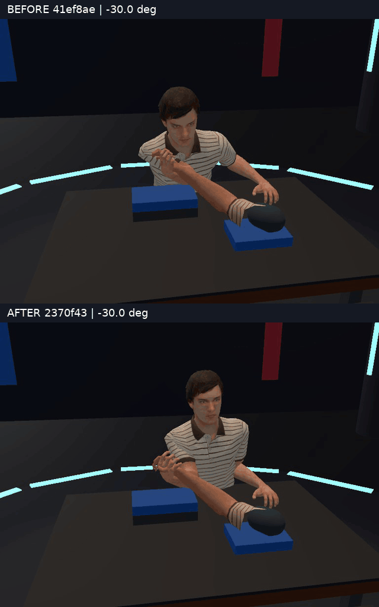
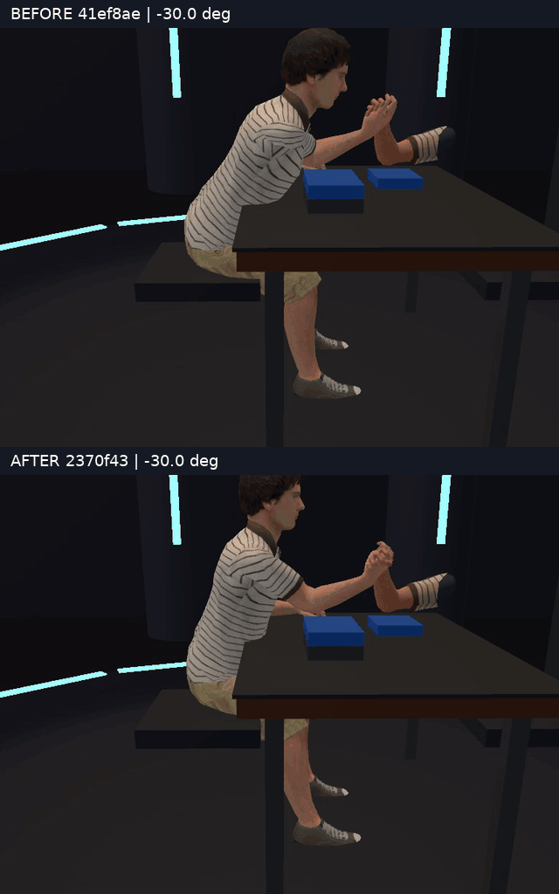

# P2-C 可直接查看的 Unity 画面

PNG **左 Before／右 After**，GIF **上 Before／下 After**。保留每个镜头的完整原画幅，没有为某个模式单独移动机位、局部遮挡或修掉穿模。图注放在画幅外。点击图片可以放大。

本页公开的是已有真实 Editor 采集；本次只整理与压缩，没有修改动画参数或新增一轮 Editor／头显测试。**虎口与拇指根部仍有穿插，自然握持未通过验收。** 正面可见人物侧移，侧面可见臀部、椅面、肩、肘与脚的位置，供独立判断坐姿；不能仅凭代理数据评价。

## 版本、采集与许可

| 项目 | Before | After |
| --- | --- | --- |
| 行为版本 | `41ef8ae` 首轮 P2-C | `2370f43` 修订 P2-C |
| 实际采集代码 | `2370f43`，以 LegacyContactGrip 恢复旧行为重采 | `2370f43`，ContactGrip |
| 本机采集目录 | `.p0-local/p2c-contact/20261119-145142/legacy/` | `.p0-local/p2c-contact/20261119-151827/contact/` |
| 模型 | Microsoft Rocketbox Male_Adult_01，双方同模型 | 同左 |

运行等级：Unity 中国版 **2022.3.62f3c1、Windows Direct3D11、ArmWrestlingMain Editor Play**。源序列各 181 帧／30 Hz，两个模式的机械角、Grip Anchor XYZ 和动画片段相位一致。采集后到发布前只有 AGENTS 证据规范变动，运行实现没有变化。不是 PICO／PCVR／实物或 UDP 验证。

相机口径：`eye/e` 为玩家眼点朝共同握点的 26° 特写，随握点转向；`player` 为原 Camera.main 视野。`front/wide-front` 固定在装置坐标 (−0.28, 0.82, −1.42)，看向 (0, 0.18, 0.34)；`side/wide-side` 固定在 (−1.98, 0.43, 0.35)，看向 (−0.07, −0.15, 0.33)，两者均 43°。两种模式使用相同相机代码。

人物、玩家裁切右臂及材质来自 Microsoft Rocketbox，**Copyright (c) 2020 Microsoft，MIT**。[完整随附许可](ROCKETBOX-LICENSE.txt) · [上游固定版本](https://github.com/microsoft/Microsoft-Rocketbox/tree/0943055db6ec570bcef9f2c8b41c9e5467c808f9/Assets/Avatars/Adults/Male_Adult_01)。桌椅、灯光和纯色环境为工程原创。采集关闭 HUD、指针和 Skybox，未显示本机 Ch03、其衍生模型、HDRI 或许可未确认字体。新增英文图注采用 DejaVu Sans，[图注字体许可](DEJAVU-LICENSE.txt)随附；没有上传字体文件。

## 零位同镜头对照

第一人称双手近景（同玩家眼点，26° 特写镜头）：

正常玩家第一人称画幅：

正面：

完整侧面，检查臀部与椅面及肘垫支撑：

## −30°／0°／+30°

每张图从上到下分别为 −30°、0°、+30°，每行左旧右新。正面桌板会遮住髋部，侧面用于检查完整坐姿；这是真实遮挡，没有裁掉下半身。

## 连续运动

每段为同一 −30° → 0° → +30° → 0° → −30° 往返，循环播放。由真实源帧抽样，不插帧、不补绘。仅缩放与调色板压缩，PNG 保留原 RGB。GIF 不代表实际运行帧率或每帧动态碰撞响应：当前接触姿态通常构建后缓存，随共同握点回放。

| GIF | 画幅 | 时长／帧率 | 文件大小 |
| --- | --- | --- | --- |
| 双手近景 | 640×1024，每侧完整 640×480 | 6 秒／8 fps | 7.61 MiB |
| 身体正面 | 同上 | 6 秒／10 fps | 2.36 MiB |
| 身体完整侧面 | 同上 | 6 秒／10 fps | 3.24 MiB |

## 复现与记录

[manifest.json](manifest.json) 记录相机、角度、布局、时长、文件字节数和 SHA256，以及源关键帧摘要。角度关键帧对应源 frame 0／45／90；完整侧视保留椅面和脚，不作局部美化。

有本机原采集目录时运行 `python tools/build_p2c_visual_evidence.py`，需要 Pillow、ffmpeg 和带许可证的 DejaVu Sans（默认查找 Matplotlib 附带版本，也可指定 `--font`）。使用 [FFmpeg palettegen／paletteuse](https://ffmpeg.org/ffmpeg-filters.html#paletteuse) 压缩；脚本检查帧数、总时长和 <8 MiB 限制。高清 MP4、全部源帧、完整 CSV 和受限人物证据仍留本机。

本次检查解码了所有 GIF 帧，查看零位和运动关键帧，并核对左右／上下模式与源序列。完整运行数据与未解决问题见[结果文档](../../P2C-physical-interaction-result.md)。
