# P2-D 接触目标修订：真实 Editor 对照

**PNG 左旧右新；GIF 上旧下新。** Before 用保留的 `LegacyHumanoidGrip` 在本轮重录首轮 P2-D `246f017` 行为，After 是 `35d6256` 表面目标路径。两者同一 MIT Rocketbox、相机、角度和 Clip 进度，均为实际 Unity `2022.3.62f3c1 / Direct3D11 / Editor Play`。

四指较首轮明显收拢，并朝对方掌背区域包握；仍能看到局部交错、悬指和不完整的拇指贴合。**不是自然握姿全部通过**，也不把骨骼目标到达当作皮肤无穿模。详细测量、代价及模型切换见 [结果](../../P2D-contact-targets-revision.md)。

## 零位

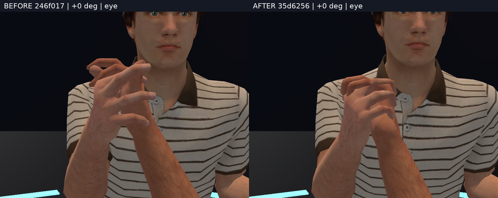

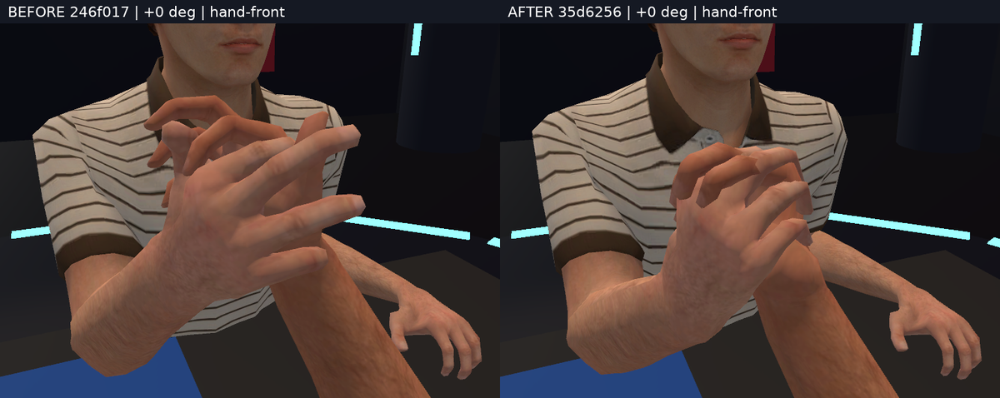

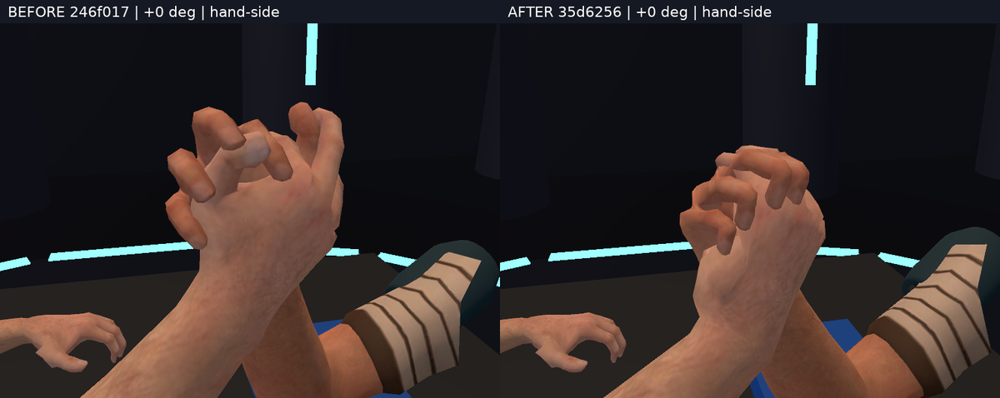

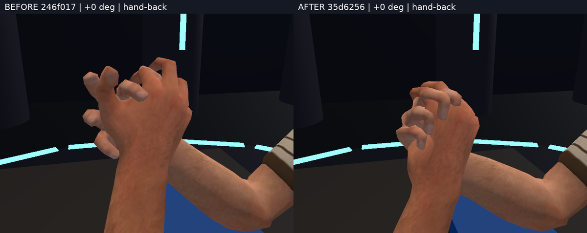

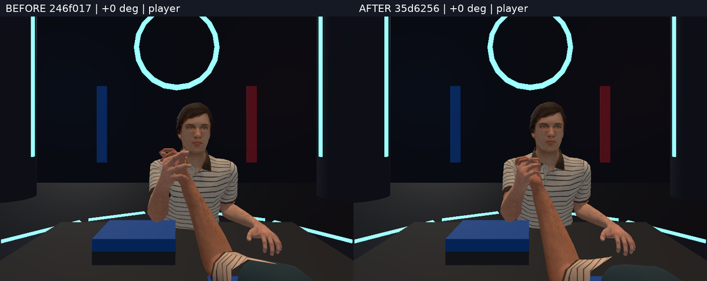

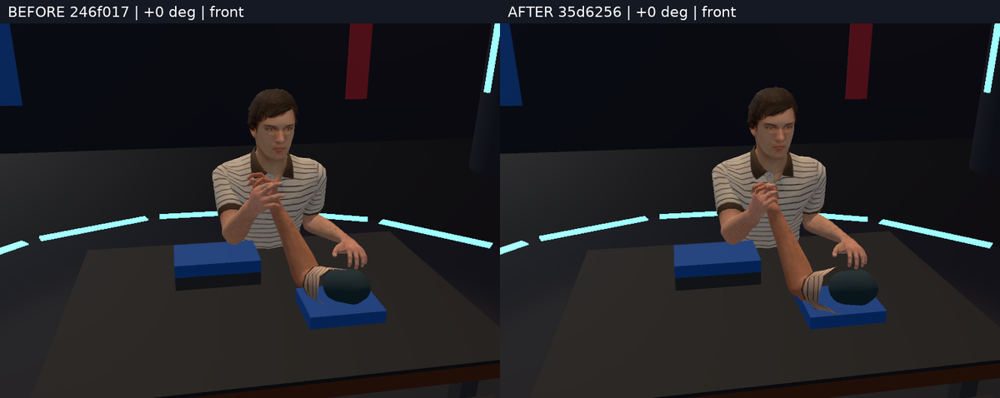

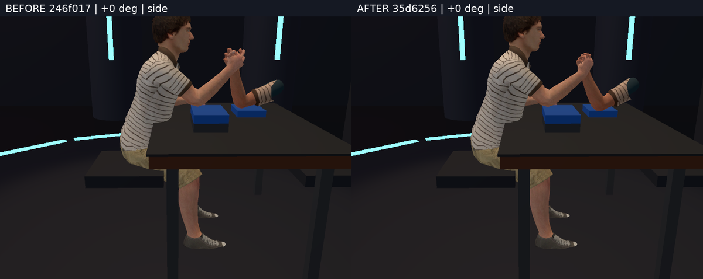

## 三角度与连续运动

每组三行是 −30° / 0° / +30°，完整画面缩小排版，没有裁掉接触/穿插区域。

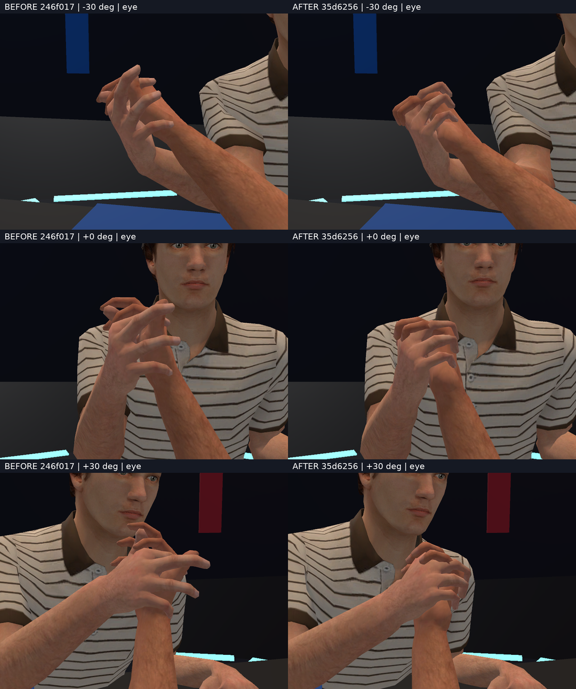

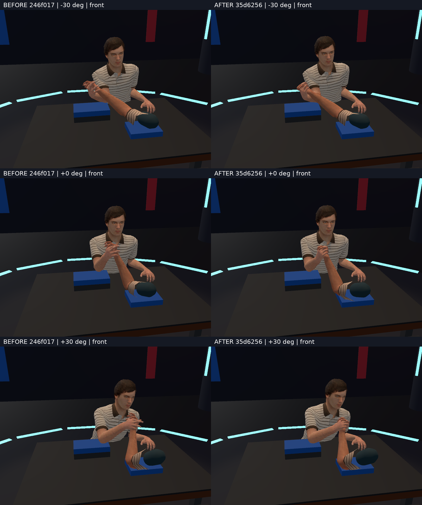

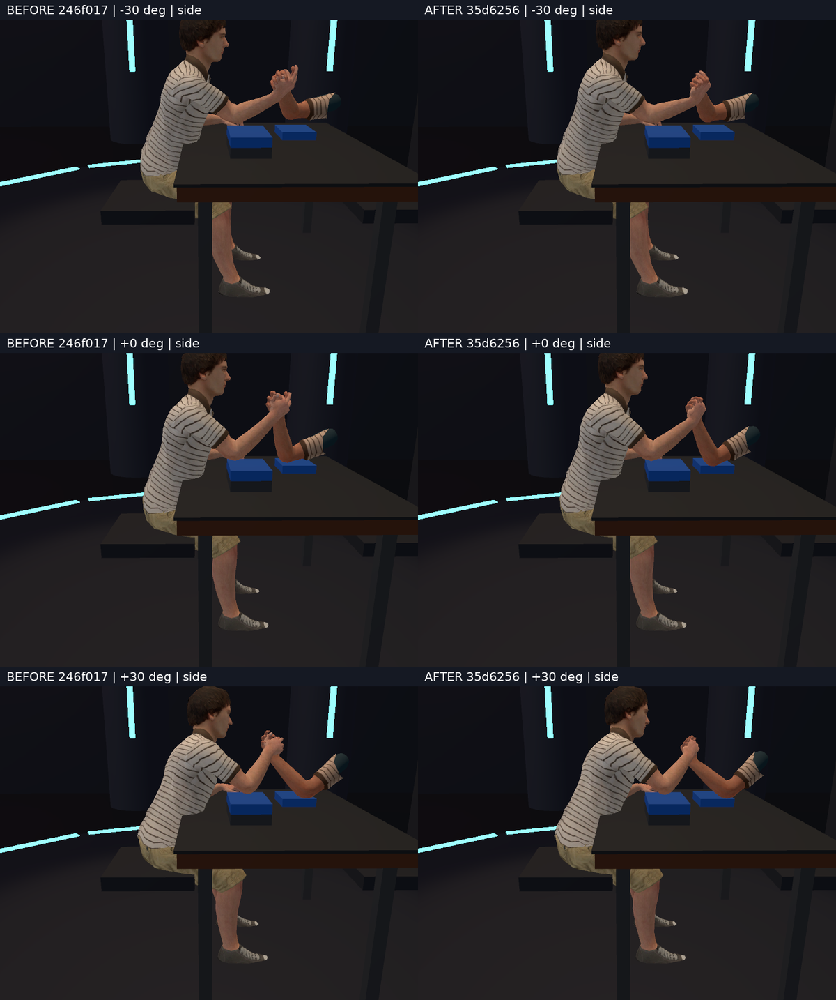

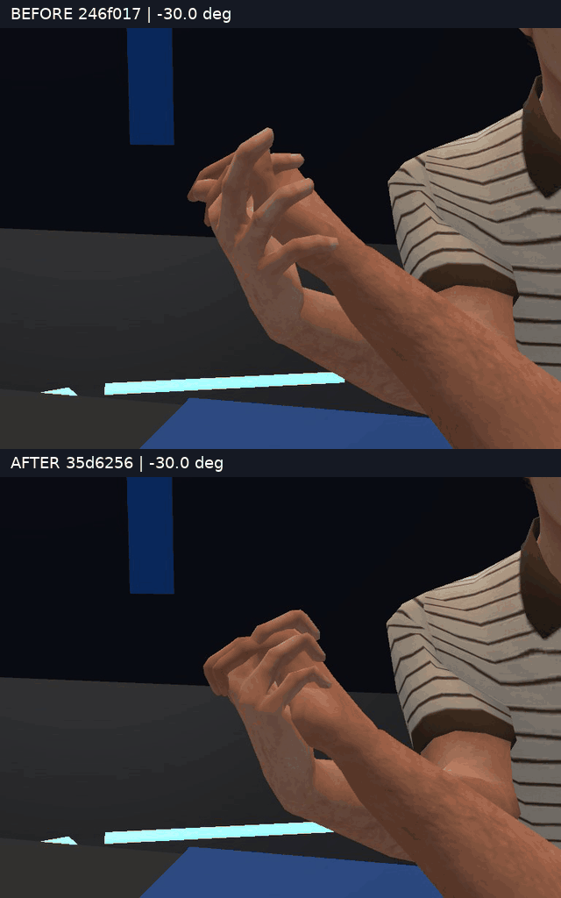

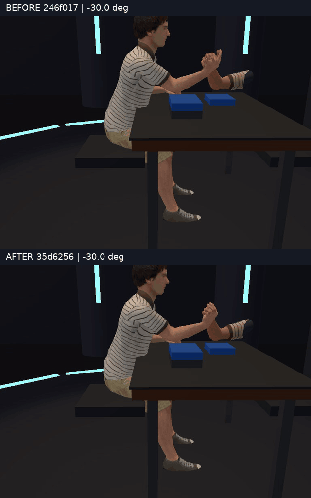

## 可编辑接触标记

以下是实际 Editor 两手预览的诊断覆盖图。青色是玩家目标，绿色是对手目标，包含掌部基准、虎口和五指接触位置。覆盖点按相机投影显示在蒙皮上方，**不做遮挡剔除**，以便查看掌内目标；它们不出现在上面的主场景截图/GIF 中。

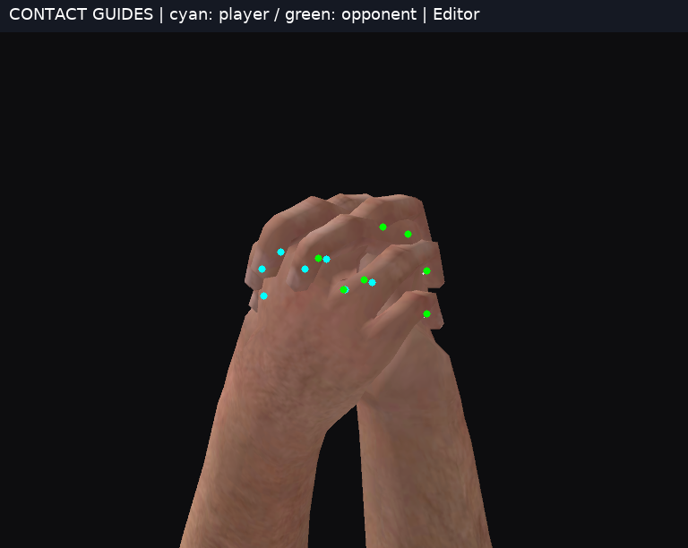

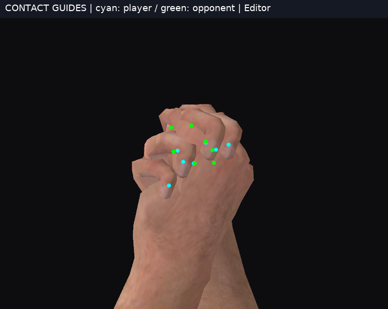

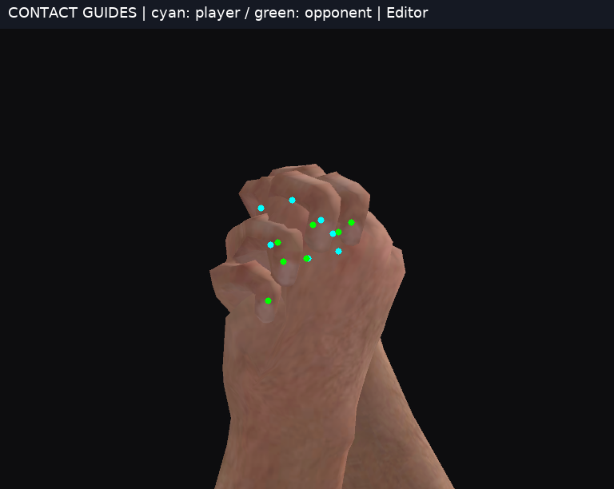

在 Unity 菜单 **扳手腕 → P2-D → Open Surface Contact Preview** 选择标记并拖动，重建/保存后同一资产直接用于主场景；在预览和主场景选择 Avatar Profile 可切换模型，无须改 C#。

## 证据边界

- 仅公开 Microsoft Rocketbox MIT 人物和原创场景；保留 [Microsoft MIT 许可](ROCKETBOX-LICENSE.txt)与标签的 [DejaVu 字体许可](DEJAVU-LICENSE.txt)。无 Ch03、其派生网格、未授权 HDRI/字体或参考照片。
- Ch03 第二骨架同一目标资产完成相同 181 帧与比赛；最终证据只在本机 `.p0-local/p2d-cross-avatar/20261119-215715/cross-local/`。它能复用，但掌根相交和肘垫穿入比 Rocketbox 更明显，不能等同于视觉验收通过。
- 11 项 Editor 模式/回退完成比赛流程、运行错误 0；没有 PICO、PCVR、真实机械或 UDP/STM32 验证。
- Rocketbox 零位掌心骨代理距 `55.78 → 49.61 mm`，手腕最大折角从约 22° 增至约 34°，碰撞代理峰值也升高；这些负面代价没有从画面中隐藏。实际皮肤粗采样、指腹代理、接触凸包是不同指标。
- [manifest.json](manifest.json)记录行为/运行时代码、原始路径及散列、相机、帧数、时长和体积。PNG <1 MiB，GIF 约六秒、8～10 fps、每个 <8 MiB。仅做缩放、标签、排版及调色板压缩，未合成中间姿态。
- [首轮 P2-D 画廊](../p2d-visual/README.md)与 [P2-C 画廊](../p2c-visual/README.md)保留，原始帧和录像继续留本机。
