# P2-D 有界约束实验：实际默认与未选候选

2026-11-20，真实 Unity `2022.3.62f3c1` Editor Play / Direct3D11 / `ArmWrestlingMain`。**本轮自然扣握仍未通过，按停止条件恢复较稳的通用 Humanoid 默认。** After 是选定回退，不表示收指更紧或握姿已经合格。

Before：上轮 `f21a3df` 表面目标模式，本轮用相同采集工具重录。After：`c64f27f` 的 `LegacyHumanoidGrip`（`Use Humanoid Grip=true`，`Use Grip Surface Targets=false`）。两者仍使用同一机械 Grip Anchor、人物、场景、相机和输入；181 帧中的角度、握点 XYZ、Animator normalized time 逐项一致。图片左旧右选定，GIF 上旧下选定。另列有界候选，避免把失败实验藏在回退对照之后。

只发布 Microsoft Rocketbox `Male_Adult_01` 和原创场景的实际画面。Ch03、混合角色画面及高清原件继续本机保留。见 [Microsoft MIT](ROCKETBOX-LICENSE.txt)、[DejaVu 字体许可](DEJAVU-LICENSE.txt)、[源帧 SHA-256 与模式清单](manifest.json)、[测试、约束与运行说明](../../P2D-joint-constraints-result.md)。旧画廊未覆盖。

## 零位：Before / 选定默认

第一人称近景：旧模式四指更紧，但腕折和交叠更大；选定默认较松，拇指与四指仍不能称为自然扣握。

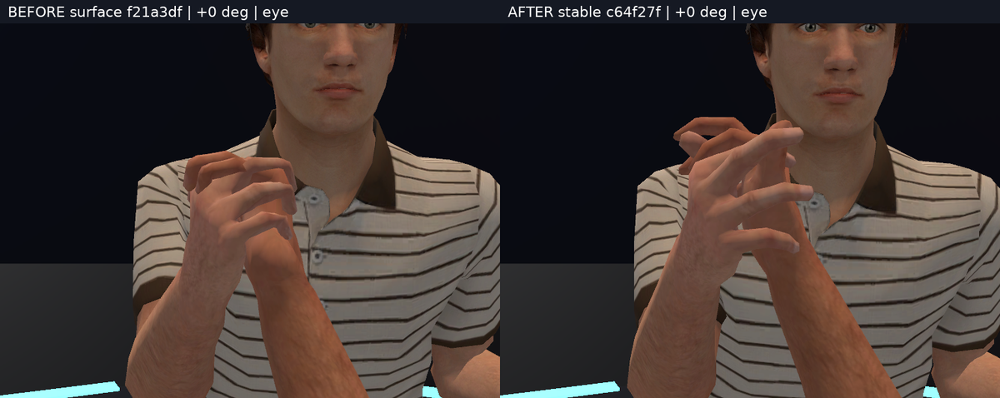

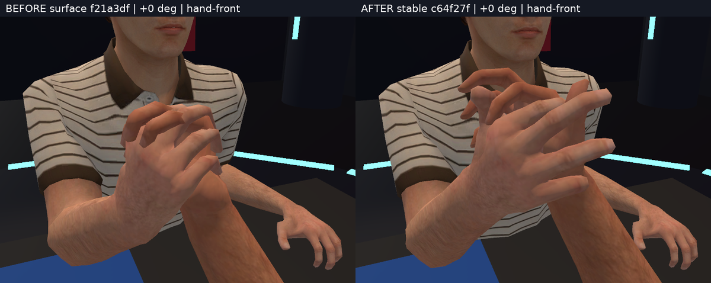

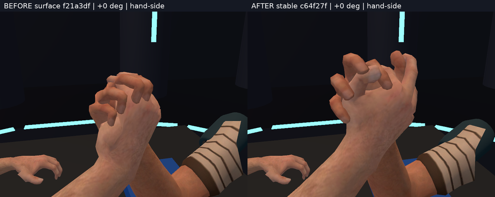

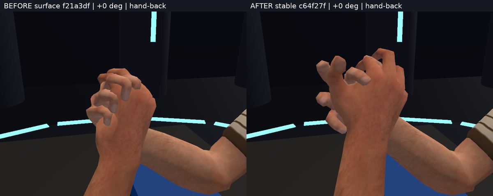

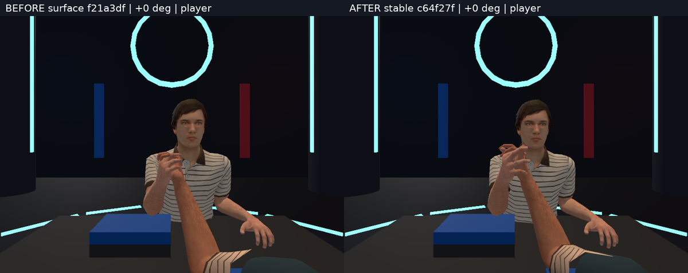

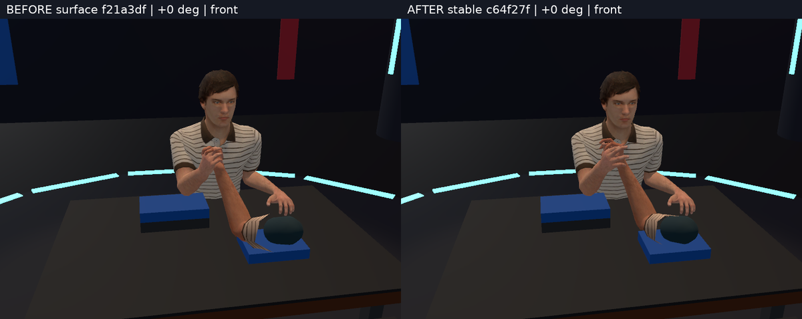

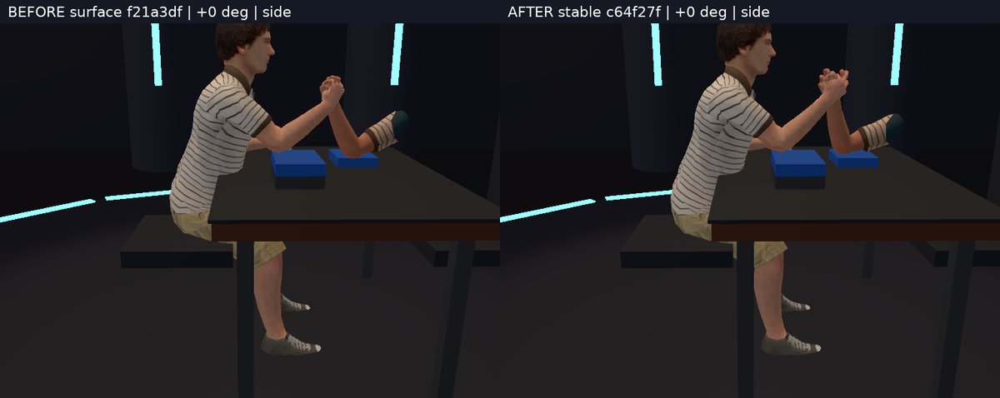

## −30° / 0° / +30°

每张从上到下三个角度，左旧右选定。局部包握、胸臂、肘垫问题仍应由这些真实画面判断，代理数字不能替代皮肤无穿模验证。

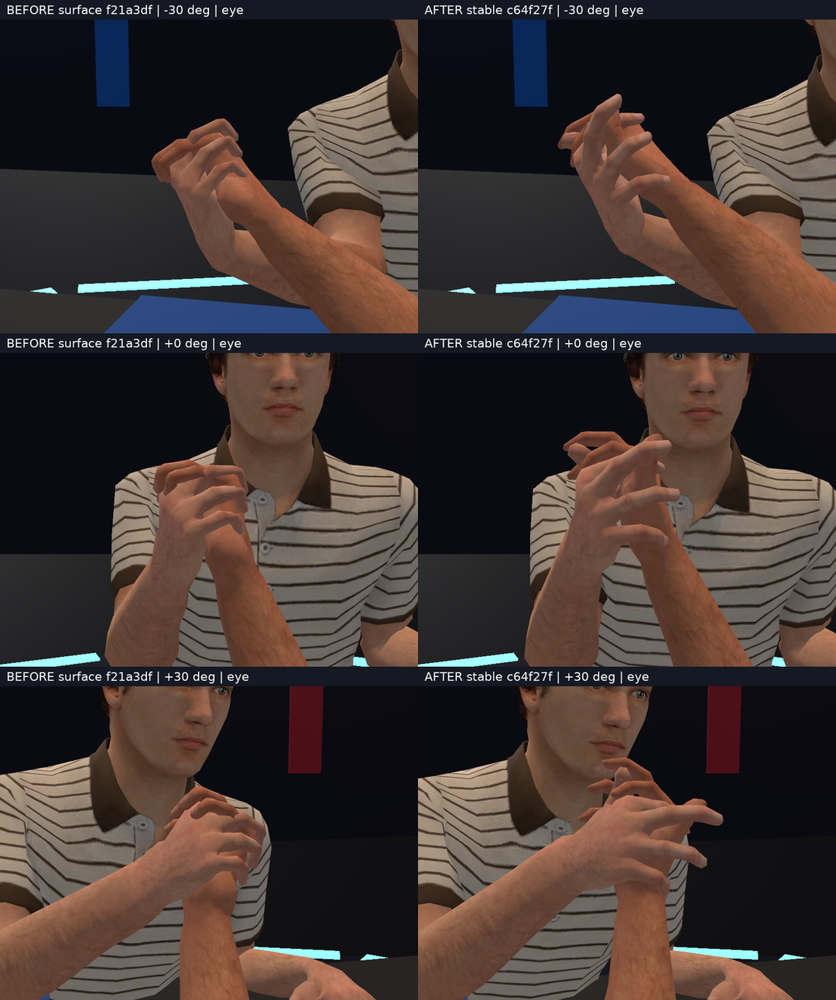

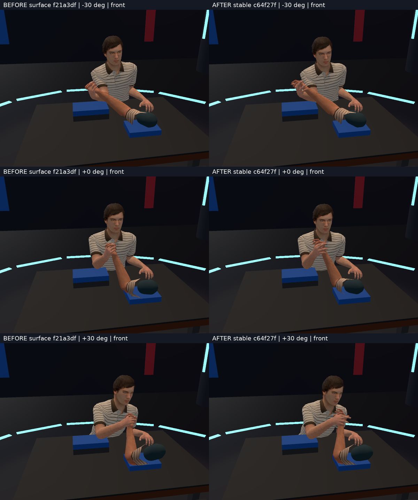

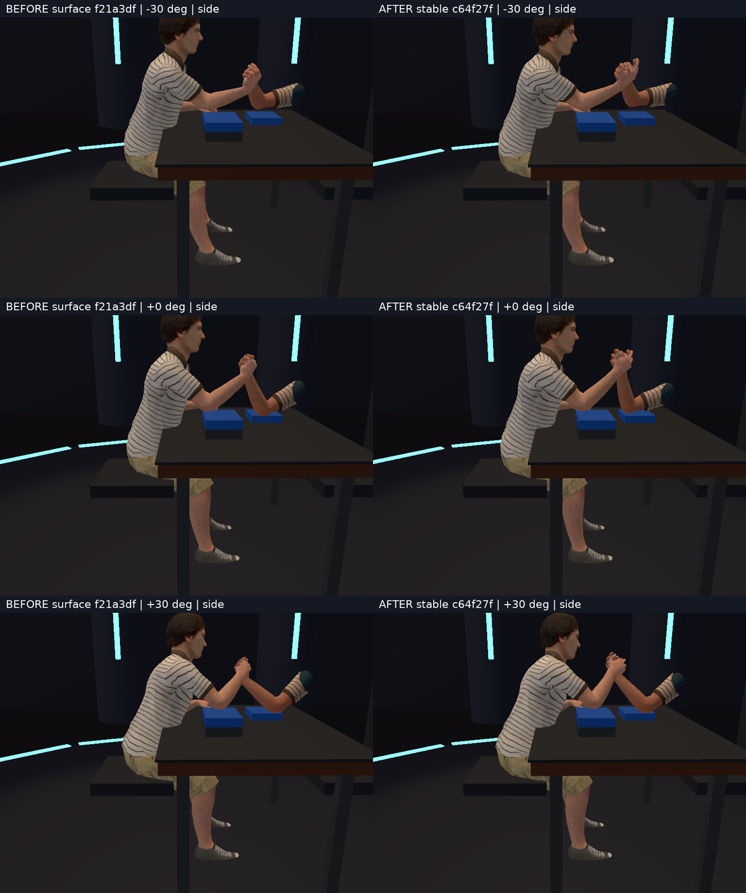

## 六秒连续往返

上下同步播放同一 −30° → +30° → −30° 输入，手部 8 fps / 6.01 秒、身体 10 fps / 6 秒，原相机视野不裁切。这里是离线 Editor 运动，不是头显帧率或真实机械演示。

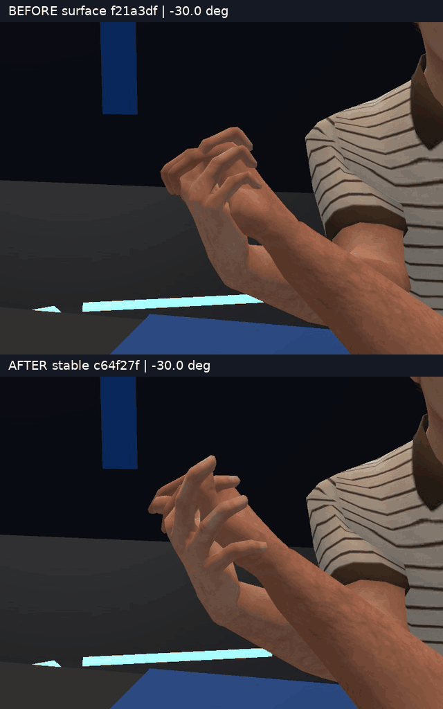

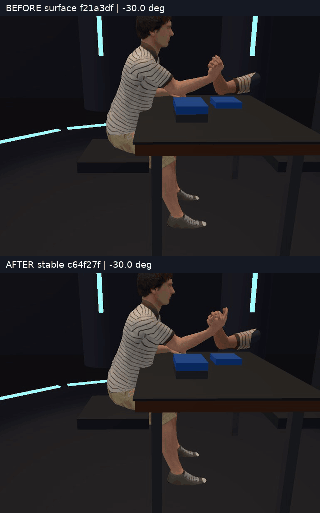

## 本轮有界候选：未选为默认

三处掌部配准、Avatar 姿态关节弧及局部碰撞硬门已经接入主场景并实际运行。候选允许接触残差，未为追指腹目标增加自由末节扭转。但下图仍有钩形、拇指接触不合理和指间交叠，因此不替换默认。它没有证明自然握姿完成，也不是完整解剖学求解器。

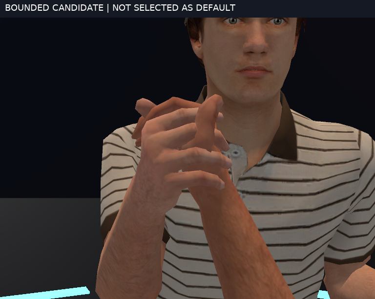

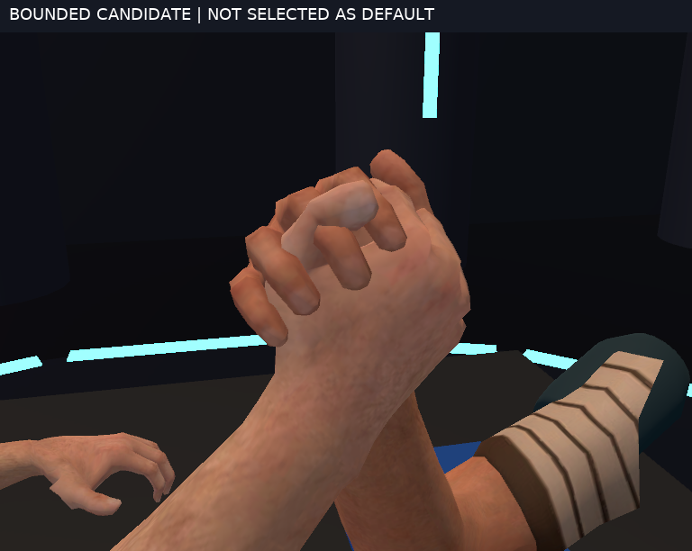

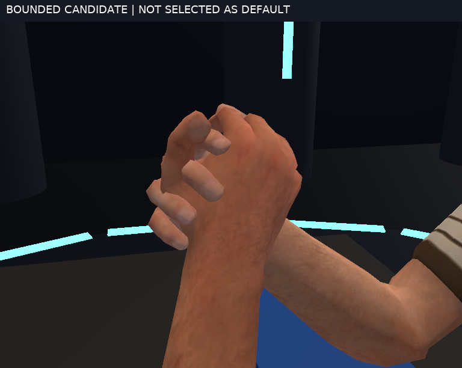

## 实际判断与剩余限制

- Rocketbox 最大对手/玩家腕折角由旧模式约 34°/34° 恢复到约 22°/22°；选定默认的根部凸包代理约 1 mm，但四指偏松。候选手部代理峰值约 10.13 mm，高于选定默认 3.64 mm。
- Ch03 亦实际扫角和比赛测试，选定默认腕折约 29°/17°，仍有皮肤交叠；局部肘下缘采样仍约穿垫 12–16 mm。其画面不公开；不能把运行通过当作跨人物视觉通过。
- 本轮默认 Rocketbox、Ch03、混合人物，候选 Rocketbox，P2-C 与胶囊共六种 Editor 比赛回归均 PASS、运行错误 0。候选与默认的三组人物另均采集了 181 帧运动。
- 没有验证 PICO、PCVR、真实机械或 UDP 联调。后续需要先制作关节可行的成对美术握姿端点，再复用现有通用适配；本轮不再搜索权重或放宽穿模阈值。

## 原始证据与处理

源码提交 `c64f27f`；准确完整 SHA、源帧路径及哈希见 manifest。Before `.p0-local/p2d-cross-avatar/20261120-101803/cross/`；After `20261120-101619/cross/`；候选 `20261120-101429/cross/`。输入帧为实际截图，处理仅拼接、缩放、标签、GIF 调色板与压缩，没有修改人物像素来隐藏问题。13 张 PNG 均小于 1 MiB，两段 GIF 均小于 8 MiB。

本机根目录：`E:\桌面\研究生\实验室\人机交互课程\实物大作业\code\armwrestling-vr`。复现公开画廊：

```powershell
python tools/build_p2d_visual_evidence.py --before .p0-local/p2d-cross-avatar/20261120-101803/cross --after .p0-local/p2d-cross-avatar/20261120-101619/cross --candidate .p0-local/p2d-cross-avatar/20261120-101429/cross --source-ref c64f27f --before-route cross --before-ref f21a3dff8388225e1773dfe8ee444829ef70d09b --before-label "BEFORE surface f21a3df" --after-label "AFTER stable c64f27f" --output docs/validation/p2d-joint-constraints --no-front-motion
```
