# P2-D 实际 Unity 画面

**左 Before / 右 After；GIF 上 Before / 下 After。** 本轮已实现两套骨架通过配置切换并接入主场景，但**自然扣握仍未通过视觉验收**。拇指横穿掌背的旧形态有所缓解，四指仍松散、像抓腕，存在局部交错；请直接看图，不能从碰撞代理数字推断网格没有穿模。

Before 是 P2-C `2370f43` 的最终 ContactGrip；After 是 P2-D 运行时代码 [`cd51b15`](https://github.com/Ihtbfas/armwrestling-vr/commit/cd51b15626a09ff843d97aefe61a9276877d7ede)。两边都是 **真实 Unity Editor Play / 2022.3.62f3c1 / Windows Direct3D11**，不是生成图、示意图或头显录像。角度、Grip Anchor 和片段进度匹配，沿用相同相机设置，没有裁掉穿插区域。只有缩放、排版、文字标注和 GIF 调色板压缩。

## 零位同镜头

第一人称双手近景：

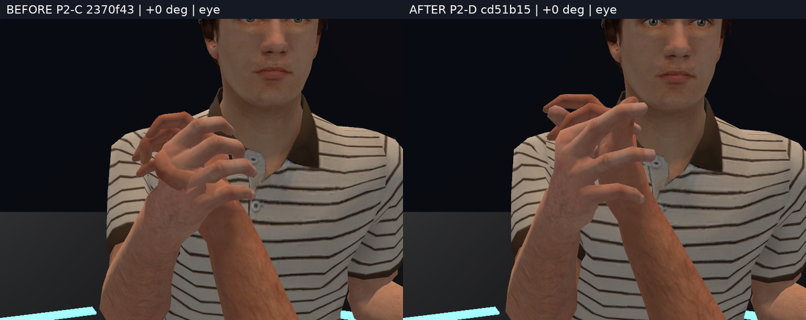

斜正面和侧面近景，检查虎口、拇指根、指腹和腕部：

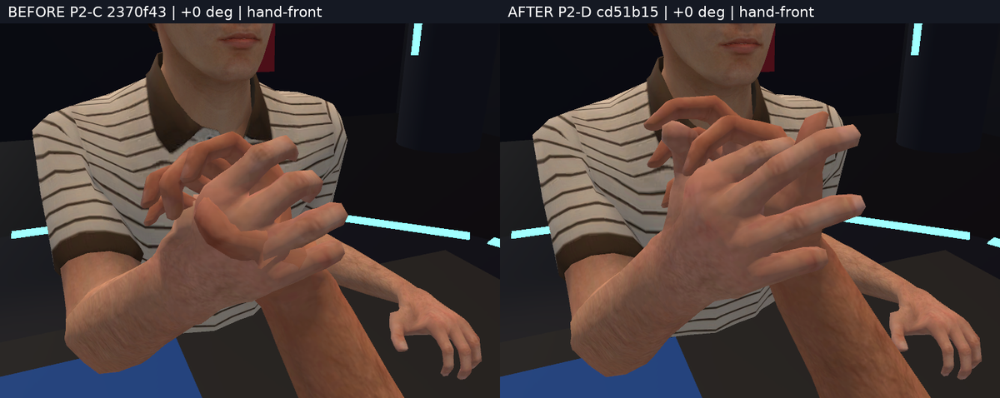

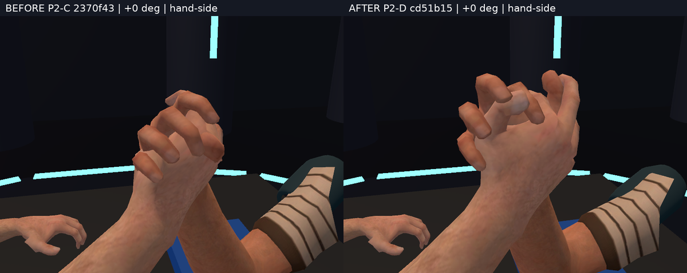

完整坐姿正侧视：

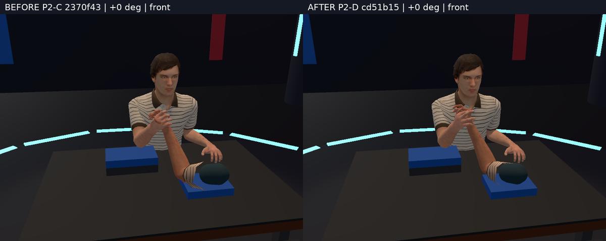

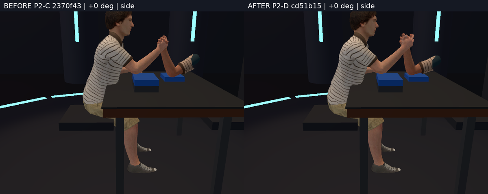

第一人称正常视场：

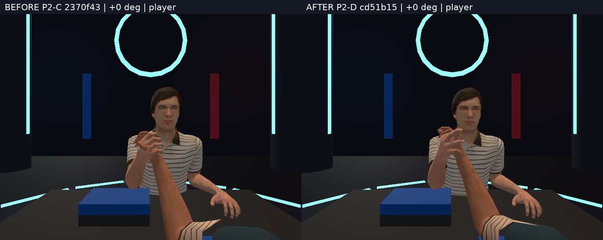

## −30°、0°、+30°

每组三行依次 −30° / 0° / +30°。原始单帧及测量在本机，以下缩小拼版用于 GitHub 查看。

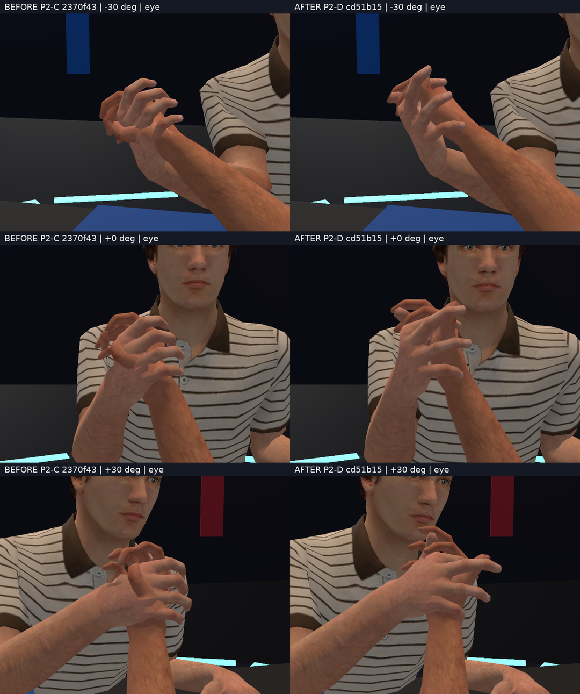

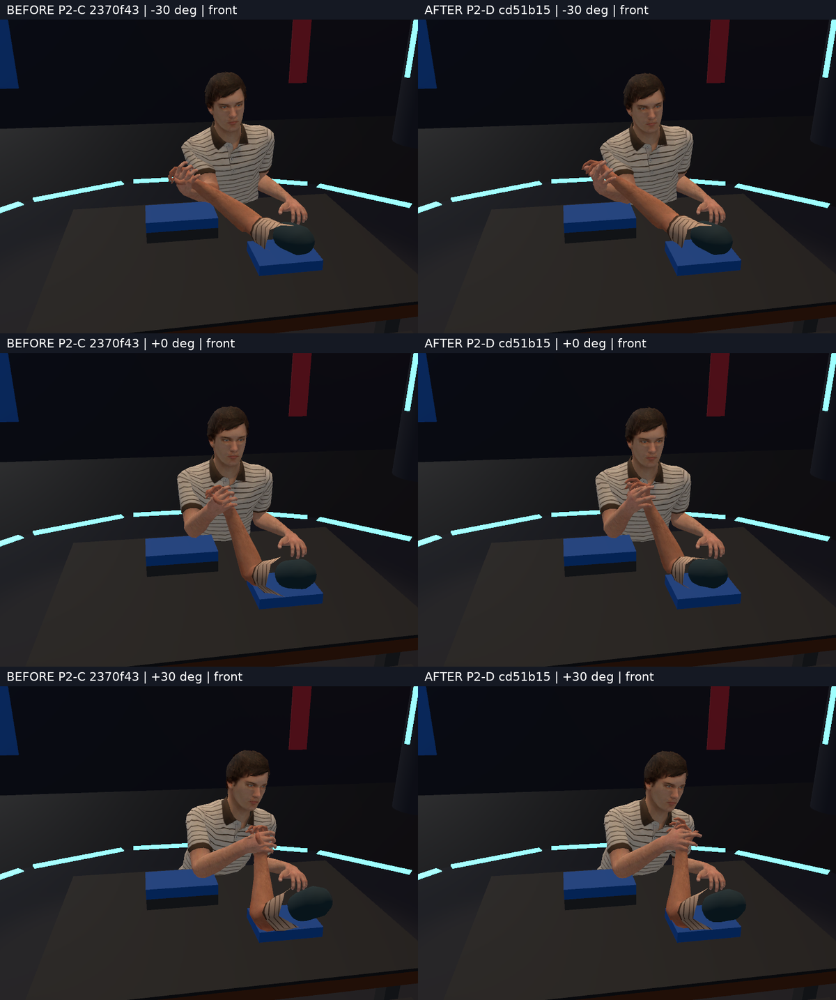

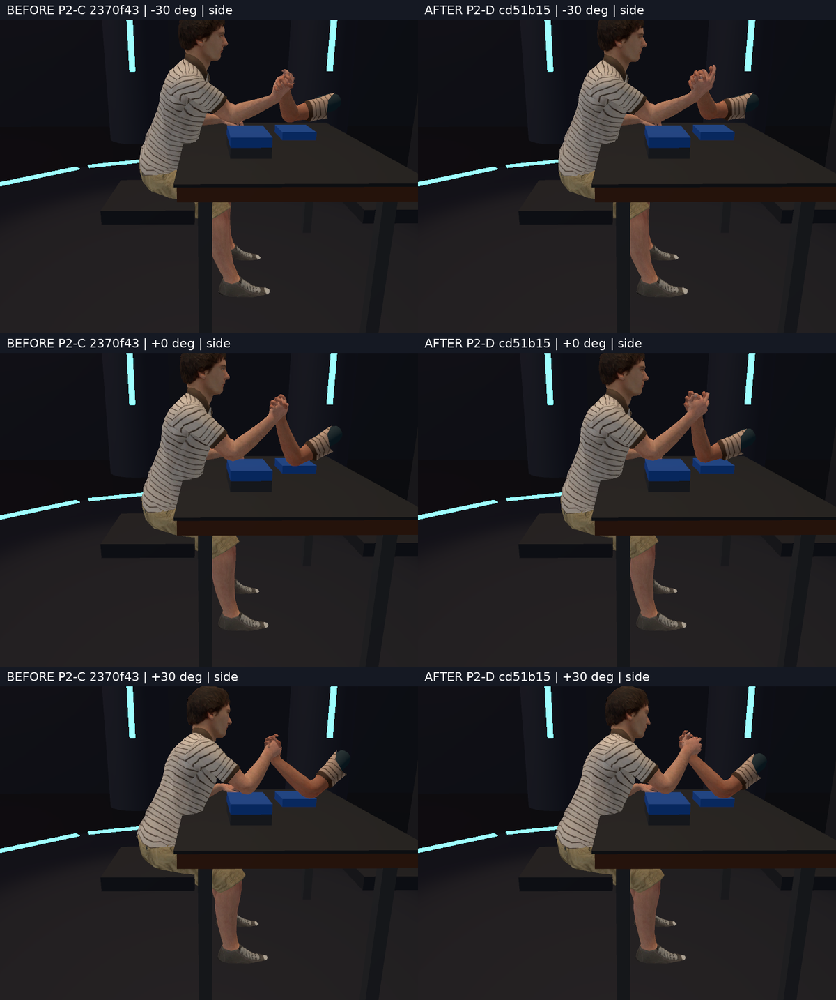

## 六秒连续往返

约 6 秒、8～10 fps，从原始 30 Hz 真实采样抽帧；没有生成中间动作。每个画面宽 640 px，完整原帧上下排，单 GIF 小于 8 MiB。

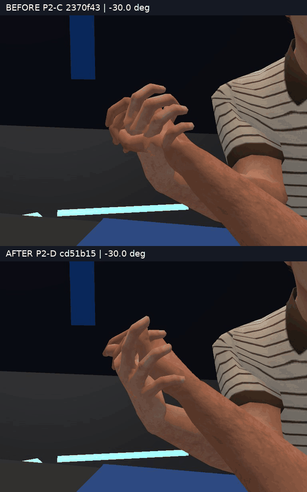

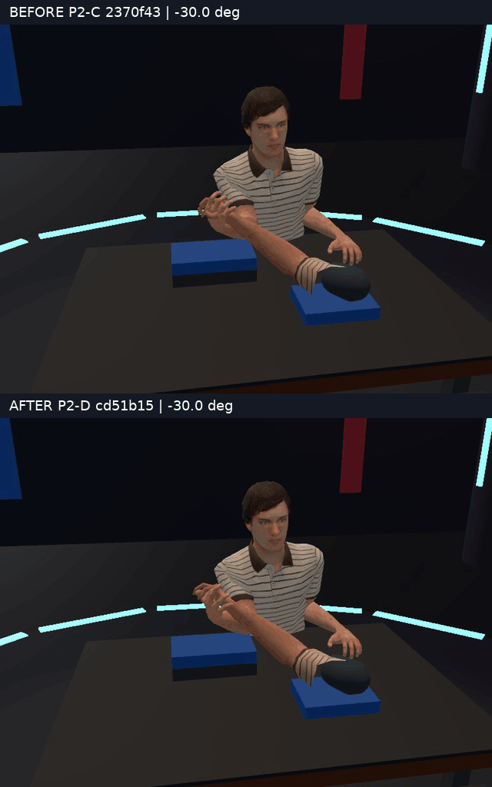

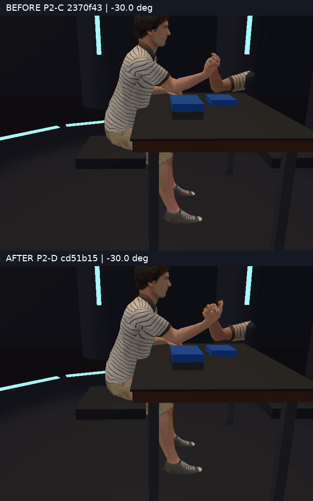

## 来源、许可和保留问题

- 公开画面中双方均为仓库现有 **Microsoft Rocketbox Male_Adult_01**、原创桌椅和纯色背景；保留 [Microsoft / MIT 许可](ROCKETBOX-LICENSE.txt)。标签使用 DejaVu Sans，保留 [字体许可](DEJAVU-LICENSE.txt)。无 Ch03、私有裁切网格、未授权 HDRI 或字体画面。
- 第二套真正不同骨架是本机 Ch03，双方均完成相同 181 帧扫描和比赛回归，另有混合人物零位/比赛；由于其公开授权未确认，**这里不上传 Ch03 对照图**。本机位置及骨架差异见 [P2-D 结果](../../P2D-cross-avatar-grip-result.md)。
- 相比 Before，After 两手的掌心骨代理间距由约 35.8 mm 变为约 55.8 mm。这是当前表面/尺寸适配的结果，**不是把两手拉开就算握姿改善**；四指贴合仍不足，不能视为理想配对姿态。掌部/手指代理、蒙皮采样和画面结论分开报告。
- 对手腕跟随保持，但 Rocketbox 在负角端有胸臂代理相交，肘表面采样部分穿垫；Ch03 有部分悬空。没有新增机械参数，也没有 PICO/PCVR/真实装置验证。
- [manifest.json](manifest.json) 记录运行时代码、原始路径/关键帧散列、角度/相机、GIF 帧数/时长、输出大小和散列。高分辨率原始序列继续在本机 `.p0-local/`；旧 [P2-C 画廊](../p2c-visual/README.md)保持不变。

复现发布：`python tools/build_p2d_visual_evidence.py --before <P2-C/contact> --after <P2-D/cross> --source-ref <运行时代码 SHA>`。脚本只接受两个公开采集路线名，拒绝 `cross-local` / `cross-mixed-local`；发布前仍需人工确认画面素材许可。
