# P2-E 美术握姿实拍对照

Unity 2022.3.62f3c1、Windows Direct3D11、真实 `ArmWrestlingMain` Editor Play。Before 是稳定 P2-D，After 是可选 P2-E Contest。PNG 左旧右新，GIF 上旧下新。两边使用相同人物、镜头、机械输入及动画相位。画面由原帧拼接、缩放、标注和压缩。

只发布 MIT Microsoft Rocketbox 和原创场景的画面。[Microsoft MIT](ROCKETBOX-LICENSE.txt) · [DejaVu](DEJAVU-LICENSE.txt) · [版本、输入和源帧哈希](manifest.json) · [本轮结果与编辑方法](../../P2E-authored-grip-result.md)

## 零位与两组端点

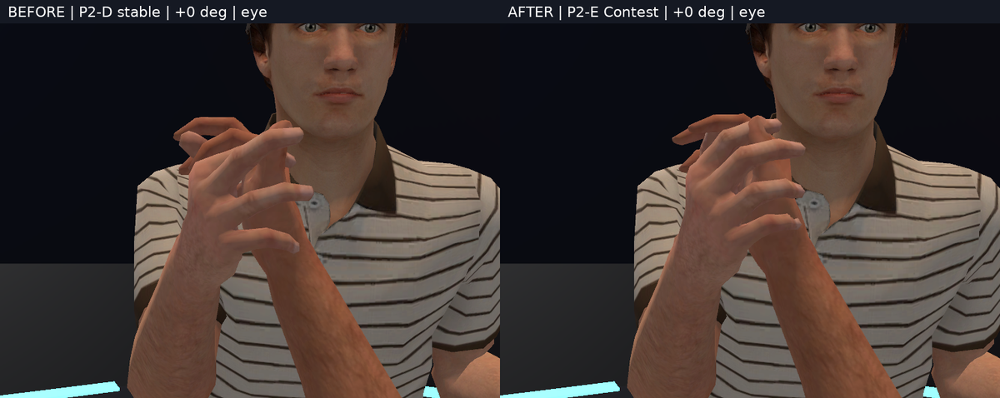

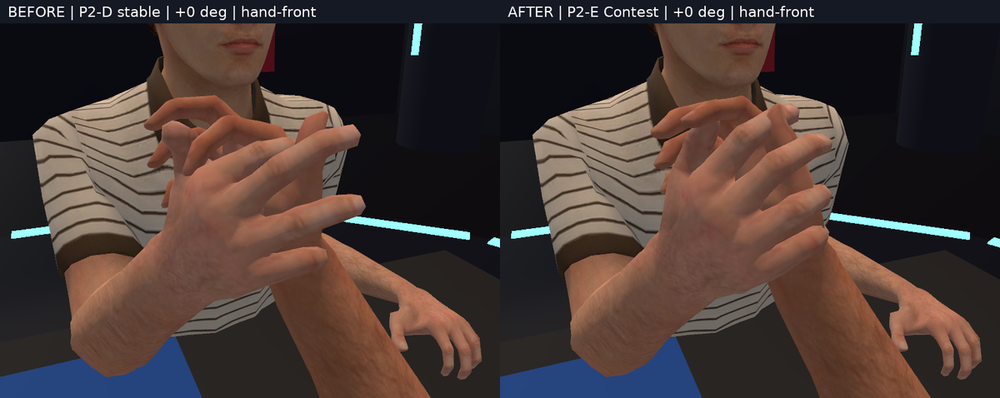

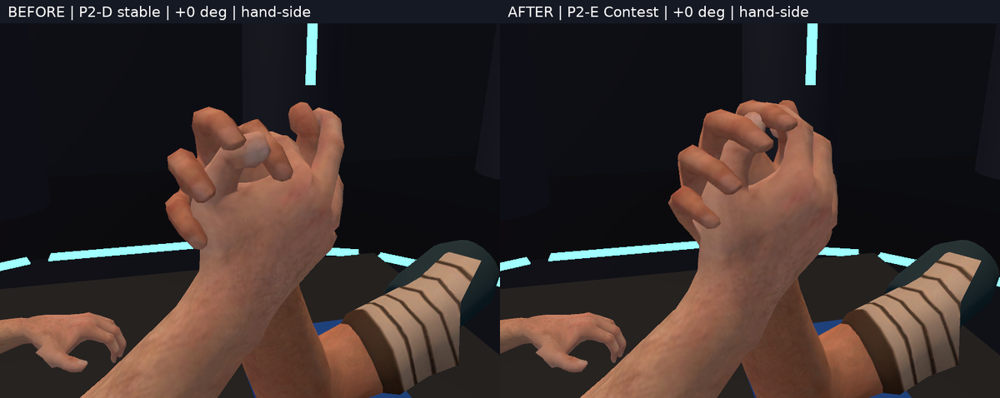

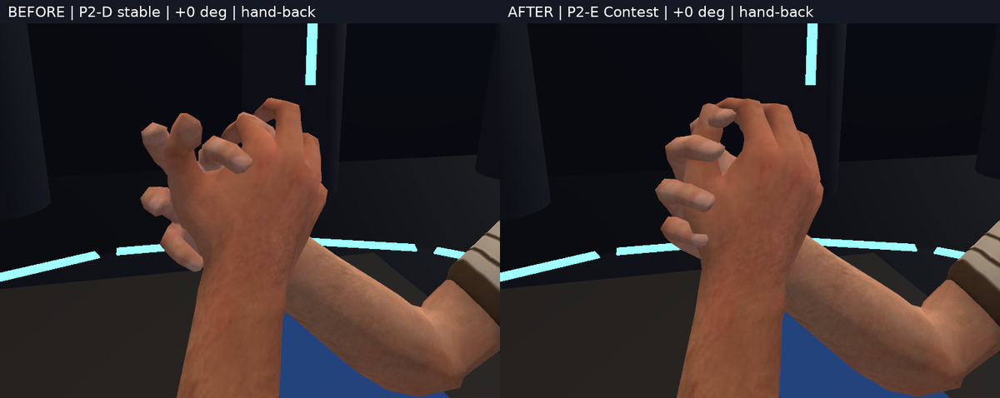

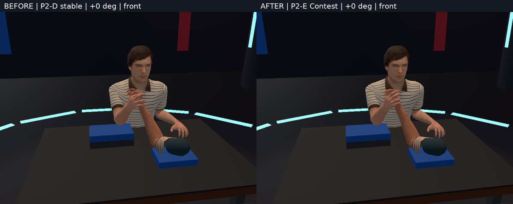

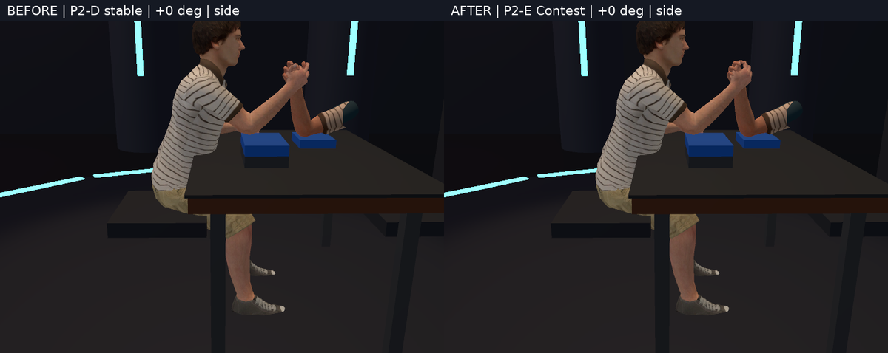

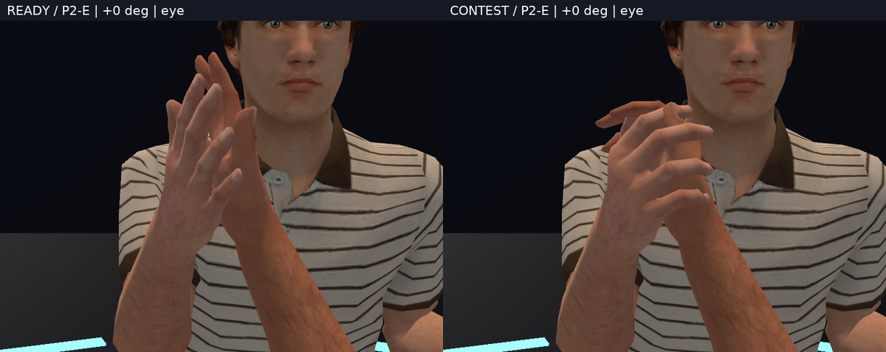

## 三角度关键帧和连续运动

各图从上到下是 −30°、0°、+30°。

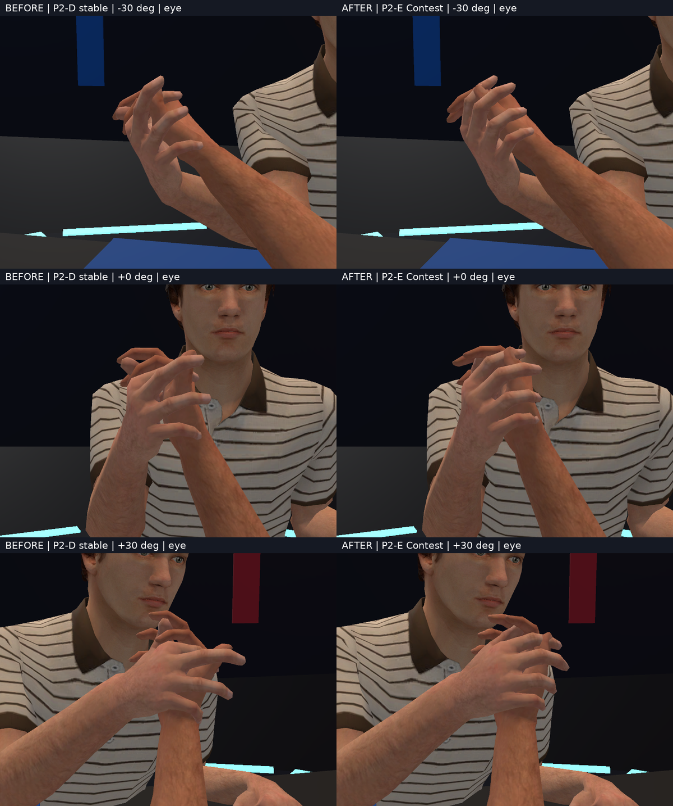

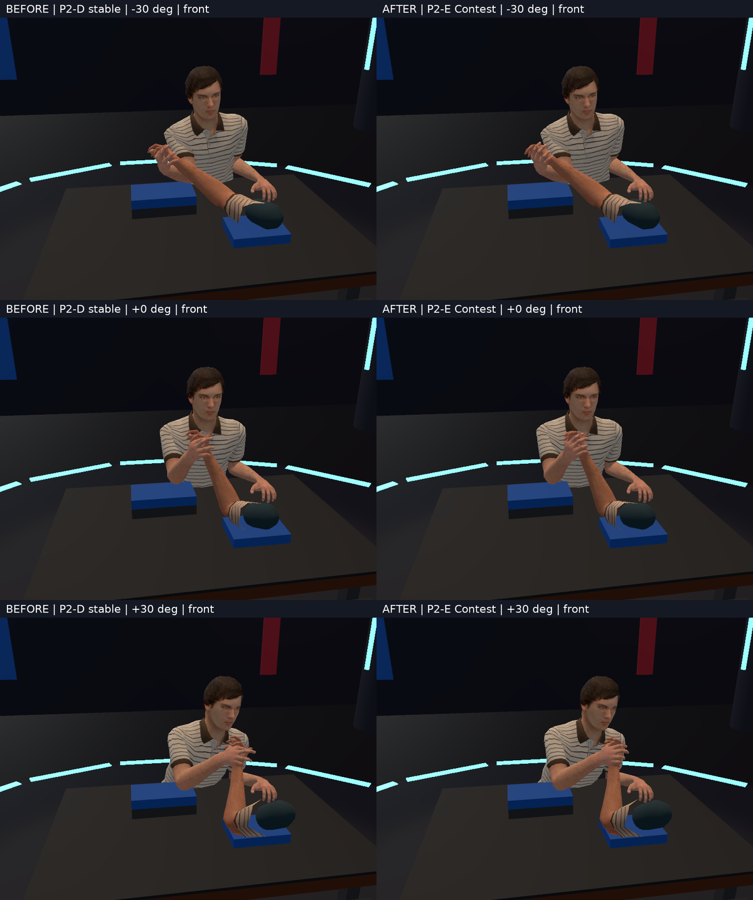

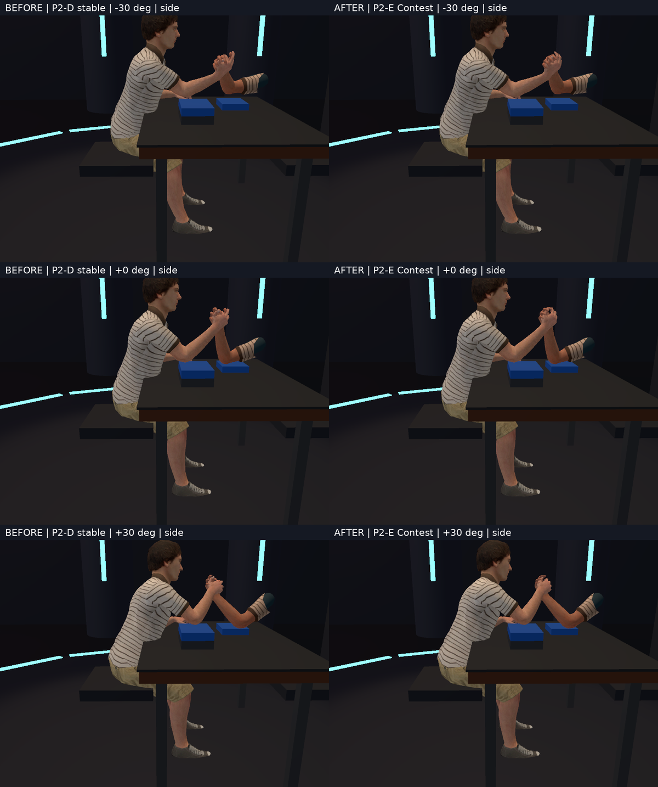

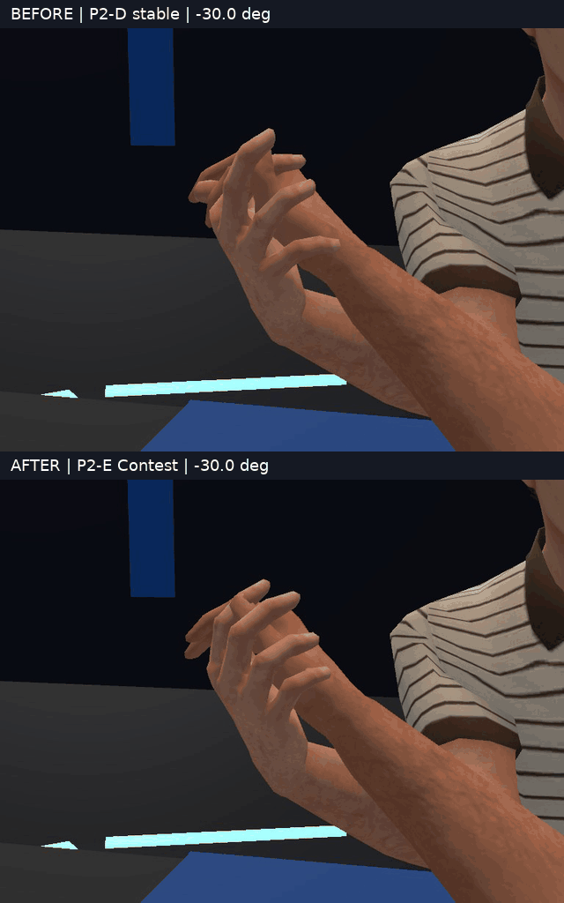

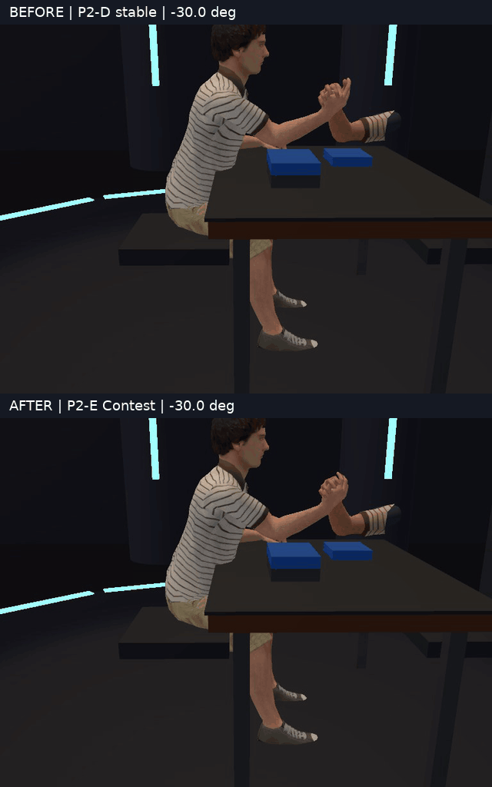

新姿态的四指向掌背包拢，拇指向虎口收起。玩家第一人称仍能看到松握，反侧还有局部指间交叠。腕姿与原来接近，Rocketbox 手部代理相交增加，主场景继续默认使用 P2-D。Ch03 和混合角色的画面仅在本机。
