# P2-E 两处手指接触收尾

左侧为四视角参考稿 `9a4e4cf`，右侧为本轮。主场景 `ArmWrestlingMain`，Unity 2022.3.62f3c1，Windows Direct3D11 Editor Play。公开画面仅含 Microsoft Rocketbox Male_Adult_01 与工程场景。两次录制逐帧匹配角度、握点坐标和 Animator 相位。[Rocketbox MIT](../p2e-user-reference/ROCKETBOX-LICENSE.txt) · [DejaVu 字体许可](../p2e-user-reference/DEJAVU-LICENSE.txt) · [来源与文件校验](manifest.json) · [结果及人物校准方法](../../P2E-contact-finish-result.md)

### 零位

俯视时观察两枚拇指中间露出的末节，以及它与食指根部的边界。眼视的四指轮廓变化很小。

下面是独立的 Unity Edit 模式 Pose Preview 局部放大。蓝灰色为对手，便于辨认拇指。后面的图均为主场景 Play 的原色画面。

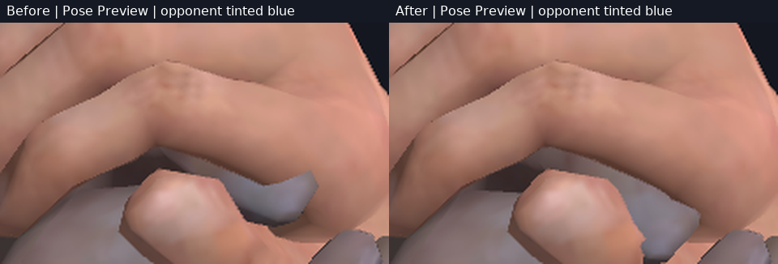

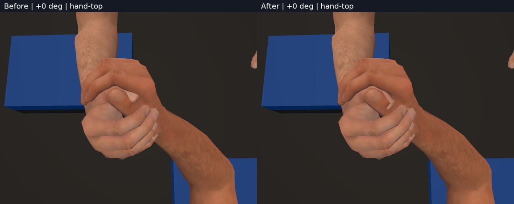

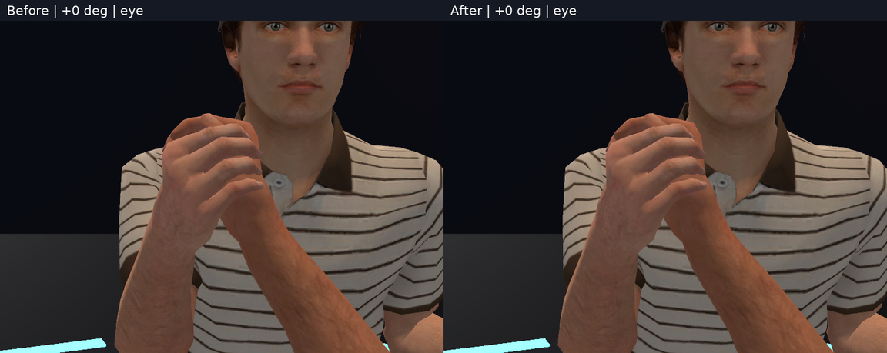

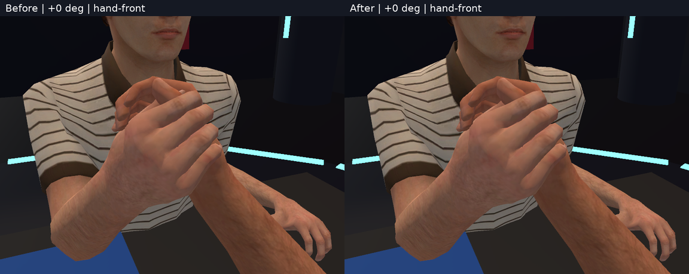

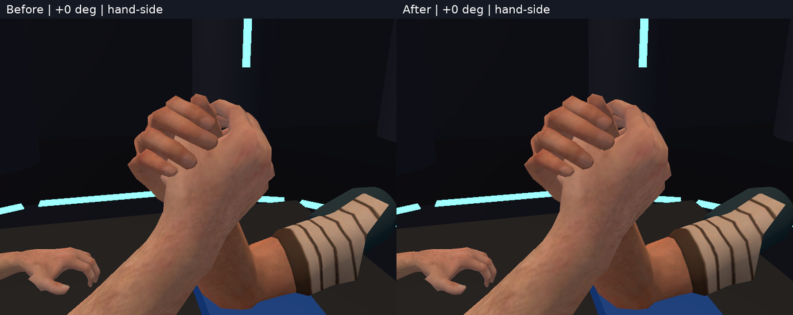

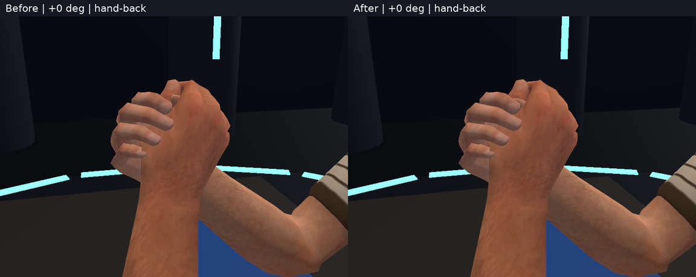

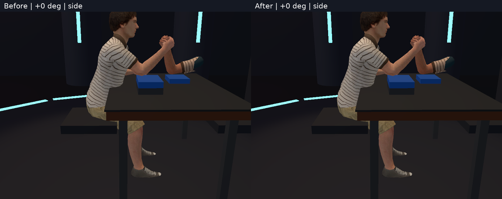

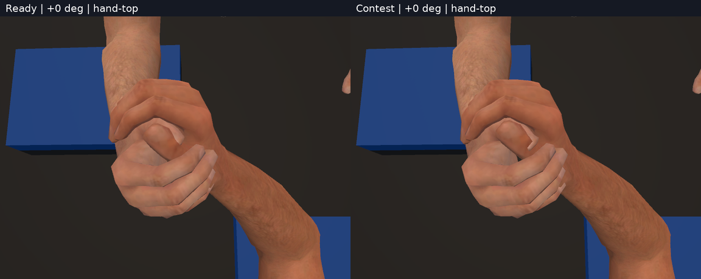

### 往返

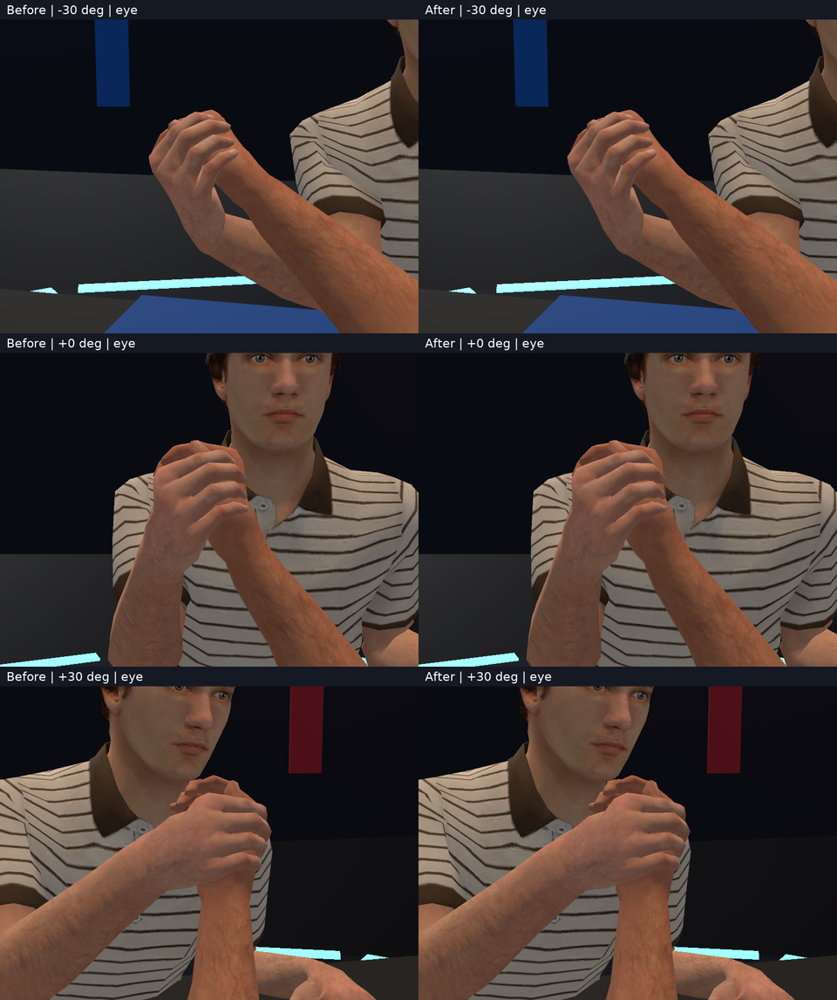

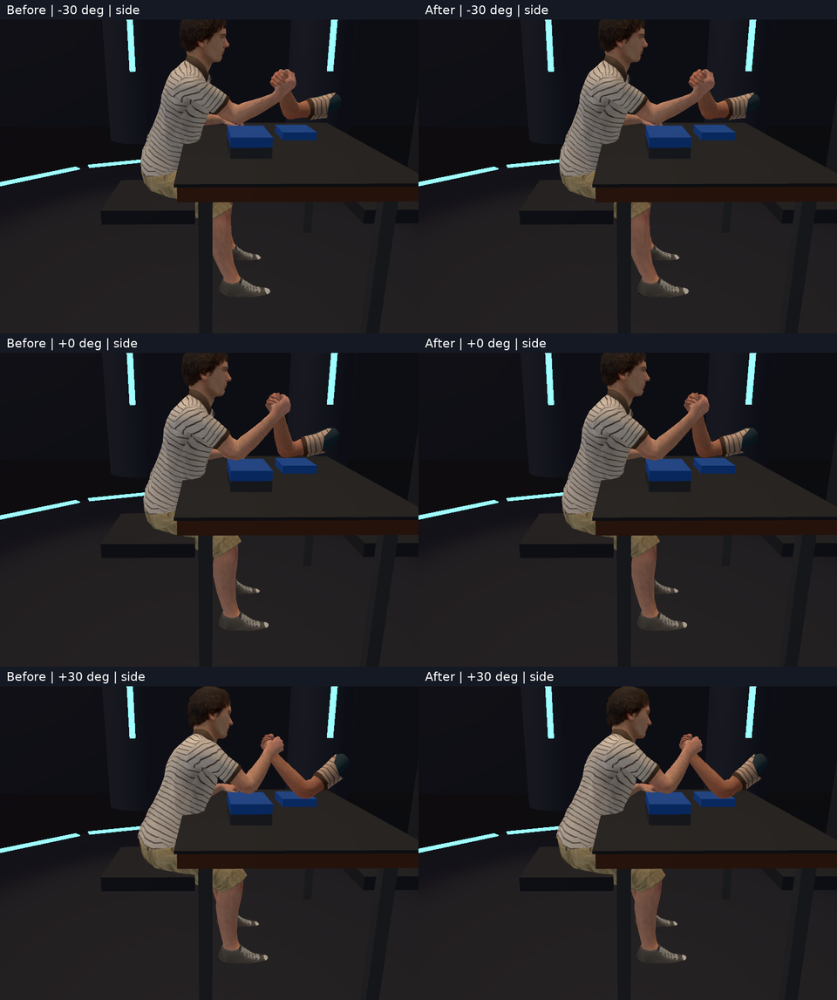

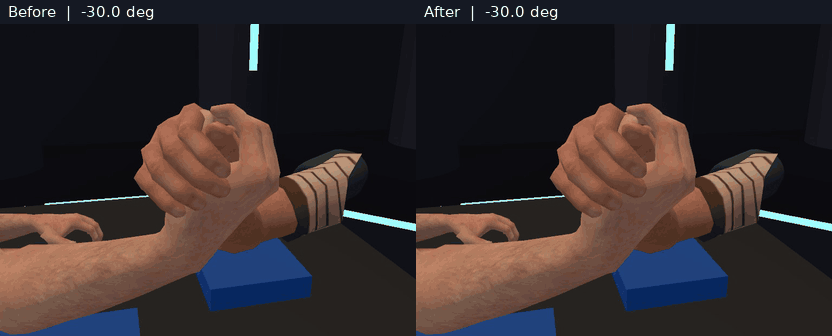
