# P2-E 真人参考定姿实拍

Unity 2022.3.62f3c1 的 `ArmWrestlingMain` Editor Play，Windows Direct3D11。相同镜头、头像、机械 Grip Anchor 路径和 Animator 相位。Before 是 P2-D 稳定默认，After 是可选的新 Contest。上轮 P2-E 也用本轮工具重录用于零位对照。稳定默认因 Ch03 仍有可见交叠而保留。

公开帧仅含 MIT Rocketbox 与原创场景，源帧仅做拼接、标注、缩放与 GIF 调色压缩。[Rocketbox MIT](ROCKETBOX-LICENSE.txt) · [DejaVu 字体许可](DEJAVU-LICENSE.txt) · [采样和哈希](manifest.json) · [结果与编辑方法](../../P2E-real-grip-result.md)

## 同镜头零位

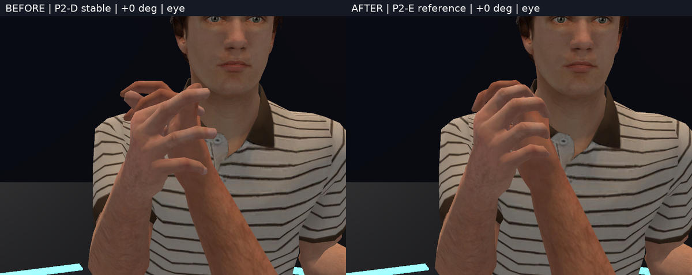

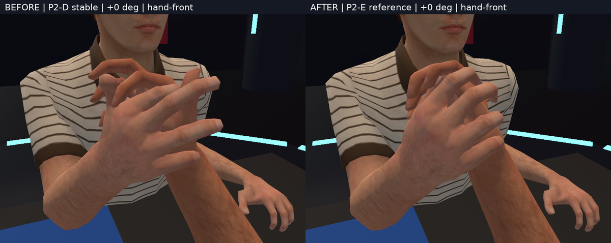

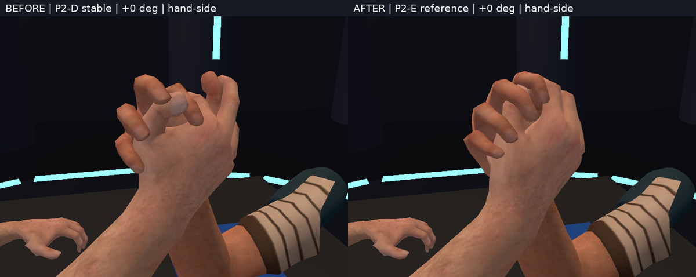

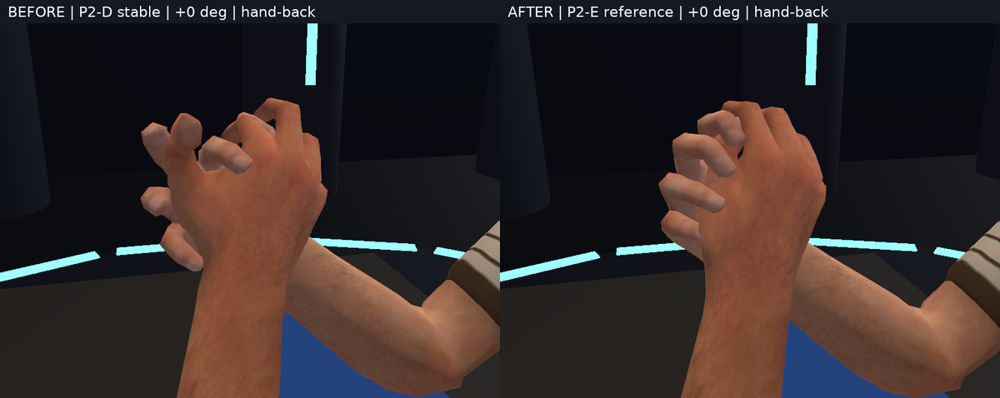

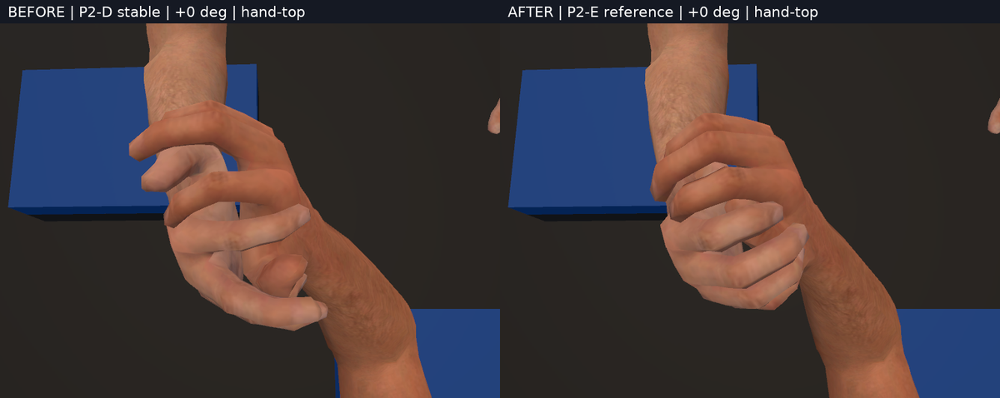

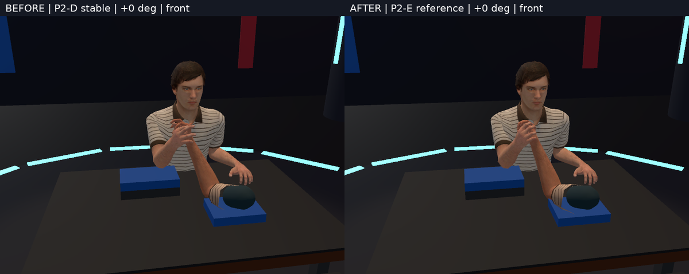

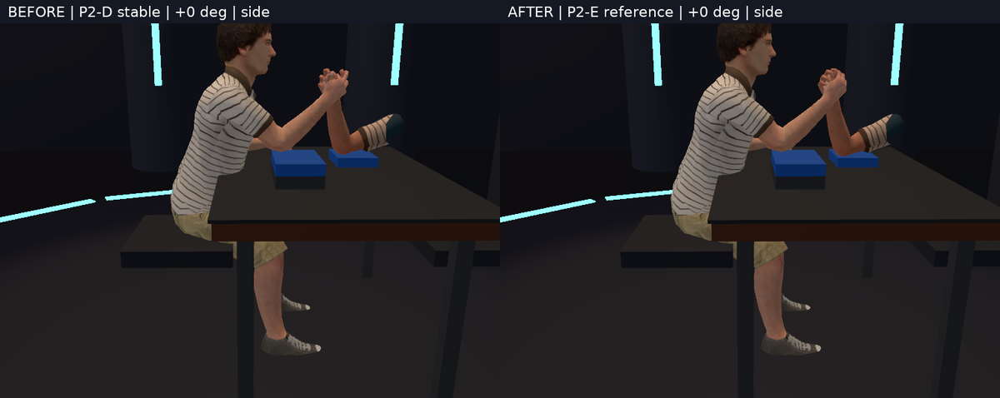

## 上轮美术握姿与当前版本

左为上一轮美术握姿，右为当前参考握姿。手指更靠近对方掌背，虎口仍有遮挡。

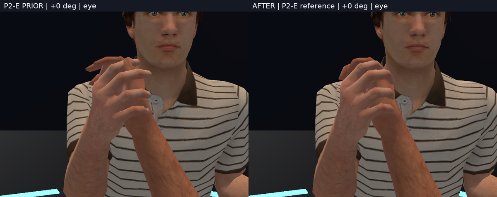

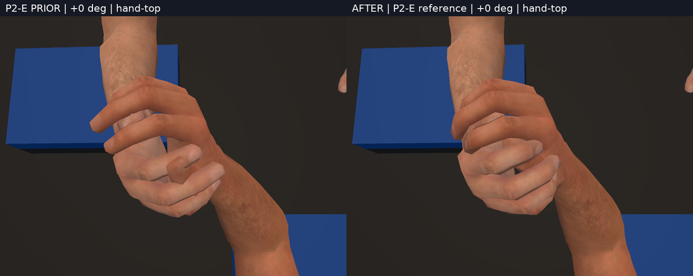

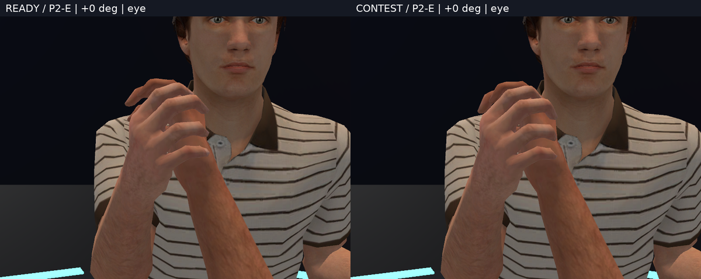

## −30° / 0° / +30° 与往返

每组 PNG 从上到下对应 −30°、0°、+30°。GIF 上方为稳定 P2-D，下方为新 P2-E。

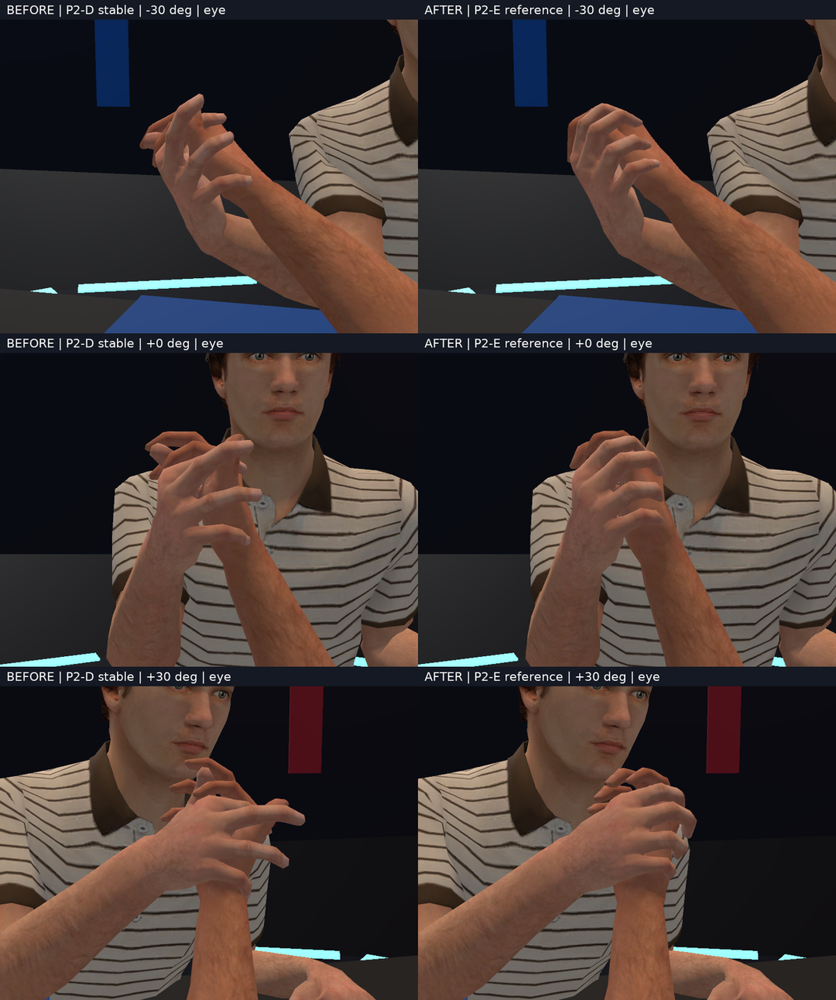

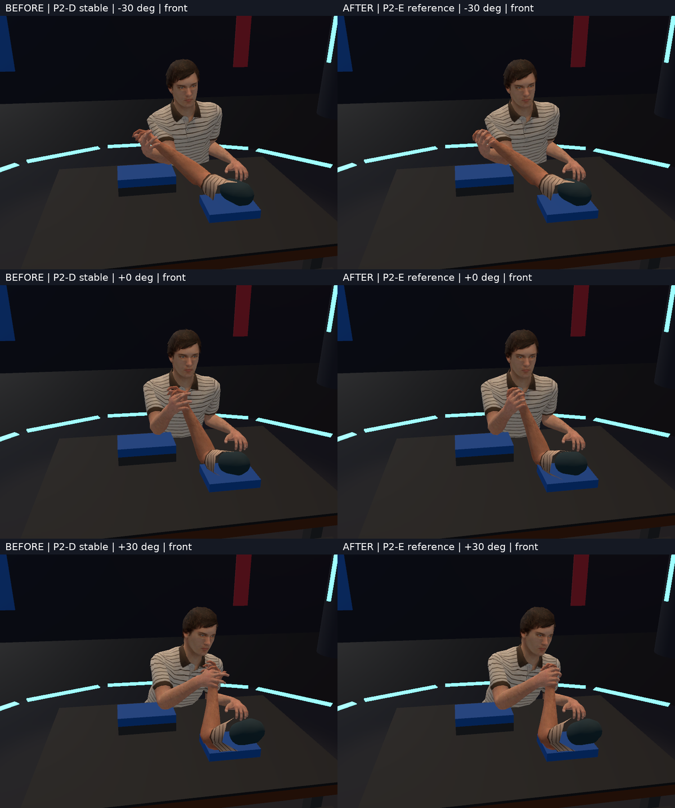

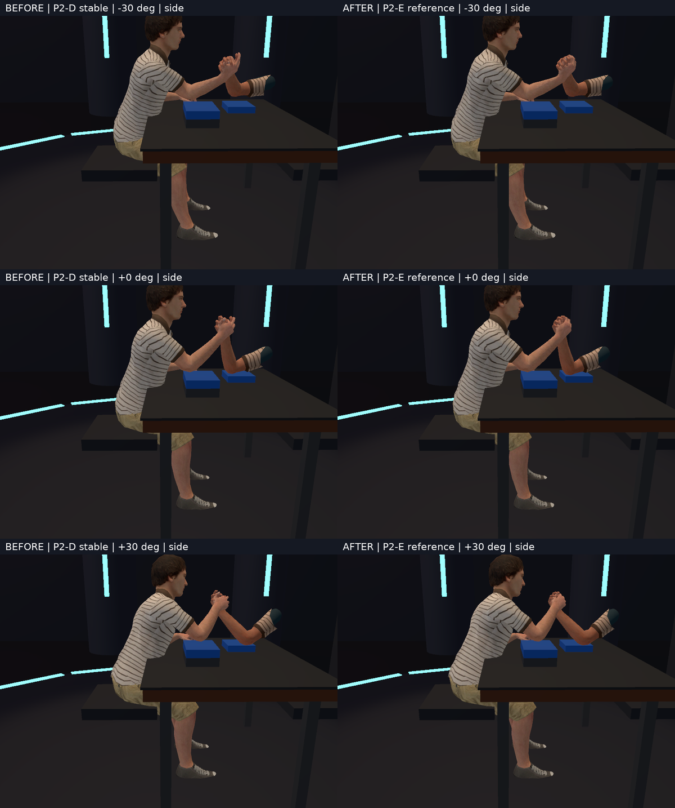

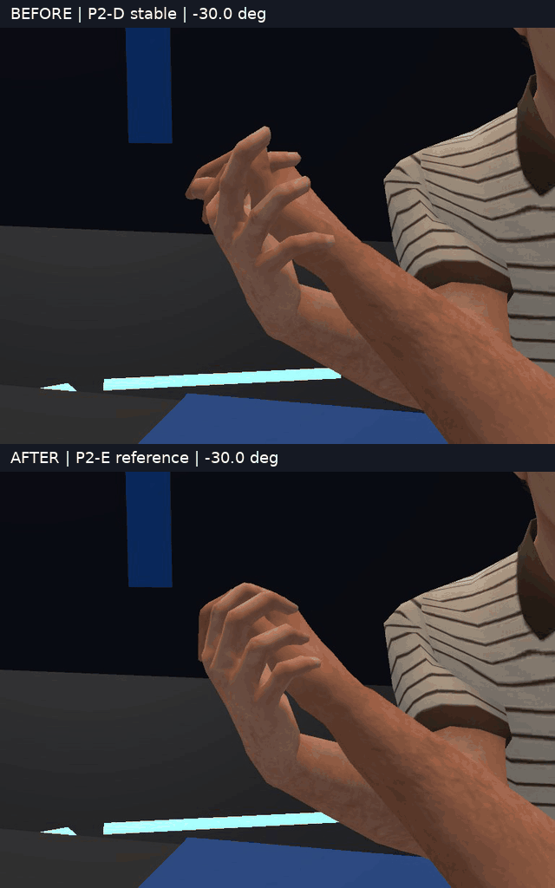

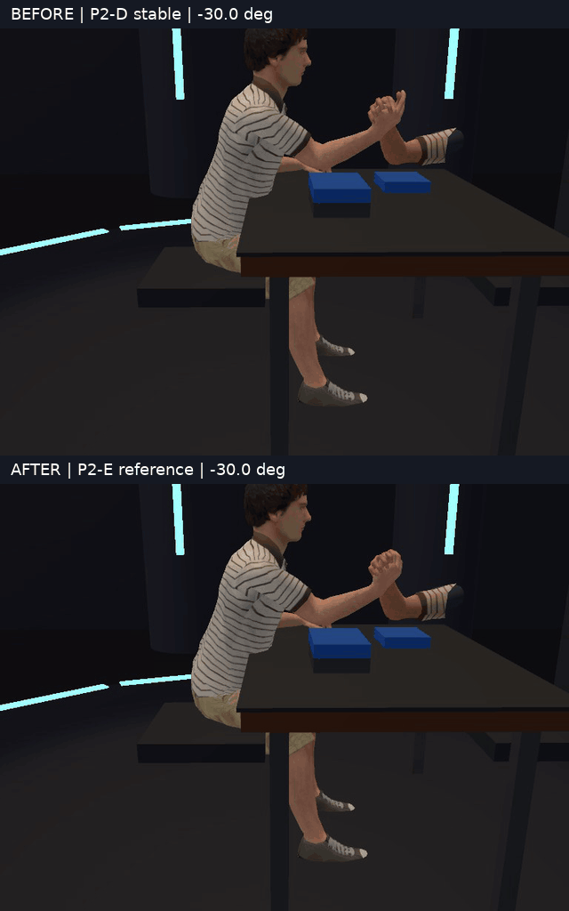
