# P2-E 四视角参考定姿 · Unity 画面

左图为上一稿 `ReferencePairedGrip`，右图为本轮 `ImagePairedGrip`。两个角色均使用 Rocketbox Male_Adult_01。通过 Windows Direct3D11 在 `ArmWrestlingMain` 的 Editor Play 重录，两侧使用同一相机、角度、握点和动画相位。图中的人物、桌面和肘垫均来自工程。公开画面经过拼接、标注和压缩。[Rocketbox MIT](ROCKETBOX-LICENSE.txt) · [标注字体许可](DEJAVU-LICENSE.txt) · [帧来源与校验值](manifest.json) · [结果](../../P2E-user-reference-result.md)

### 零位握姿

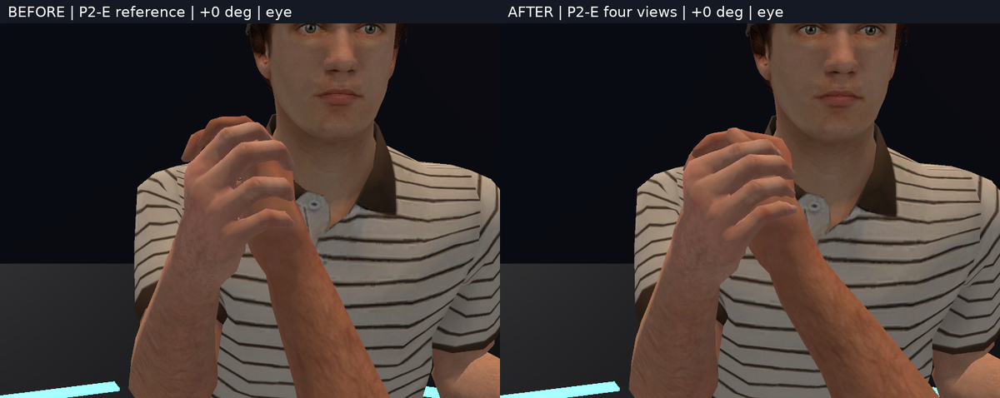

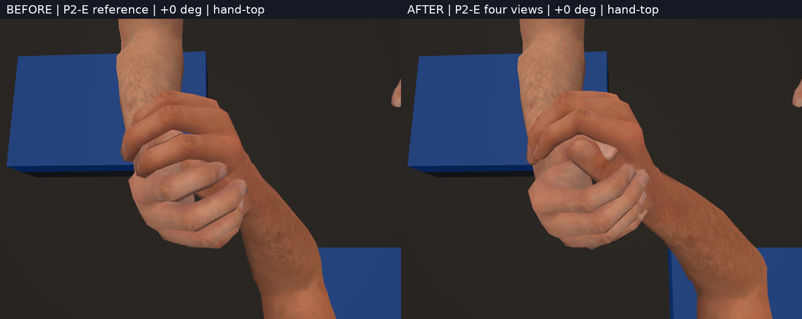

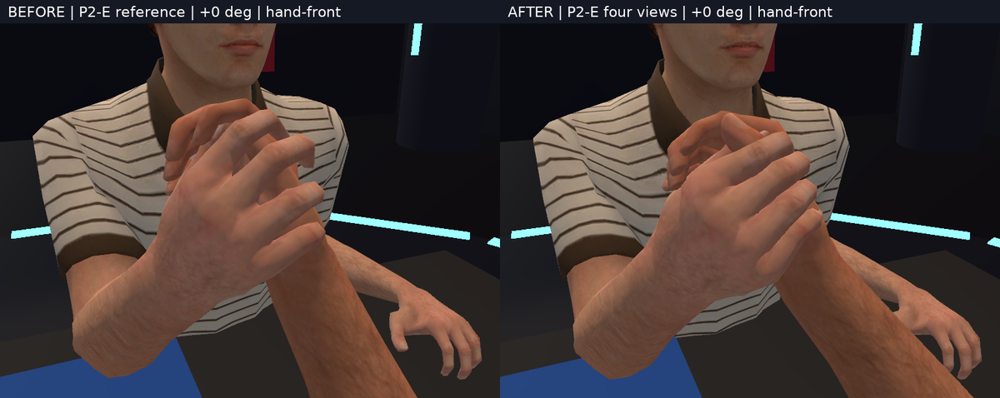

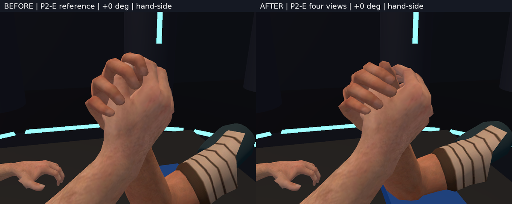

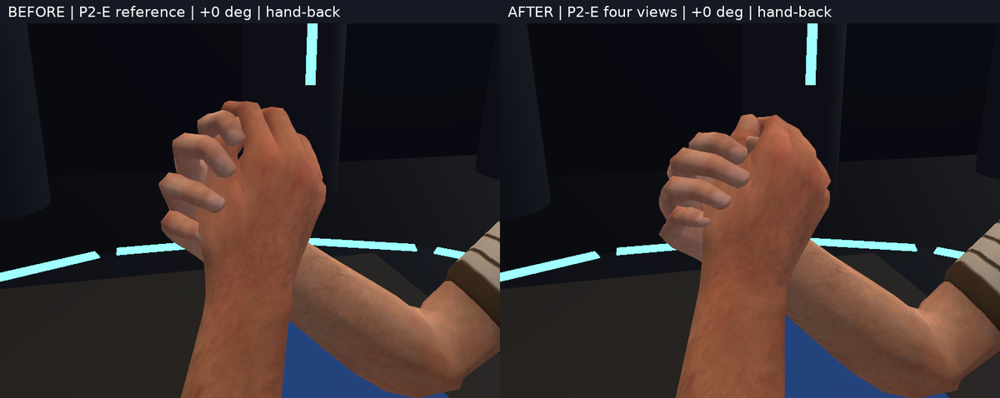

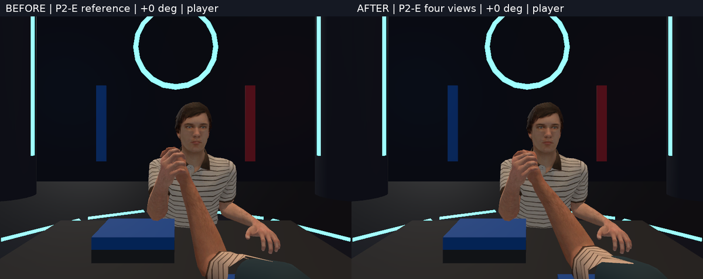

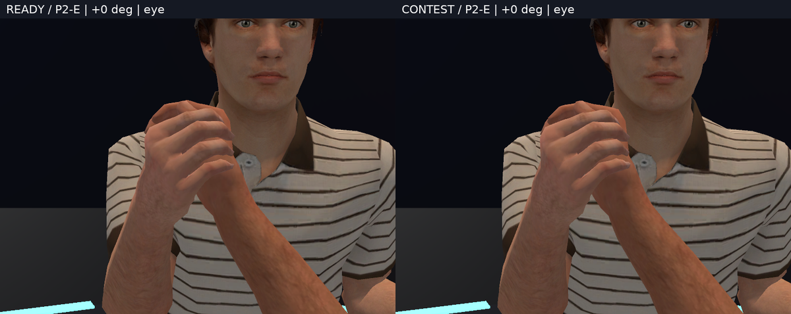

### 极限角与坐姿

每张拼图的三行依次为 −30°、0° 和 +30°。侧面保留桌面、肘垫及双臂。

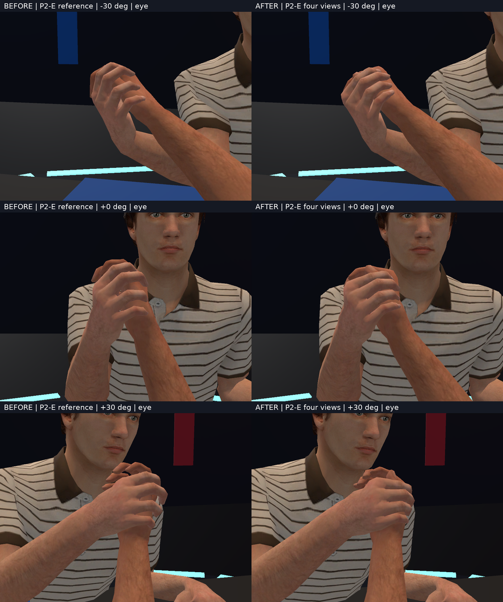

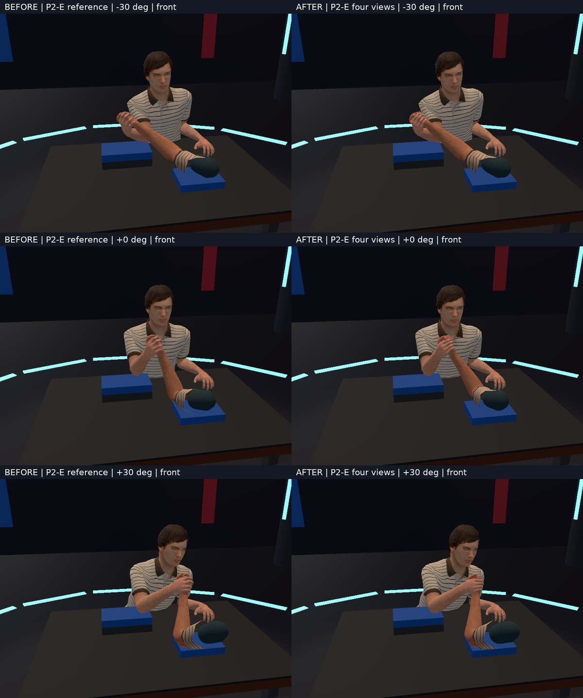

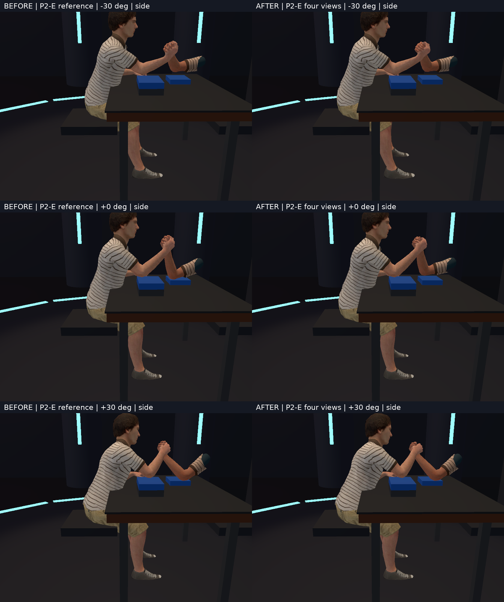

### 六秒往返

上方为上一稿，下方为本轮。

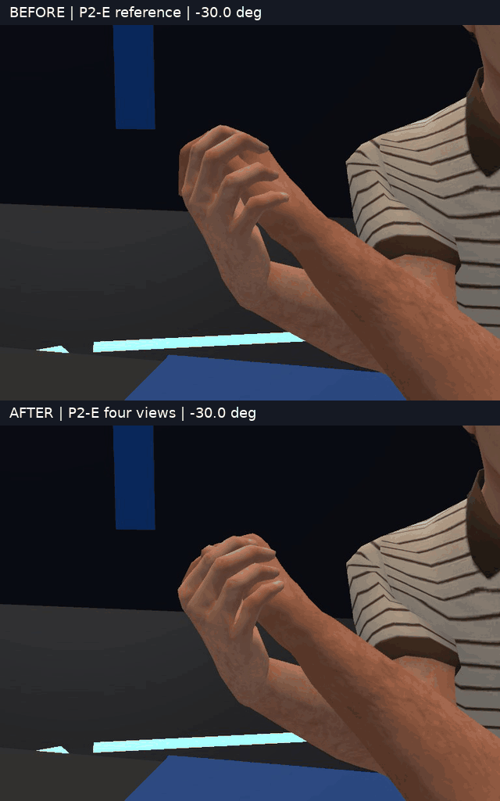

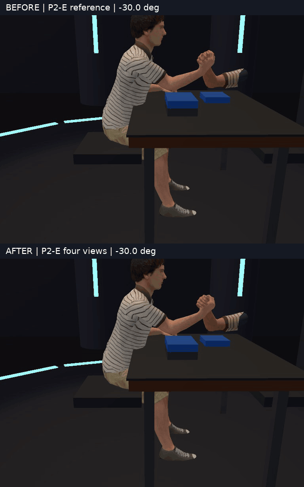
