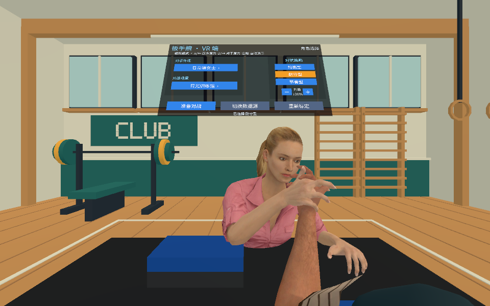
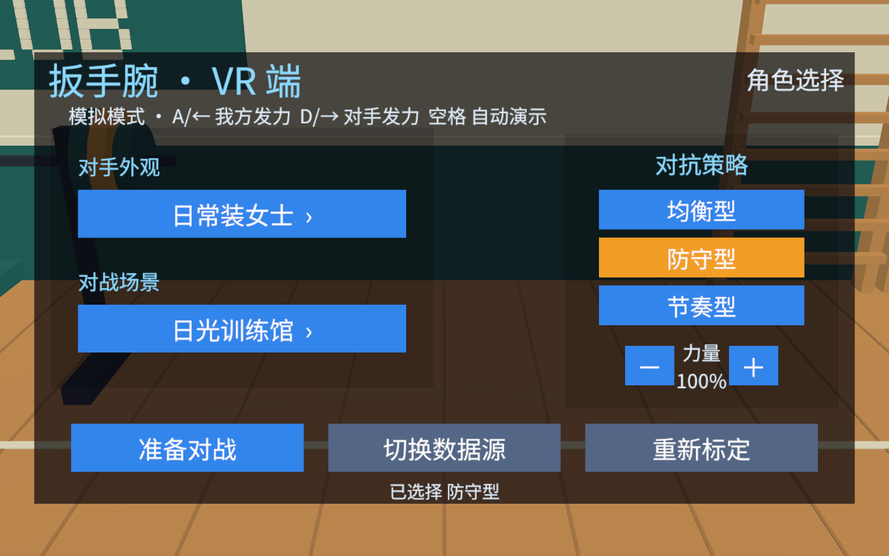
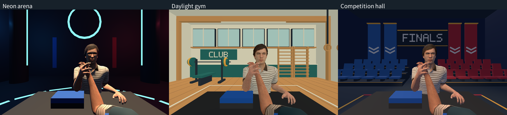
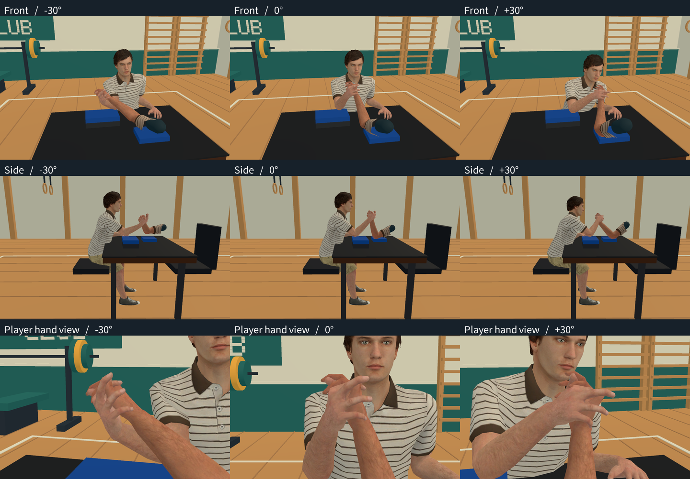
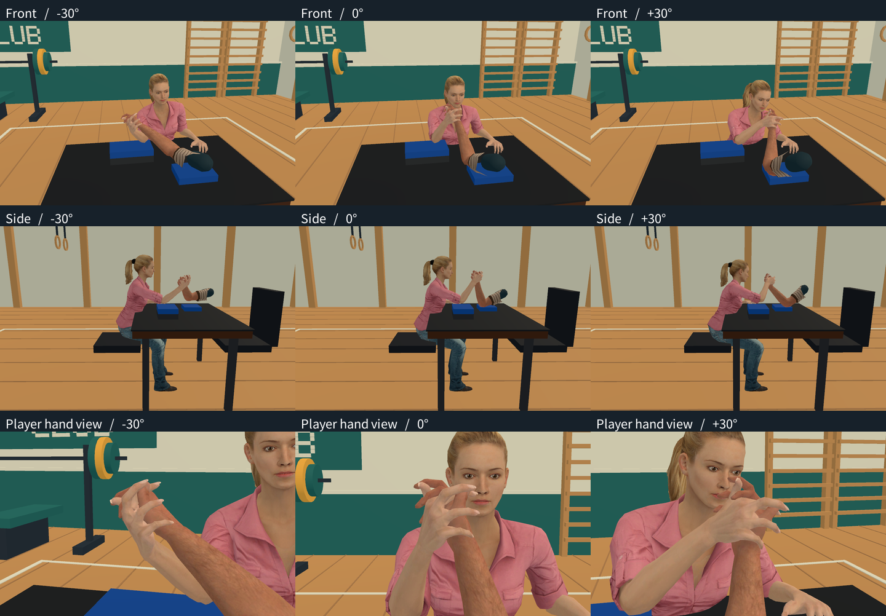
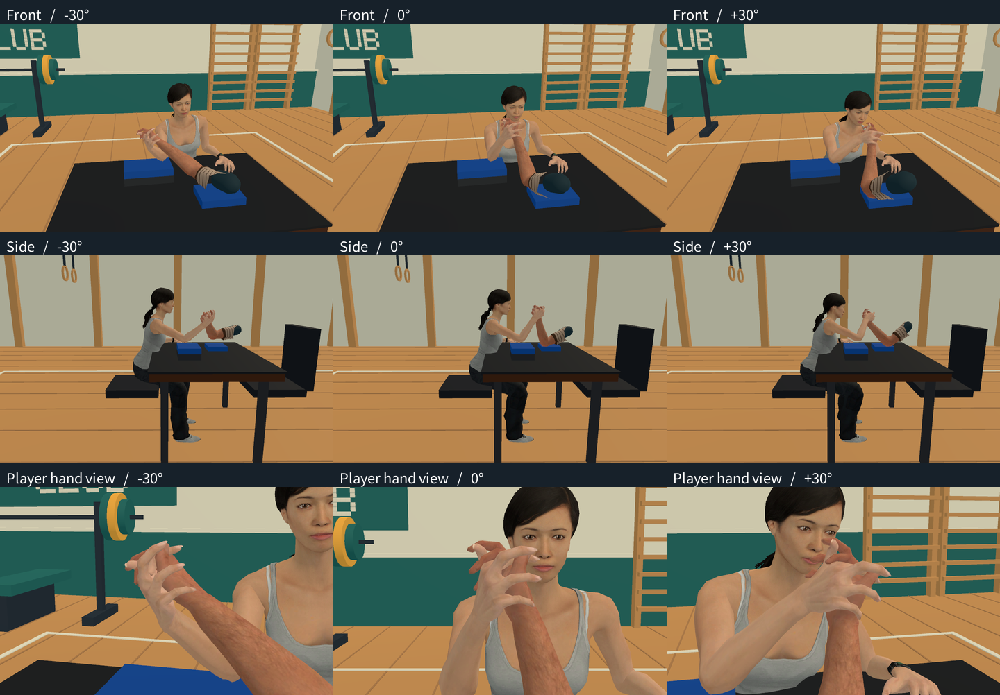
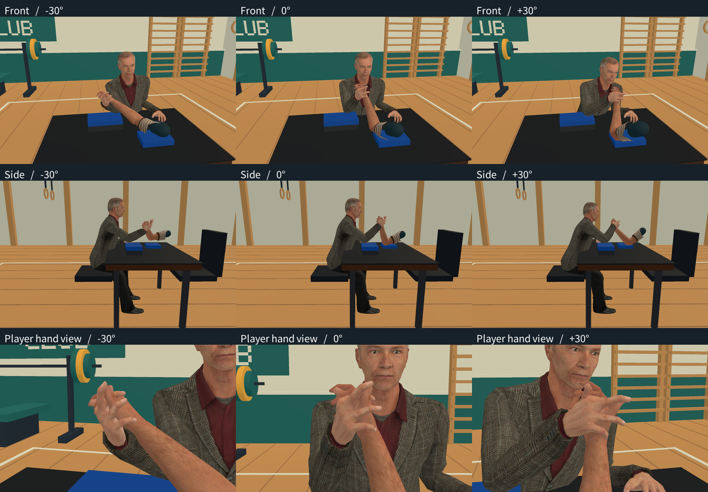
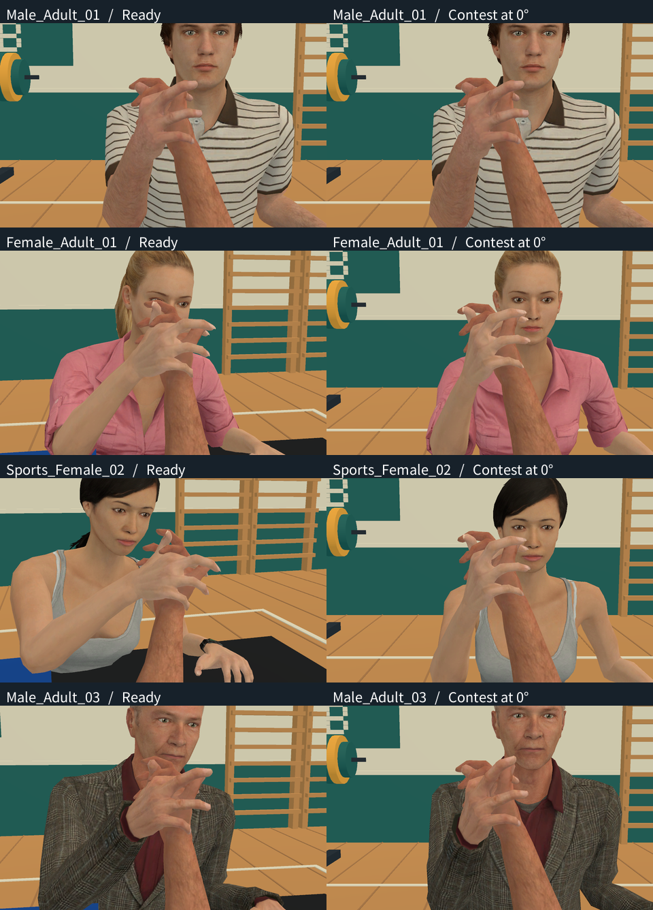
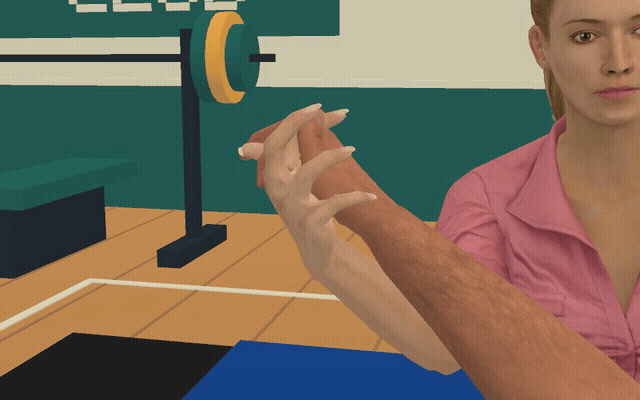

# P2-F · Unity Editor 实拍

以下 PNG、GIF 于 2026-11-22 在 Windows Unity 2022.3.62f3c1 的 Direct3D 11 Play 模式中采集，工程只含可公开资源。默认画面对应源码版本 `93df514`。比赛入口是 `Assets/Scenes/ArmWrestlingMain.unity`，数据源为离线模拟。画面保留场馆实际照明。

## 大厅与场馆

第一张为玩家的原始视角，第二张由相机正对同一帧的世界空间面板，以 1600 × 1000 再渲染。面板中已经选择日常装女士、日光训练馆和防守型，力量为 100%。

从左到右依次为科技竞技场、日光训练馆、锦标赛场馆。三张图使用同一玩家相机、原始条纹衫男士和零位机械角。仅在拍摄环境与动作时临时隐藏 HUD。

## 三个机械角下的四位对手

每张图的列依次是 −30°、0°、+30°，行依次是桌前正面、完整侧面、从玩家眼位看向握点的手部近景。四位对手共用训练馆、机位和玩家手臂。第三行保留近景镜头的完整画幅。

**默认男士 · Male_Adult_01**

**日常装女士 · Female_Adult_01**

**运动装女士 · Sports_Female_02**

**灰发绅士 · Male_Adult_03**

## 握姿与运动

左列为各人物的正常 Ready 阶段，右列为 Contest 阶段的零位。公开照片及动画使用默认 `LegacyHumanoidGrip`。

日常装女士的近景 GIF 展示 −30° → +30° → −30° 的连续往返。每个源序列含 181 个采样点，按 30 Hz 向实际 Play 中的机械握点施加角度，逐帧执行 Animator 和 IK。GIF 每三帧取一帧，共 60 帧，10 fps，循环 6 秒。

从侧面能看到臀部、座板、双腿及肘垫的相对位置。中性位两只手掌贴近，部分指尖仍有空隙，交叠区域也可见。肘点接近垫边时，骨骼与垫面之间的高度差不能直接说明皮肤是否受力。这里的手是公开男士的前臂裁片，侧面可见玩家手臂截面。

## 回归与来源

- 默认握姿及可选 `ImagePairedGrip` 各跑 36 种「4 位人物 × 3 场馆 × 3 策略」组合，核对策略编号、力量与实际人物资源。每种握姿均跑四场完整训练馆比赛，逐一观察 Ready、Countdown、Fighting、Paused、恢复、Finished；各局结算后回大厅，最后恢复原男士和科技场馆。
- 每位对手均具备有效 Humanoid Avatar、15/15 个具有实际顶点权重的右手指关节、运行中的 IK，以及带贴图的身体、头部和透明材质。肘垫、桌面、座板与 Grip Anchor 在换场后维持位置与尺寸。比赛模拟、桌面鼠标与头显测试在[阶段报告](../../P2F-opponent-scenes-result.md)中分别说明。
- 可复现入口是 [P2FValidation.Run](../../../Assets/ArmWrestling/Editor/P2FValidation.cs)。Unity 命令行使用 `-batchmode -force-d3d11 -projectPath <公开工程> -executeMethod ArmWrestlingVR.EditorTools.P2FValidation.Run -logFile <日志>`，由验证器完成后退出。额外传入 `-p2fauthored` 可运行可选握姿。此批量测试调用实际大厅按钮的 `Press()`。本页图片和 GIF 来自上述 Editor Play 采集。
- 本次公开副本的原始帧和 CSV 位于 `.p0-local/p2f/default-20261122-090654/`，可选握姿数据位于 `.p0-local/p2f/authored-20261122-090548/`。主工作区的 `.p0-local/p2-closeout/public.path` 记录了采集工程所在位置。使用 [build_p2f_visual_evidence.py](../../../tools/build_p2f_visual_evidence.py) 加上默认握姿的采集目录即可重建拼图和 GIF。
- 所有人物及玩家手臂来自 Microsoft Rocketbox，版权 © 2020 Microsoft，源版本 `0943055db6ec570bcef9f2c8b41c9e5467c808f9`。场馆由项目程序生成。界面和图注使用项目附带的 SIL OFL 字体 MatchUI-Regular。[Rocketbox 原始仓库](https://github.com/microsoft/Microsoft-Rocketbox/tree/0943055db6ec570bcef9f2c8b41c9e5467c808f9) · [MIT 许可](../../../Assets/ArmWrestling/Resources/P2F/ROCKETBOX-LICENSE.txt) · [字体许可](../../../Assets/ArmWrestling/Resources/Fonts/MatchUI-OFL.txt)
